<p align="center">
  
</p>

<h1 align="center">Big-Mount</h1>

<p align="center">
  Automatic mounting of internal partitions at boot, diagnosis of read-only
  devices, what keeps a device busy, safe removal, and a drive manager that
  rescues files from failing disks.<br>
  Made for <a href="https://www.biglinux.com.br">BigLinux</a> (Manjaro/Arch, KDE Plasma 6, Wayland).
  It also works on GNOME and without any graphical session.
</p>

<p align="center">
  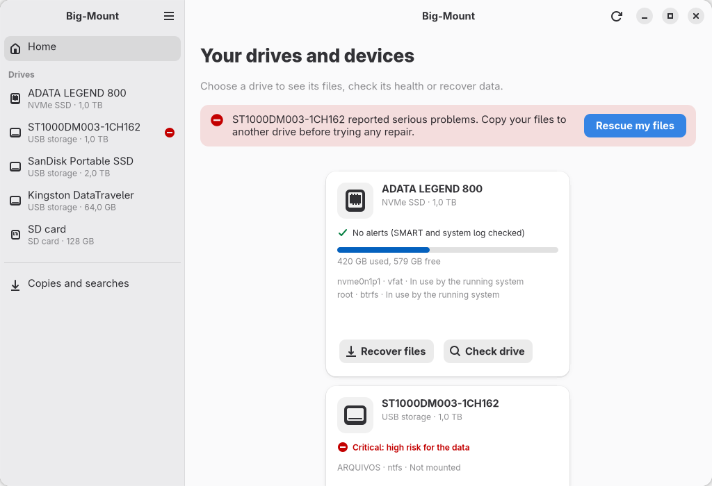
</p>

---

## Contents

1. [What Big-Mount does](#1-what-big-mount-does)
2. [Installation](#2-installation)
3. [Quick start](#3-quick-start)
4. [Automatic mounting at boot](#4-automatic-mounting-at-boot)
5. [Why can't I write here? (read-only devices)](#5-why-cant-i-write-here-read-only-devices)
6. [Busy devices and safe removal](#6-busy-devices-and-safe-removal)
   - [6a. Drive manager and file rescue](#6a-drive-manager-and-file-rescue)
     - [Step by step, in the window](#6a2-rescue-files-step-by-step-in-the-window)
     - [The same in the terminal](#6a3-the-same-in-the-terminal)
     - [Commands and options](#6a4-commands)
     - [When the files cannot be reached](#6a7-when-the-files-cannot-be-reached)
7. [Desktop integration and notifications](#7-desktop-integration-and-notifications)
8. [Command reference](#8-command-reference)
9. [Configuration](#9-configuration)
10. [Installed files](#10-installed-files)
11. [Security and privileges](#11-security-and-privileges)
12. [Troubleshooting](#12-troubleshooting)
13. [Translations](#13-translations)
14. [Development](#14-development)
15. [Performance](#15-performance)
16. [Known limitations](#16-known-limitations)
17. [License](#17-license)

---

## 1. What Big-Mount does

| Part | When it runs | As | What it does |
| --- | --- | --- | --- |
| **Automatic mounting** (`bigmount`) | at every boot, from `big-mount.service` | root | mounts the partitions of **internal disks** under `/mnt/<label>`, so they are always available (data, Windows, other Linux installs) |
| **Diagnosis** (`bigmount --diagnose`, `--gui`) | on request | you | explains why a device cannot be written to, and offers the fix when it is safe |
| **Busy device** (`bigmount --busy`) | on request | you | shows which programs, or other holders, prevent the unmount |
| **Safe removal** (`--unmount`, `--safe-remove`, `--gui-remove`) | on request | you | unmounts and powers off the drive through UDisks2, without forcing anything |
| **Drive check and Secure Erase** (`--diagnose DISK`, `--gui-drive-check`, `--secure-erase`) | on request | you (UDisks2 asks for the administrator password to erase) | tells whether a drive stopped answering or failed to read and write since boot; erases a SATA SSD that no longer keeps what is written, and checks that it keeps it again |
| **Drive manager and file rescue** (`--drive`, `--gui-drive`) | on request | you (UDisks2 and polkit for what needs more) | explains how a drive is doing, mounts it without changing it, copies files off it with real progress, resumes after a power cut, makes disk images ([6a](#6a-drive-manager-and-file-rescue)) |
| **Notifier** (`bigmount --notifier`) | off by default; when turned on in the menu of the application, at every login | you | tells you, once per boot, when a device was mounted read-only, and why |

The priorities of the project, in order: **data integrity**, stability and
compatibility, correctness, security, performance and user experience.
That is why Big-Mount **never**:

- repairs filesystems by itself (`fsck`, `ntfsfix`, `btrfs check --repair`);
- forces unmounts (`umount -f`, `umount -l`) or kills processes (`kill -9`, `fuser -k`);
- changes permissions recursively (`chmod -R`, `chown -R`);
- touches partitions listed in `/etc/fstab`;
- mounts removable devices, which belong to UDisks/Plasma;
- opens windows as root.

The one operation that erases data, the Secure Erase of a whole drive
([5.4](#54-drive-errors-and-secure-erase)), runs only when you ask for it,
confirm it, type the name of the drive and give the administrator password.

### New in 2.6.0: a welcome, an About that says what it does, and dialogs of its own

- A **welcome screen** shows what Big-Mount can do the first time it opens on its home
  (not when it opens on a drive that needs attention). **Show this screen on startup**
  turns it off; it stays in the main menu, under **Welcome screen**.
- **About Big-Mount** gives the version, what it does (in **Details**), the web page
  ([github.com/biglinux/big-mount](https://github.com/biglinux/big-mount)), where to
  **report an issue**, the credits (Bruno Gonçalves and Rafael Ruscher) and the license.
- The dialogs of `--gui`, `--gui-remove` and the notifier are now drawn with **GTK 4 and
  libadwaita**, like the application, on any desktop. **KDialog and Zenity are no longer
  used**; `libnotify` became a dependency, so notifications always have one path. Labels
  and program names reach the dialog as data and are shown as plain text. A risky
  answer is never the default button, and a dialog that cannot be shown is never taken
  as a yes: the question goes to the terminal instead.

<p align="center">
  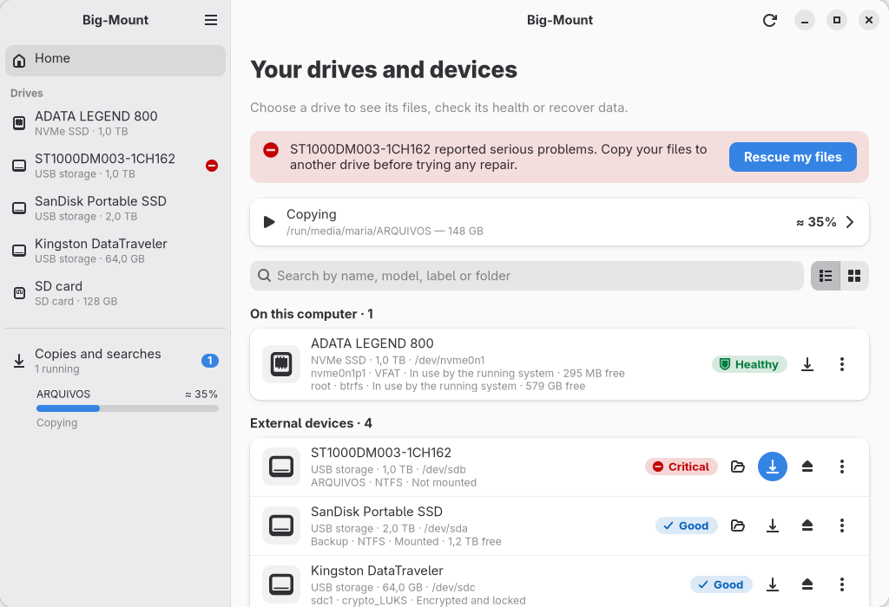
  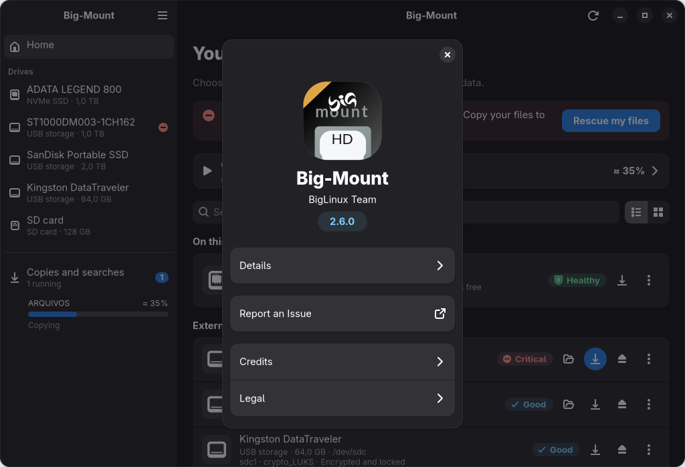
</p>
<p align="center">
  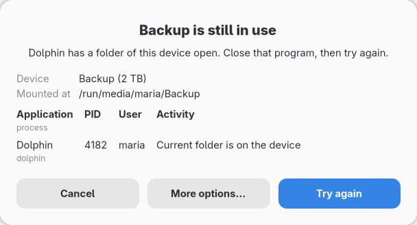
</p>

### New in 2.5.0: a Home that shows everything, health in one word

- **Home** is a list by default, or a grid, and remembers which. Drives are grouped:
  **On this computer**, **External devices**, **Disk images**. A search finds a drive
  by name, model, volume label, folder or health, with or without accents.
- Every drive says how it is doing in **one word**: **Critical**, **Poor**, **Good**
  or **Healthy** (or *Not assessed*). See [6a.2](#6a2-rescue-files-step-by-step-in-the-window)
  for what each one needs. **Healthy** is only said when the drive's own report
  (SMART) was read and nothing is wrong, so a USB drive is at most **Good** until you
  read its SMART. Internal SATA and NVMe drives are read without a password, through
  UDisks2: hours powered on, temperature, NVMe life used.
- Each drive has its actions at hand: open its files, recover them, **safely remove**,
  and in its menu **unmount**, **force unmount** and **erase data permanently**.
  *Force* never forces the filesystem: it shows which programs keep the drive busy
  and, if you agree, asks them to close as when you close their windows (never a
  program that is writing, never the system), then unmounts. Erasing warns first,
  then the drive is checked and you confirm twice more.
- **Copies and searches** in the side shows how many there are, and below it every
  running one with its bar and its percentage (only when the total is measured). A
  click opens its page.
- When a drive with problems is **mounted** (at boot, or when you plug it in), a
  window says what was found, with **Open Big-Mount** or **Close**. Once per boot and
  drive.

<p align="center">
  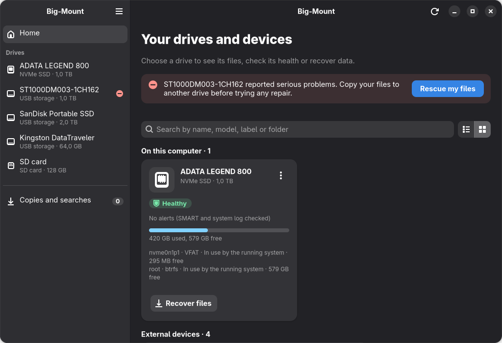
  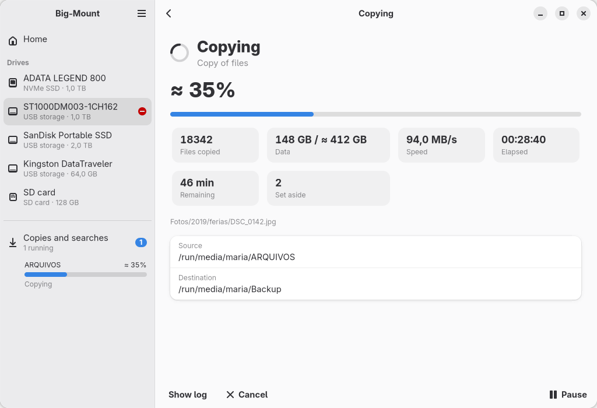
</p>

### New in 2.4.0: one application

The drive manager window (PySide6) and the dialogs of the drive check
(KDialog/Zenity) did almost the same thing, in two different ways. They are now one
application in GTK 4 and libadwaita:

- `bigmount --gui-drive` and `bigmount --gui-drive-check` open the **same window**; the
  second one opens on the health of the drive. A second call goes to the window that is
  already open.
- **Home** shows every drive: kind, size, health in words and an icon, room,
  volumes, and **Rescue my files** when a drive is at risk.
- **Recover files** is an assistant in five steps (from where, what, how, where,
  confirm), with four ways: copy directly, quick analysis, deep analysis (PhotoRec,
  after a ddrescue image of a physical disk) and lost partitions (TestDisk, read only).
  It never offers the same physical disk as the destination.
- **What was found** stays light with a million entries, and says whether these are
  files that exist, candidates found by content, or files already copied.
- **Erase data permanently** lives apart, under **Advanced maintenance**: two
  confirmations, the typed name checked again by the engine, polkit as always.
- Light and dark styles, a narrow window, keyboard, Brazilian Portuguese.
- PySide6 is no longer needed. The terminal commands (`--drive`, `--secure-erase`) and
  the boot did not change.

<p align="center">
  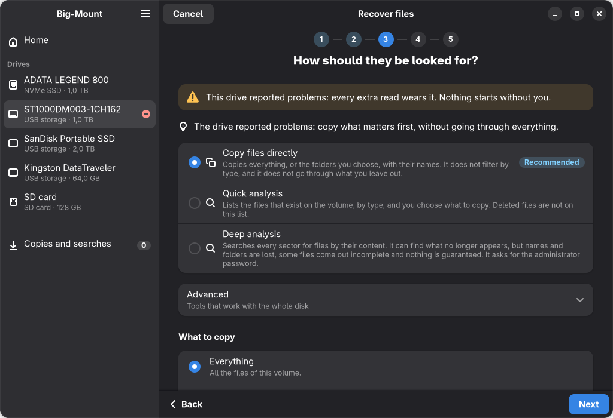
  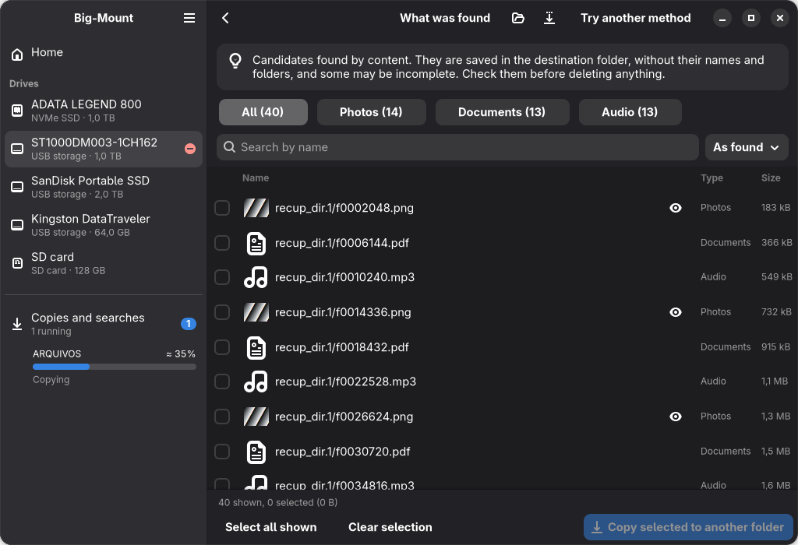
</p>

How it was designed, tested and reviewed:
[`docs/gtk-unification/`](docs/gtk-unification/08-final-report.md) (in Portuguese).

---

## 2. Installation

### 2.1 From the BigLinux repository (recommended)

Big-Mount is part of BigLinux. To install or update it:

```bash
sudo pacman -Syu big-mount
bigmount --version          # Big-Mount 2.6.0 or later has everything in this README
```

The BigLinux build service builds the package from the `master` branch of
[biglinux/big-mount](https://github.com/biglinux/big-mount). A new package
reaches `biglinux-testing` first, and `biglinux-stable` later.

> **Check what you have.** On 2026-10-25 the `biglinux-stable` repository
> still shipped `big-mount 25.12.23-2237`, the script from December 2025
> (the fixed `26.04.24` package was only in `biglinux-testing`). That
> version prints `grep: /var/lib/sddm/state.conf: Permission denied` and
> `Error looking up object for device /dev/nvme`, and ignores every option.
> See [12.1](#121-errors-about-sddm-or-devnvme).

### 2.2 From a release

The build service also attaches every package it builds to a
[release of biglinux/big-mount](https://github.com/biglinux/big-mount/releases):

```bash
# download big-mount-<version>-x86_64.pkg.tar.zst from the release page, then
sudo pacman -U ./big-mount-*.pkg.tar.zst
```

The release name is the package version, the date and time it was built
([2.4](#24-what-happens-on-installation-and-updates)). After
installing, `bigmount --version` says which Big-Mount it is: the application
needs 2.4.0 or later, its Home 2.5.0, and the welcome and the GTK dialogs 2.6.0.

### 2.3 Build the package yourself

`pkgbuild/PKGBUILD` builds the `master` branch of
[biglinux/big-mount](https://github.com/biglinux/big-mount), downloading it from
GitHub, so it builds what was pushed and not your local changes:

```bash
git clone https://github.com/biglinux/big-mount.git
cd big-mount/pkgbuild
makepkg -f
sudo pacman -U ./big-mount-*.pkg.tar*
```

To package a **local checkout or another branch** without touching the
PKGBUILD, generate a temporary one outside the repository:

```bash
cd big-mount                               # your checkout
git checkout my-branch
mkdir -p ~/build/big-mount && cp pkgbuild/big-mount.install ~/build/big-mount/
cd ~/build/big-mount
sed "s|^source=.*|source=(\"big-mount::git+file://$OLDPWD#branch=$(git -C "$OLDPWD" branch --show-current)\")|" \
    "$OLDPWD/pkgbuild/PKGBUILD" > PKGBUILD
makepkg -f
sudo pacman -U ./big-mount-*.pkg.tar*
```

### 2.4 What happens on installation and updates

- On the **first** installation a pacman hook enables the service
  (`systemctl enable big-mount`).
- Nothing is restarted automatically, and nothing runs in your session by
  default. The new boot code runs at the next boot. The package prints how
  to apply it right away: `sudo systemctl restart big-mount` is safe, and
  mounted NTFS volumes stay mounted (verified on a running system).
- Your `/etc/big-mount.conf` is kept on updates (`backup=`).

Check what was installed, and which code it runs:

```bash
bigmount --version          # version, package and the exact git revision it was built from
bigmount --doctor           # full self-check (see 12.2)
pacman -Qi big-mount
systemctl is-enabled big-mount
```

Output of the package built from commit `0cbac17` of the development fork
(`big-mount 26.10.26.0139-1`); a package built from `biglinux/big-mount`
names it as its `source:`. Once it is installed by pacman, a `package:` line
with the installed package and version is added:

```text
$ bigmount --version
Big-Mount 2.2.0
  revision: 0cbac17f698415ab584a4ba5db0ecb2f7e273a31 (2026-10-26T01:39:00Z)
  source:   https://github.com/ruscher/big-mount
```

The package version is the build date and time, as in every BigLinux
package (`26.10.22-1342`), and the full commit it was built from is stored in
`/usr/lib/big-mount/version`.

### 2.5 Requirements

| Package | Kind | What for |
| --- | --- | --- |
| `bash` ≥ 5.2 | required (base) | every script |
| `util-linux` | required | `blkid`, `lsblk`, `findmnt`, `mount`, `flock`, `setsid` |
| `udisks2` | required | unmount, mount, unlock, power off and take ownership through polkit |
| `polkit` | required | authorization; `pkexec` for the administrator view and the helper of the drive manager |
| `ntfs-3g` | required | `lowntfs-3g` for NTFS |
| `lsof` | required | find what keeps a device busy |
| `rsync` | required | every copy off a drive, in the window and in `--drive copy` |
| `smartmontools` | required | the SMART counters on the health page (read only when you ask) |
| `python`, `python-gobject`, `gtk4`, `libadwaita` ≥ 1.5 | required | the application (`--gui-drive`, `--gui-drive-check`) and every dialog (read-only device, busy device, a drive that needs attention). Never loaded at boot |
| `libnotify` | required | notifications (`notify-send`) |
| `ddrescue` | optional | disk images of a failing drive, before a deep analysis |
| `testdisk` | optional | finding lost partitions, searching files by content (PhotoRec) |

`coreutils`, `findutils`, `gawk` and `systemd` (`udevadm`, `journalctl`) come with every
Arch-based system and are not listed.

Without a graphical session, everything works in the terminal. Optional packages
are detected when they are needed, and what is missing is explained. Big-Mount
never installs anything by itself. To have every way of rescuing files:

```bash
sudo pacman -S --needed ddrescue testdisk
```

PySide6 was needed up to 2.3.0 and is not anymore. If no other program uses it,
`sudo pacman -Rs pyside6` removes it.

### 2.6 Disable or uninstall

```bash
# disable only the automatic mounting, keep everything else
sudo touch /etc/bigmountall-no

# disable the service
sudo systemctl disable big-mount

# remove the package
sudo pacman -R big-mount
```

Removing the package does not unmount anything. Mounted partitions stay
mounted until the next boot.

---

## 3. Quick start

```bash
bigmount --diagnose                    # overview of every device
bigmount --diagnose /dev/sdb1          # why can't I write here?
bigmount --diagnose ~/Stick/photos     # any folder on the device works too
bigmount --busy /run/media/$USER/HDD   # what is using this device?
bigmount --safe-remove /dev/sdc        # unmount everything and power the drive off
bigmount --gui                         # the same, in dialogs
bigmount --gui-drive                   # drive manager: health of each drive, rescue files
bigmount --drive                       # the same in menus, in any terminal and over SSH
sudo bigmount --dry-run                # what the boot would mount, without mounting
bigmount --doctor                      # is the installation healthy? (for bug reports)
bigmount --version                     # which version and which code is installed
```

`bigmount` without options is the boot service's job and needs root. Run by
a user, it only explains that (exit 5) instead of failing on each step.

In Dolphin: right-click a folder → **Storage device** → **Why can't I
write here?**, **Safely remove** or **Diagnose the drive and rescue files**.

In the application menu: **Big-Mount** (the drive manager), whose right-click
menu has **Storage Diagnostics**.

A disk is failing and you need the files? Go to
[6a](#6a-drive-manager-and-file-rescue), and do not run repair tools on it first.

---

## 4. Automatic mounting at boot

### 4.1 Sequence

```text
big-mount.service (Type=oneshot, After=local-fs.target, KillMode=process)
└─ /usr/bin/bigmount
   1. exits if /etc/bigmountall-no exists
   2. locks /run/lock/big-mount.lock (flock), so two runs never overlap
   3. creates the compatibility links /media -> /mnt and /mnt/user-mount -> /run/media
   4. finds the last user (SDDM, LightDM, or the first UID >= 1000), reads /etc/big-mount.conf
   5. takes one snapshot of the system:
        the diskseq of every disk, blkid, lsblk -P, /proc/mounts
   6. pass 1: drops what is not a filesystem, what is virtual and what is already mounted
   7. asks udev about every candidate in a single call (udevadm info),
      and waits for udev ONCE (udevadm settle) if a device is not processed yet
   8. pass 2, for each candidate, in blkid order:
        hidden by UDisks? external? listed in fstab? -> not mounted
        choose /mnt/<label>, check the diskseq again, mount, read the real state back
   9. writes /run/big-mount/status for the notifier and the diagnosis
```

On the development machine a run takes about **40 ms** and creates **27
processes** (see [Performance](#15-performance)).

### 4.2 What is never mounted

| Case | Why |
| --- | --- |
| partition in `/etc/fstab` (even `noauto`) | the administrator's explicit configuration always wins |
| already mounted | no double mounts |
| `swap`, `squashfs` | not user data |
| `crypto_LUKS`, `BitLocker`, `LVM2_member`, RAID/ZFS/bcache members, no `TYPE` | containers, not filesystems |
| `loop*`, `zram*`, `ram*`, `/dev/mapper/*`, `dm-*` | virtual devices, set up by whoever uses them |
| `UDISKS_IGNORE=1` | ESP, MSR, Windows recovery (what UDisks calls `HintIgnore`) |
| an **external** device | belongs to UDisks/Plasma (see below) |
| udev still has no information after the wait | without facts, there is no telling whether it is external |
| `diskseq` changed during the scan | the disk was replaced; the decision no longer holds |

### 4.3 How an external device is recognized

Many USB hard disks and SSDs report `RM=0` ("not removable"), so the decision
combines **independent sources**. Any one of them is enough to leave the
device to UDisks:

| Source | Fact | Examples |
| --- | --- | --- |
| kernel (sysfs) | `/sys/block/X/removable = 1` | USB sticks, card readers |
| kernel (`lsblk TRAN`) | `usb`, `ieee1394`, `sbp` | USB HDD/SSD with `RM=0`, docks, FireWire |
| kernel (`lsblk HOTPLUG`) | port marked removable | USB, NVMe in Thunderbolt/USB4 enclosures |
| kernel (sysfs) | `device/type = SD` | SD card in an internal reader (`MMC` is soldered eMMC: internal) |
| udev | `ID_BUS=usb`/`ieee1394`, `ID_PATH` containing `-usb-` | the same information, seen by udev |
| udev | `ID_DRIVE_FLASH_SD=1`, `ID_DRIVE_MEDIA_FLASH_SD=1` | SD cards |
| udev | `UDISKS_SYSTEM=0` | an administrator's rule, e.g. for eSATA bays ([9.3](#93-esata-bays-and-other-special-cases)) |

To see the decision for every device (excerpt from the development machine):

```console
$ sudo bigmount --dry-run
/dev/nvme0n1p1: skipped, hidden by udev/UDisks (UDISKS_IGNORE)
/dev/nvme0n1p2: skipped, listed in /etc/fstab
/dev/sdd1: left to UDisks, external device (transport=usb hotplug ID_BUS=usb ID_PATH=usb)
dry-run: mkdir -p /mnt/Basic_data_partition
dry-run: mount -t lowntfs-3g -o uid=1000,gid=1007,rw,noatime,exec,umask=000,nodev,nofail,x-gvfs-show /dev/sdb3 /mnt/Basic_data_partition
/dev/sdb3: would be mounted ntfs on /mnt/Basic_data_partition (rw)
/dev/sdb1: skipped, hidden by udev/UDisks (UDISKS_IGNORE)
dry-run: mkdir -p /mnt/Dados
dry-run: mount -o noatime,rw,nodev,nofail,x-gvfs-show /dev/sda1 /mnt/Dados
/dev/sda1: would be mounted btrfs on /mnt/Dados (rw)
```

`--dry-run` creates no directory, mounts nothing and writes no status file.
It works as a normal user, but as root `blkid` sees every partition. On a
terminal the messages follow your language; in the journal they stay in
English.

### 4.4 Mount point name

1. The filesystem `LABEL`; without one, the `PARTLABEL` (GPT partition
   name); without both, the device name (`sdb3`).
2. Spaces, `/` and control characters become `_`. Accents and Unicode are
   kept (`Family Photos` → `/mnt/Family_Photos`).
3. `.` and `..` are rejected (`..` would mount over `/`), and so are labels
   longer than 200 bytes. In both cases the device name is used.
4. If `/mnt/<name>` is used by **another** device, a number is added:
   `Data1`, `Data2`... Empty directories and stale links are reused.
5. The link `/mnt/<device>` → `/mnt/<label>` is created (`/mnt/sda1` →
   `/mnt/Data`). An old link pointing elsewhere, for example after the disks
   changed order, is updated. A real directory or file at that path is never
   touched.

The label comes from the device and is untrusted: it never goes through
`eval`, `echo` or a shell.

### 4.5 Mount options

| Filesystem | Command |
| --- | --- |
| NTFS | `mount -t lowntfs-3g -o uid=U,gid=G,rw,noatime,exec,MASK,nodev,nofail,x-gvfs-show` |
| FAT32, exFAT (`TYPE` containing `fat`) | `mount -o uid=U,gid=G,noatime,rw,MASK,nodev,nofail,x-gvfs-show` |
| ext4, Btrfs, XFS, F2FS and others | `mount -o noatime,rw,nodev,nofail,x-gvfs-show` |

- `U`/`G`: UID and GID of the last user who logged in.
- `MASK`: `umask=000` by default; see [`PERMISSIONS`](#91-etcbig-mountconf).
- `x-gvfs-show`: shows the partition in Dolphin and Nautilus.
- ext4/Btrfs/XFS keep the filesystem's own permissions.

### 4.6 Windows NTFS partitions

- **No `ntfsfix`.** Older versions ran `ntfsfix` on every boot. It marks the
  volume as "needs to be checked" (the dirty bit): Windows then runs chkdsk
  at every start, and drivers such as `ntfs3` refuse to write. ntfs-3g
  recovers the journal by itself when needed.
- **Windows hibernated or with Fast Startup:** ntfs-3g mounts the volume
  read-only on its own. Big-Mount reads the real state back from
  `/proc/mounts`, records the reason and the notifier tells you. ntfs-3g
  versions that refuse (exit codes 13, 14 and 15 of `ntfs-3g.probe(8)`) are
  retried with `ro`. `remove_hiberfile`, which would delete the Windows
  session, is never used.
- To write again, shut Windows down completely (Shift + Shut down) or
  disable Fast Startup.

### 4.7 Status file

`/run/big-mount/status` (root, 0644, cleared at every boot) has one line per
mount made at boot, with fields separated by tabs:

```text
# big-mount status v1: DEVICE UUID MOUNTPOINT STATE REASON
/dev/sda1	12a560b3-...	/mnt/Data	rw	-
/dev/sdb3	BE0256040255C1D7	/mnt/Basic_data_partition	ro	ntfs-readonly
/dev/sdc5	-	/mnt/Old	failed	mount-exit-32
```

| `STATE` | Possible `REASON` |
| --- | --- |
| `rw` | `-` |
| `ro` | `ntfs-readonly`, `ntfs-hibernated`, `ntfs-inconsistent`, `ntfs-unclean`, `readonly-fallback` |
| `failed` | the NTFS reasons, or `mount-exit-N` |

### 4.8 Logs

```bash
journalctl -b -u big-mount            # what happened during this boot
journalctl -b -u big-mount -p warning # warnings and errors only
systemd-analyze blame | grep big-mount
```

Example messages:

```text
/dev/sda1: mounted btrfs on /mnt/Data (rw)
/dev/sdd1: left to UDisks, external device (transport=usb hotplug ID_BUS=usb ID_PATH=usb)
/dev/sdb3: the driver mounted ntfs read-only on its own (ntfs-readonly)        [warning]
/dev/sdc5: mount of ext4 on /mnt/Old failed (exit 32)                          [error]
waiting for udev to finish processing /dev/sde1
```

### 4.9 The systemd service

```ini
[Unit]
Description=BigLinux automount internal partitions
After=local-fs.target
RequiresMountsFor=/mnt

[Service]
Type=oneshot
RemainAfterExit=yes
ExecStart=/usr/bin/bigmount
KillMode=process
```

`KillMode=process` matters: the NTFS FUSE daemon (`mount.lowntfs-3g`) is
started inside the service. With the default `control-group`, a `systemctl
restart big-mount` killed it and the volume vanished under the programs
using it. Nothing stays resident: the script ends within milliseconds.

---

## 5. Why can't I write here? (read-only devices)

```bash
bigmount --diagnose /dev/sdX1       # or any folder on the device
bigmount --gui /dev/sdX1            # in a dialog
```

<p align="center">
  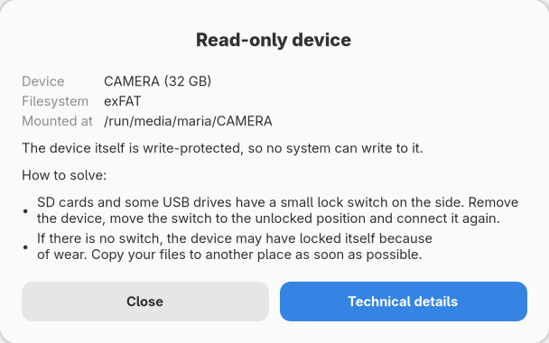
</p>

### 5.1 Causes

| Case | Meaning | How it is detected | Fix offered |
| --- | --- | --- | --- |
| **ok** | read and write | mounted `rw` and your user may write (`access(2)`) | — |
| **A** mounted read-only | someone mounted it `ro`, no visible problem | `ro` option, no other cause | **Mount again with writing**, only for UDisks mounts, never for fstab entries |
| **B** no permission | mounted rw, but the main folder belongs to another user (common for ext4/Btrfs/XFS formatted as root) | rw + no permission; owner from `stat` | **Become owner of the main folder** (UDisks `TakeOwnership`, not recursive, polkit) |
| **B** partition holding an operating system | another Linux install or the Windows disk | `etc/os-release`, Btrfs `@` subvolumes, `Windows/System32`... | none: system folders must keep their owners |
| **B** mounted for another user | FAT/NTFS with another `uid=` | `uid=` option | **Mount again for my user** (UDisks mounts only) |
| **C** filesystem errors | the kernel stopped writes to protect the data | `/sys/fs/ext4/*/errors_count`, kernel messages ("Remounting filesystem read-only", "forced readonly") | none: copy the data and check the disk unmounted |
| **D** unsafe NTFS | hibernation, Fast Startup, interrupted shutdown | NTFS mounted `ro`; reason from the status file or from the ntfs-3g journal | none: needs Windows |
| **E** write-protected | SD card lock switch, protected media | `/sys/block/*/ro = 1` | none: move the switch |
| **F** hardware | read/write errors, cable, port | kernel `I/O error` messages | none: copy the data, try another cable |
| **G** no write support | CD/DVD, ISO, SquashFS, journaled HFS+, APFS, legacy `ntfs` driver | type of the mounted filesystem | none |
| folder of another user | you asked about a folder that belongs to someone else, inside a writable device | the folder itself, under the mount that contains it | none: the owner is named |
| system partition | `/`, `/boot/efi`... of the running system | system mount points | none |
| swap | swap space, not for files | filesystem type | none |

The fix button only appears when the cause has a safe, verifiable
correction. Every correction asks for confirmation and is checked
afterwards. If it fails, Big-Mount says that nothing was changed. Even when
the device is writable, the diagnosis warns when the filesystem has
recorded errors (e.g. ext4 `errors_count` > 0).

### 5.2 Terminal example

```console
$ bigmount --diagnose /mnt/root
== No permission to write ==
Device: sdc2 (KINGSTON SA400S37480G, 479 GB)
Path: /dev/sdc2
Filesystem: Btrfs
Mounted at: /mnt/root
Status: Writable, but not by your user
This partition contains an operating system. Its folders belong to that system and must keep their owners.

How to solve:

  - Save your files in a folder that belongs to you, for example your home folder on that system.

Technical details:
  device:      /dev/sdc2 (sdc2), disk /dev/sdc
  transport:   sata  removable=0 hotplug=0 ro(part)=0 ro(disk)=0
  filesystem:  btrfs  label='' uuid=e1ee0ad7-...
  mount:       /mnt/root type=btrfs vfs=rw,nodev,noatime fs=rw,ssd,...,subvolid=5,subvol=/
  diagnosis:   permission (root directory root:root 755)
```

### 5.3 Overview and self-check

Excerpt from the development machine:

```console
$ bigmount --diagnose
Storage devices

  DEVICE           LABEL                  SIZE FS      MANAGED BY     MOUNTED AT                     STATE
  /dev/sda1        Dados                  1 TB btrfs   big-mount      /mnt/Dados                     read and write
  /dev/sdb3        -                    479 GB ntfs    big-mount      /mnt/Basic_data_partition      read and write
  /dev/sdc2        -                    479 GB btrfs   big-mount      /mnt/root                      no write permission
  /dev/sdd1        Novo volume            2 TB ntfs    fstab          /run/media/ruscher/Novo volume read and write
  /dev/nvme0n1p2   -                    999 GB btrfs   system         /home                          in use by the system

Environment
  big-mount.service            enabled
  UDisks2                      available
  lsof                         installed
  python3                      installed
  notify-send                  installed
  kernel log                   readable
```

"Managed by" tells who mounted it: `big-mount`, `fstab`, `UDisks` (Plasma or
Dolphin), `system` (`/`, `/home`, `/boot`...) or `other`.

### 5.4 Drive errors and Secure Erase

Some problems belong to the drive, not to a filesystem. A failing SSD can
stop answering, and then lock itself in a protection mode in which it
**acknowledges every write and keeps none**. An installer then fails with
something like `sfdisk --force --append /dev/sda ... Failed to add
partition`, and a partition table you erased comes back.

```bash
bigmount --diagnose /dev/sda        # the drive, then each of its filesystems
bigmount --gui-drive-check          # the application, on the health of the drive
sudo bigmount --secure-erase /dev/sda
```

The check reads, as your user and without changing anything: the kernel
messages of this boot about the disk, its partitions and **its port**
(`ata1`, `nvme0`, where timeouts are reported), the SMART verdict from
UDisks2, and the ATA security state from udev. It reports timeouts and link
resets, read/write errors, a slowed-down link, and a drive that predicts its
own failure. A few damaged sectors replaced by spare ones are shown but are
not an alarm. When a filesystem is diagnosed, the errors of its drive are
mentioned, and the dialog offers **Check the drive…**.

For an internal SATA drive that supports it, **Advanced maintenance** →
**Erase data permanently** in the application (or `--secure-erase`) runs the drive's
own ATA Secure Erase through UDisks2:

1. shows what will be lost (every partition), with Cancel as the default;
2. asks you to type the name of the drive (`sda`);
3. unmounts its filesystems and locks its encrypted volumes;
4. if the firmware froze the security commands at power-on, asks whether
   the computer may sleep a moment to unfreeze them;
5. erases (UDisks2 asks for the administrator password);
6. checks the result: the old partition table must be gone, and a new empty
   one (GPT on UEFI computers, MBR otherwise) must be read back from the
   drive.

It is refused for the drive of the running system (start from a live USB
drive), USB and hot-plug drives, NVMe, drives without the feature, and
drives with a security password. If the drive ignores the erase, or still
does not keep what is written, Big-Mount says so: replace it. The case that
led to this feature, and every decision, are in
[`docs/14-drive-health-and-secure-erase.md`](docs/14-drive-health-and-secure-erase.md).

---

## 6. Busy devices and safe removal

### 6.1 What is using the device

```bash
bigmount --busy /run/media/$USER/HDD
```

Illustrative example (the real processes are collected at that moment):

```console
== Novo volume is still in use ==
A terminal is open in a folder of this device. In total, 3 programs are using it.

Type cd in that terminal, or close it, then try again.

Device: Novo volume (SanDisk Portable SSD, 2 TB)
Filesystem: exFAT
Mounted at: /run/media/ruscher/Novo volume
Programs using it:
  Application  |  process  |  PID  |  Activity
  Dolphin (file manager)  |  dolphin  |  2567  |  Open for reading
  KDE thumbnail generator  |  kioworker  |  1234  |  Open for reading
  Command shell (terminal)  |  bash  |  4410  |  Current folder is on the device
Also keeping it busy:
  - Also mounted at /var/lib/os-prober/mount
An open file does not necessarily mean that something is being copied.
```

<p align="center">
  
</p>

The dialog starts with a plain-language summary and advice, chosen from the
holder that matters most. A program writing outranks a terminal, which
outranks a file manager, then an indexer, then anything else. The
technical table follows, and full paths, users and states are behind
**Technical details**.

What is checked:

| Holder | Source |
| --- | --- |
| processes with open files, a current folder, a program or library on the device | `lsof -F` (structured field output) and `/proc/PID` |
| the same partition mounted elsewhere (e.g. os-prober leftovers) | `findmnt --source` |
| another device mounted inside it | `findmnt -R` |
| a swap file on it, or the partition itself as swap | `/proc/swaps` |
| a disk image stored on it and attached to a loop device | `/sys/block/loop*/loop/backing_file` |
| encryption, LVM or RAID on top of the partition | `/sys/class/block/*/holders` |

Friendly names are shown for:

- Dolphin, and kioworker by protocol (thumbnails, trash, files);
- Baloo, Tracker;
- terminals and shells;
- players, viewers, editors, browsers;
- copy/archive tools, sync clients (Nextcloud, Syncthing, Dropbox...) and
  backup tools.

An open file does **not** mean that something is being copied, so there are
no percentages, speeds or remaining times.

**Why does Plasma sometimes only say "one or more files are open"?**
Plasma's applet runs `lsof` as you and only sees your processes. The
generic message appears when the holder is invisible to it: a process of
root or another user, or a holder without a process (a second mount, swap,
a loop device). Big-Mount shows those, and offers **Show programs of all
users (administrator)**.

### 6.2 Unmount and remove

```bash
bigmount --unmount /dev/sdc1              # this filesystem only
bigmount --safe-remove /dev/sdc           # every partition of the drive, then power off
bigmount --safe-remove /dev/sdc --no-power-off
bigmount --unmount /dev/sdc1 --close-apps # offer to close the programs that hold it
bigmount --gui-remove /run/media/$USER/HDD # in dialogs (also in the Dolphin menu)
```

Sequence:

1. **Diagnosis.** Resolves the device and its drive, and **refuses** if the
   drive holds the running system (`/`, `/home`, `/boot`, `/boot/efi`,
   `/usr`, `/var`... or active swap).
2. **Services.** systemd services that stop when the device goes away
   (`BindsTo=`, `Requires=`, `PartOf=`, `Requisite=` or
   `RequiresMountsFor=` on its mount, such as a photo or media server) are
   listed first. Nothing happens until you agree to stop them. The message
   says whether they start again by themselves when the device comes back.
3. **Normal attempt.** `udisksctl unmount` for every mount of every
   partition (stacked layers first). Polkit asks for a password when needed.
4. **Busy** (`org.freedesktop.UDisks2.Error.DeviceBusy`). Shows what holds
   it and offers **Try again**, **Refresh the list**, **Show technical
   details**, **Close the listed programs…** and **Show programs of all
   users**.
5. **Verification.** The mount table decides, not the answer of
   udisksctl, and every partition is checked again at the end.
6. **Release.** An NTFS or exFAT volume mounted through FUSE is still being
   written by its driver (`ntfs-3g`) after the unmount returns, and a
   container may have its own mount of the device. Big-Mount waits until
   both are gone (up to 60 s) before saying anything is safe.
7. **Encryption.** Open LUKS volumes on the drive are locked.
8. **Power off.** `udisksctl power-off`, only for removable drives, only
   when nothing else uses the drive, with 3 attempts. Internal disks are
   only unmounted.

Before every step that cannot be undone, the disk sequence number is read
again: if another device took the name, the operation stops. If an unmount
or power-off takes more than 2 seconds, a popup says "Writing pending data
to the device. Do not disconnect it yet."

**Closing programs** is only offered for processes that:

- are **yours**;
- are **not** part of the desktop session (plasmashell, kwin, dbus,
  pipewire...);
- are **not** shells. A terminal ignores the request, so the advice is to
  type `cd` or close it;
- have **no** file open for writing. Closing in the middle of a copy would
  leave an incomplete file.

The confirmation always warns that unsaved changes may be lost, and
**Cancel is the default button**. The signal is `SIGTERM` (what closing a
window does), never `SIGKILL`. Before sending it, the start time of the
process is compared with the one recorded at diagnosis, so a process that
inherited the PID is never hit.

Final messages, shown only after verification:

| Outcome | Popup |
| --- | --- |
| unmounted and powered off | **Safe to disconnect** — Successfully unmounted and powered off. You can disconnect it now. |
| removable, cannot be powered off by the computer | **Safe to disconnect** — Successfully unmounted... |
| internal disk | **Device unmounted** (does not suggest unplugging it) |
| holds the running system | **Unable to remove device** |
| authorization refused | **Unable to unmount device** — the device remains mounted |
| still in use (LVM, RAID) | **Unable to power off device** — do not disconnect it yet |
| power-off failed | **Unable to power off device** — it was unmounted; wait a moment before disconnecting it |
| services depend on it | dialog **Services use this device**: **Stop them and remove** or **Cancel** (default) |

---

## 6a. Drive manager and file rescue

For a drive that may be failing, a drive the desktop cannot open, or any time files
must come off a disk and you want to know that they really did. This is new in
2.3.0, and one GTK 4 application since 2.4.0. It works in a window, in menus in any
terminal (also over SSH), and as commands for scripts. All three use the same engine, so they say the same things.

<p align="center">
  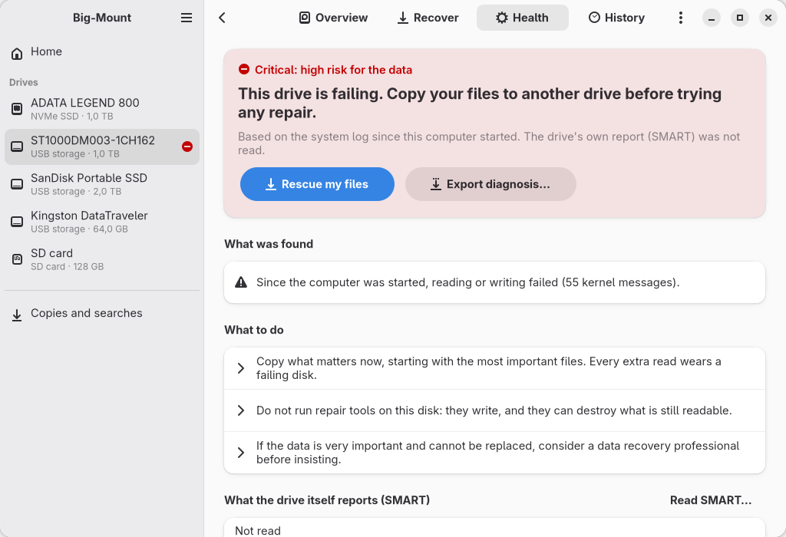
</p>

```bash
bigmount --gui-drive [DISK]        # the application
bigmount --gui-drive-check [DISK]  # the same application, opened on the health of the drive
bigmount --drive                   # the same in menus, in any terminal
```

Also from the desktop: right-click a folder in Dolphin → **Storage device** →
**Diagnose the drive and rescue files**, or open **Big-Mount** in the application
menu.

The pictures in this section are the real window, drawn by
[`tests/readme-screenshots.py`](tests/readme-screenshots.py) with sample drives. The
terminal transcripts are real output, with a real copy between two disposable disk
images; only the names of the user, the volumes and one model were changed. The window
follows the light or dark style of the system and its language.

### 6a.1 What it does differently from a file manager

- **It protects the disk first.** A read-only mount, without replaying journals
  where possible, and optionally blocking writes on the device itself. Repair tools
  are never run: they write, and can destroy what is still readable.
- **One bad sector does not hold the rest.** A file that stops advancing is set
  aside after 90 seconds and the copy goes on. Good files are saved first. While the
  destination is still writing, a file gets four times as long, so a slow USB drive
  syncing a large file does not get the next one set aside.
- **A power cut loses nothing.** A file gets its final name only after it was fully
  written and synced, and the job resumes, also with the drive under another name.
- **It says what really happened.** Without a measured total there is no percentage:
  a drive at risk is not scanned just to draw a bar. `completed` means nothing was
  left behind, and otherwise you get the list.
- **The destination is checked.** Not inside the source, not on the same physical
  disk (through partitions, LUKS and LVM) unless you allow it, enough room, and
  existing files are kept unless you decide otherwise.

These rules come from a real rescue, of a disk with 1,848 pending sectors behind a
USB bridge: 15,464 files saved, one set aside, and a power cut in the middle.
[`docs/16-drive-copy-engine.md`](docs/16-drive-copy-engine.md) tells which rule came
from what.

### 6a.2 Rescue files, step by step, in the window

One application, one window. `bigmount --gui-drive` opens it on your drives;
`bigmount --gui-drive-check` opens the same window on the health of a drive. It is
GTK 4 and libadwaita, follows the light and dark styles of the system, and reflows
down to a phone-sized window.

<p align="center">
  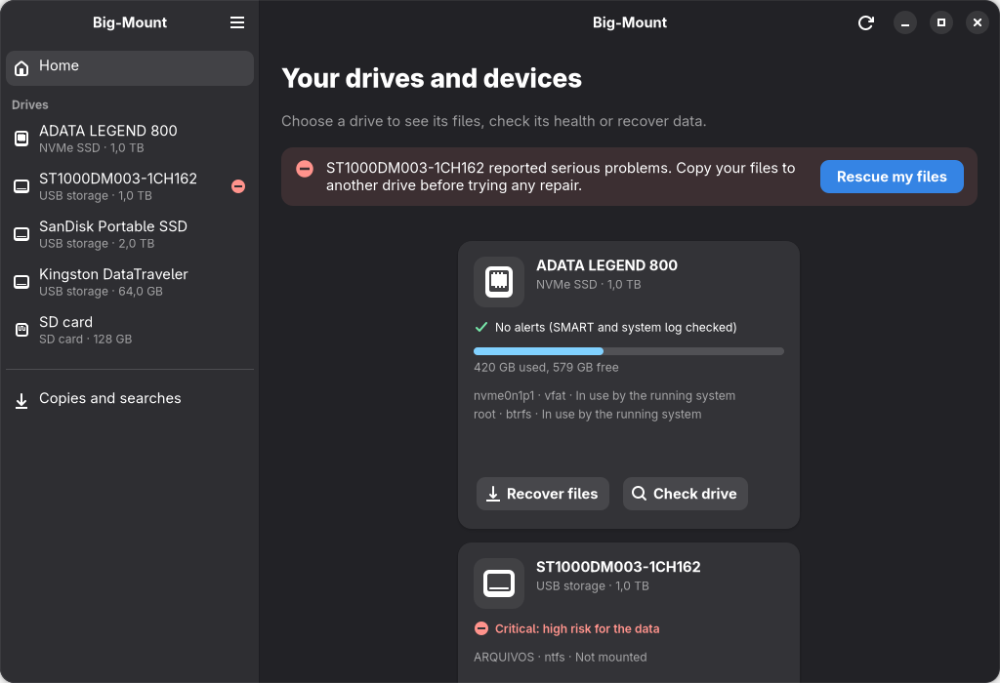
</p>

**1. Look at the drive.** Home lists every drive, as a list or a grid, grouped by
where it is, with a search. Each one says how it is doing in one word and an icon,
never in colour alone. Reading this touches nothing on the disk: it comes from the
kernel log, udev and UDisks2. The page says where the verdict comes from, and *not
examined* is never shown as *no alerts*.

<p align="center">
  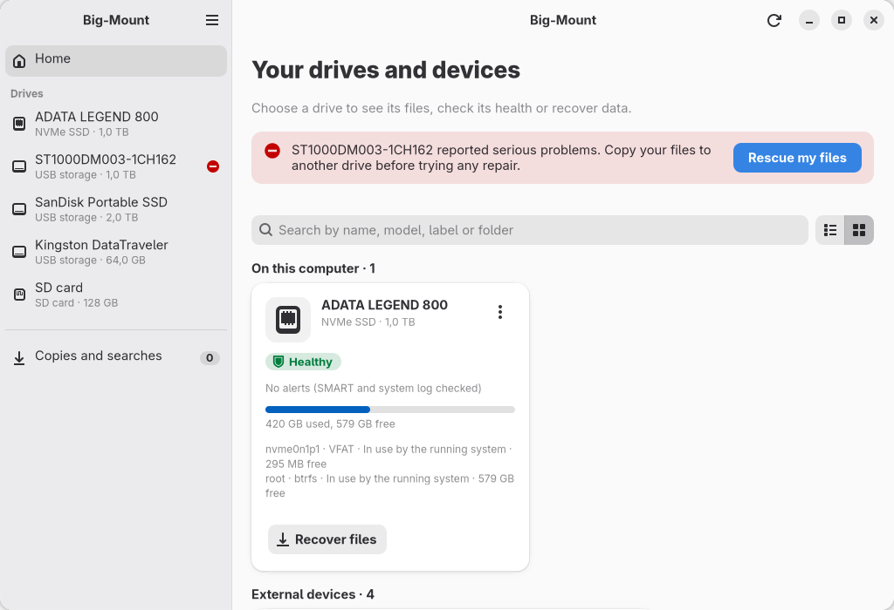
</p>

| Health | When |
| --- | --- |
| **Critical** | the drive reports failure (SMART), unreadable sectors, an NVMe critical warning or media errors, or 3 or more read errors since boot |
| **Poor** | timeouts, 3 or more USB resets, replaced sectors on a hard disk, one read error, CRC errors, SMART values below their limit now, or an SSD that used 90 % or more of its rated life |
| **Good** | no alert, but: SMART was not read (the system log alone), an SSD past half of its rated life, SMART values that were below their limit in the past, a hard disk powered on for 35,000 hours or more (about four years), an SSD for 50,000, or a drive that is hot now (55 °C for a hard disk, 70 °C or its own limit for an SSD) |
| **Healthy** | the drive's own report (SMART) was read with the system log, and none of the above |
| **Not assessed** | neither the log nor SMART could be read |

Why a drive without alerts is not **Healthy** is listed on its health page. Age alone
never makes a drive *Poor*: the rest of its report does. There is no date of
manufacture to read, so its use is measured in hours powered on.

**Read SMART…** asks for the password, starts no test, and adds the counters of the
drive with the time they were read. The raw counters decide, not the verdict: that
disk with 1,848 pending sectors said `PASSED`. The serial number stays hidden until
you ask for it.

<p align="center">
  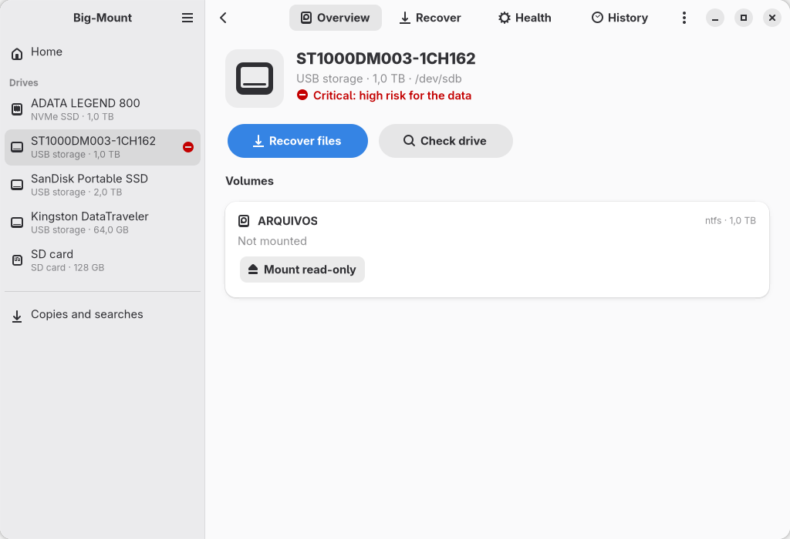
  
</p>

**2. Recover files** opens an assistant in the same window: five steps, with Back
that loses nothing.

| Step | What you choose | What the engine checks |
| --- | --- | --- |
| From where | a volume, the whole drive, or a disk image | it is still the same drive (serial, not `/dev/sdX`) |
| What | all types, or photos, videos, documents, audio, compressed files | what each type can and cannot find, said before |
| How | the way it advises first, then the others | which tools exist, and why a way cannot be used |
| Where | a place on another physical disk | not the same disk, not inside the source, room, permission |
| Confirm | nothing: a summary, and **Start** | every check again, writing nothing |

The ways of looking for files:

- **Copy files directly**: everything, or the folders you mark, with names and dates.
  Advised for a drive at risk: what matters first, nothing walked for nothing.
- **Quick analysis**: a list of the files that exist on the volume, by type; then you
  pick what to copy. It reads folders, never file contents, and it says plainly that
  deleted files are not on that list.
- **Deep analysis**: a search by content with PhotoRec, which can find what no longer
  appears, without names or folders. On a physical disk it first makes an image with
  GNU ddrescue, and the search runs on the image only after you confirm.
- **Advanced**: a disk image only, or lost partitions with TestDisk, which only reads.

On an SSD that discards deleted blocks (TRIM) the assistant says, before anything
starts, that files deleted long ago may be gone for good.

<p align="center">
  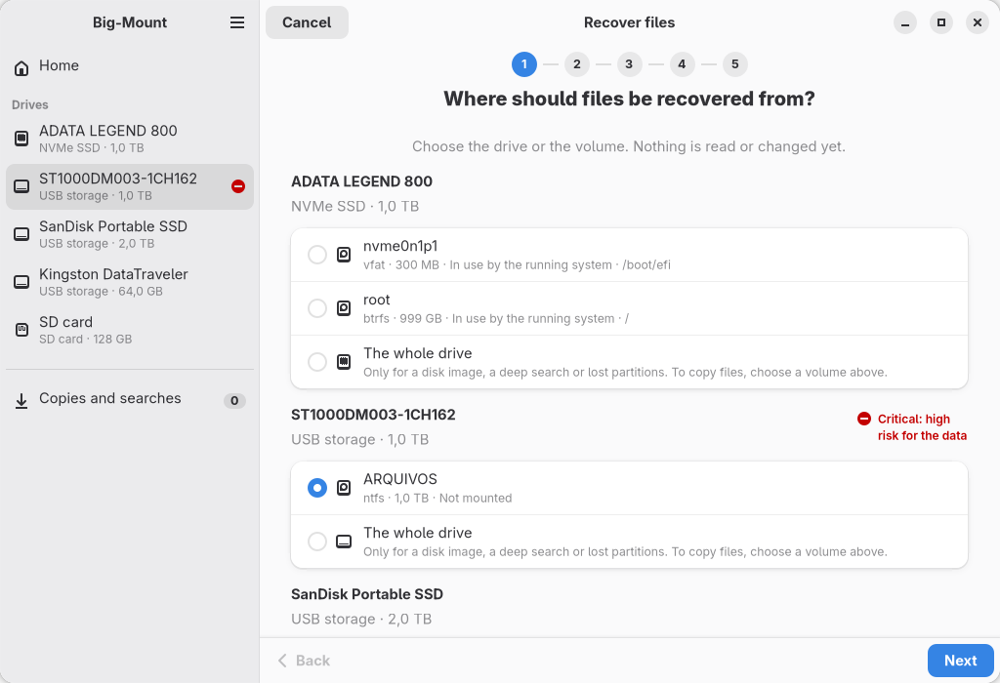
  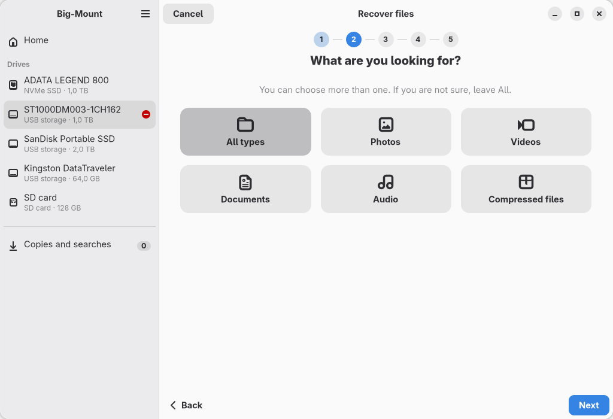
  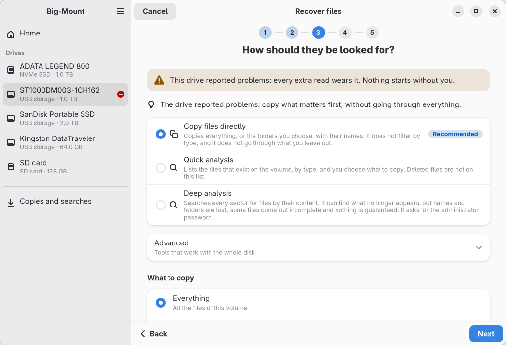
  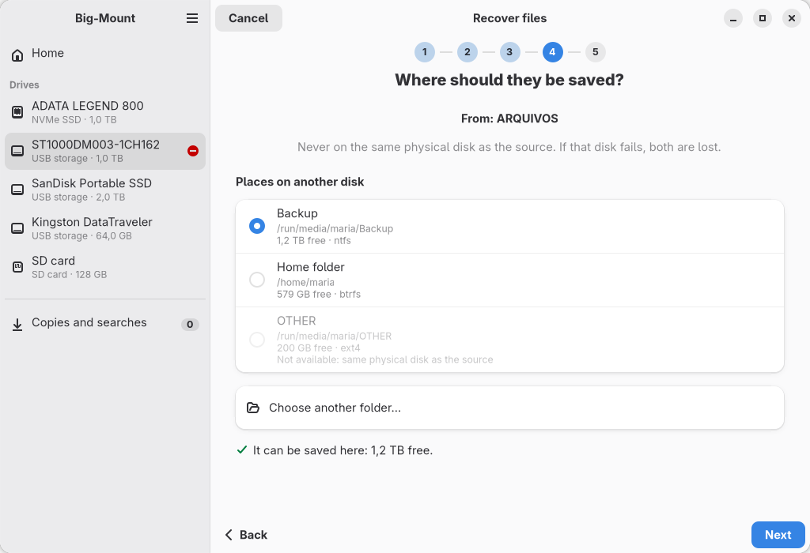
  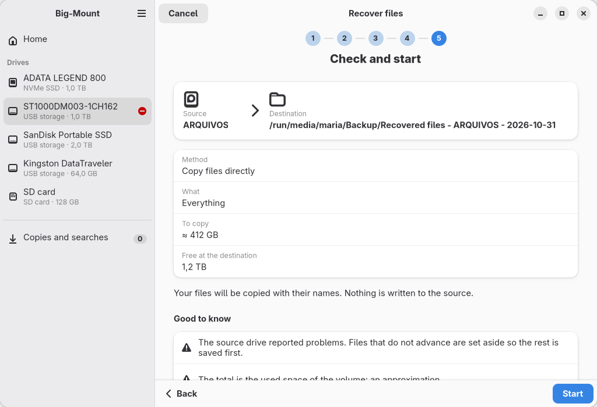
</p>

The same physical disk has no button that allows it in the assistant. The terminal
keeps `--allow-same-disk` for whoever really means it.

**3. Follow it, or close the window.** Work runs in the background and goes on
without the window; closing it only says so. Numbers are real: files, bytes, current
speed, time left only when it can be known, and a moving bar with the reason when
there is no total. A copy can be paused; a search can be cancelled, and what it found
stays.

<p align="center">
  
</p>

**4. See what was found.** A list that stays light with a million entries: filters by
type, search by name, order, selection with its size, and a preview of pictures on
request (never of a drive at risk, never by opening the file). Words match the list:
files that **exist**, or **candidates** found by content, which have no names and may
be incomplete. **Recover selected** copies them, through the same checks.

<p align="center">
  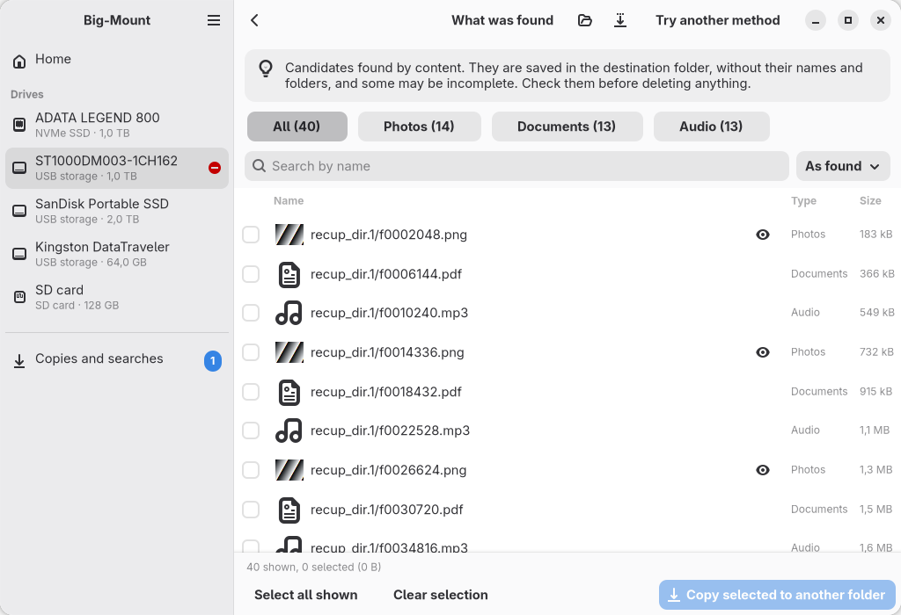
</p>

**Copies and searches** lists all of them, running or past, including one interrupted
by a power cut, ready to resume.

**Erase data permanently** lives under **Advanced maintenance**, apart from
recovery. See [5.4](#54-drive-errors-and-secure-erase).

<p align="center">
  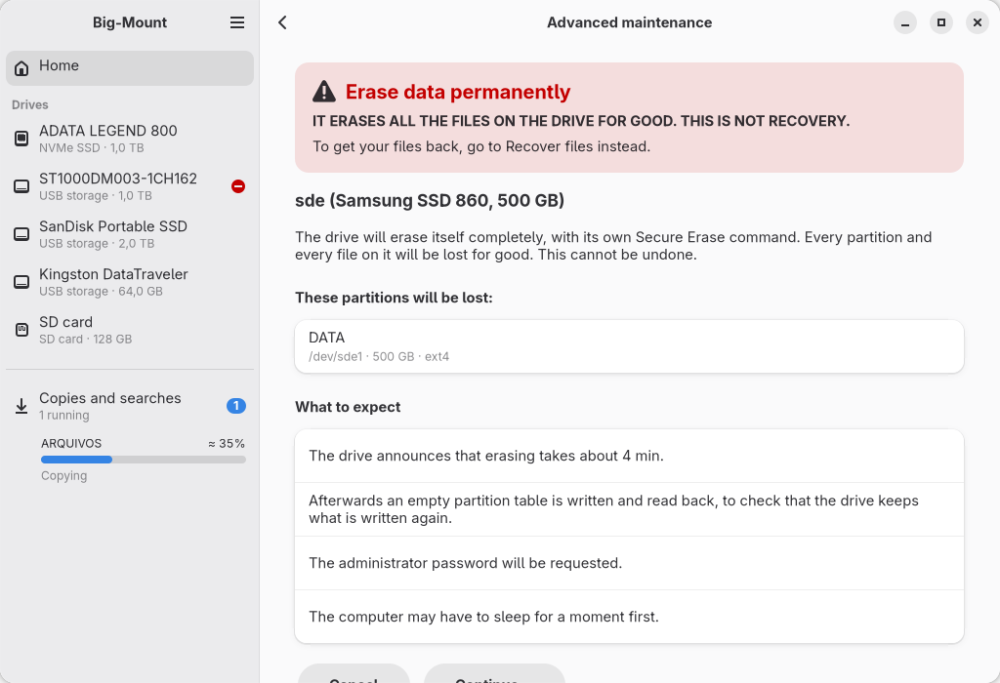
  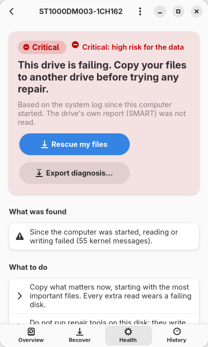
</p>

### 6a.3 The same in the terminal

`bigmount --drive` without a command opens numbered menus. They need no graphical
session, and have no colours or boxes on a plain terminal, or with `NO_COLOR` set.

```text
╭──────────────────────────────────────────────╮
│           BIG-MOUNT DRIVE MANAGER            │
│         Safe diagnosis and recovery          │
╰──────────────────────────────────────────────╯

Devices found: 3

 1. SanDisk Portable SSD — 2 TB
    USB storage
    Health: No alerts in the system log (SMART not read)
      sda1 “Backup” 2 TB ntfs — Mounted /run/media/me/Backup

 2. ST1000DM003-1CH162 — 1 TB
    USB storage
    Health: Critical: high risk for the data
      sdb1 “OLD-DATA” 1 TB ntfs — Not mounted

 3. NVMe SSD — 1 TB
    NVMe SSD
    Health: No alerts in the system log (SMART not read)
      nvme0n1p1 314 MB vfat — In use by the running system /boot/efi
      nvme0n1p2 999 GB btrfs — In use by the running system /home

  j) Copies and images
  a) Refresh
  0) Quit
Choose a device [1-3]: 2

DEVICE: ST1000DM003-1CH162

1. Complete information
2. Storage diagnosis
3. Mount safely (read-only)
4. Explore files
5. Copy files to another disk
6. Advanced recovery
7. Unmount safely
8. Export report
0. Back
Choose:
```

The diagnosis, as a command:

```text
$ bigmount --drive diagnose /dev/sdb

== ST1000DM003-1CH162 ==
Type: USB storage
Capacity: 1 TB
Connection: USB
Device: /dev/sdb
Health: Critical: high risk for the data
What was found:

  - Since the computer was started, reading or writing failed (55 kernel messages).
  - Since the computer was started, it stopped answering and the connection had to be reset (2 kernel messages).
  - Since the computer was started, the USB connection was reset or lost 48 times.
  - Copy what matters now, starting with the most important files. Every extra read wears a failing disk.
  - Do not run repair tools on this disk: they write, and they can destroy what is still readable.
  - If the data is very important and cannot be replaced, consider a data recovery professional before insisting.
Volumes:

  - /dev/sdb1: ntfs — Not mounted — writing blocked on the device
For the SMART details of the drive, which need the administrator password: bigmount --drive diagnose DEVICE --smart
```

A complete rescue, from the command line:

```text
$ bigmount --drive mount /dev/loop1 --read-only
Mounted read-only at /run/media/me/OLD-DATA

$ bigmount --drive destinations --source /run/media/me/OLD-DATA
* /run/media/me/Backup  (264 MB free)
* /home/me  (153 GB free)

$ bigmount --drive copy --source /run/media/me/OLD-DATA --destination /run/media/me/Backup/rescue \
           --item Pictures --item Documents/Taxes --dry-run
dry-run: /run/media/me/OLD-DATA → /run/media/me/Backup/rescue
41 files, 31 MB to copy; 0 already exist with different content.

$ bigmount --drive copy --source /run/media/me/OLD-DATA --destination /run/media/me/Backup/rescue \
           --item Pictures --item Documents/Taxes
Copy started: 20261030-214916-0acc
To follow it: bigmount --drive status 20261030-214916-0acc --watch
Completed and checked
Source:                /run/media/me/OLD-DATA
Destination:           /run/media/me/Backup/rescue
Files:                 41 / 41
[████████████████████████████] 100%
Copied:                31 MB / 31 MB
Speed:                 0 B/s (average 31 MB/s)
Elapsed:               00:00:01
Current file:          Pictures/2020/IMG_9.JPG

$ bigmount --drive report 20261030-214916-0acc
== Completed and checked ==
Source: /run/media/me/OLD-DATA
Destination: /run/media/me/Backup/rescue
Files copied: 41
Data copied: 31 MB
Elapsed: 00:00:01
Check: rsync confirmed each file as it was copied; no second comparison was made

Log: /home/me/.local/state/big-mount/jobs/20261030-214916-0acc/events.log

$ bigmount --drive copy --source /run/media/me/OLD-DATA --destination /run/media/me/OLD-DATA/inside
The destination is inside the source. The copy would copy itself.
$ echo $?
20
```

Interrupting and resuming, at any moment:

```bash
bigmount --drive jobs                          # every copy, and its id
bigmount --drive status ID --watch             # follow it; Ctrl+C stops watching, not the copy
bigmount --drive pause ID                      # stop safely, to resume later
bigmount --drive cancel ID                     # the same, and it is marked as cancelled
bigmount --drive resume ID                     # also after a power cut, or at another mount point
bigmount --drive resume ID --retry-deferred    # also what was set aside: more strain on the disk
```

### 6a.4 Commands

| Command | What it does |
| --- | --- |
| `bigmount --drive` | interactive menus (needs a terminal) |
| `list` | drives, volumes, and what is known about their health |
| `inspect TARGET` | everything known about a drive or a volume |
| `diagnose TARGET` | explains the state of the drive, reading nothing from it |
| `diagnose TARGET --smart` | also reads SMART (asks for the password) |
| `mount DEV` | mounts a volume without changing it; `--read-only` is the default |
| `unmount TARGET` | unmounts with every check of safe removal; a whole drive: all of its volumes |
| `safe-remove TARGET` | unmounts everything on the drive and powers it off |
| `busy TARGET` | which programs keep it busy, and which of them may be closed (and why not) |
| `close-apps TARGET` | asks your programs that keep it busy to close, as closing their windows: never the system, never one that is writing |
| `protect DEV`, `unprotect DEV` | blocks or allows writing on the device itself (asks for the password) |
| `unlock DEV` | unlocks an encrypted volume |
| `destinations --source FOLDER [--need BYTES]` | where the files can go, best first |
| `copy --source FOLDER --destination FOLDER` | copies in the background and follows the progress |
| `jobs` | copies and images, running and past |
| `status ID [--watch]` | progress of one of them |
| `pause ID`, `cancel ID` | stop safely; either can be resumed |
| `resume ID [--retry-deferred]` | goes on; optionally tries what was set aside |
| `report TARGET\|ID` | report of a drive or a copy; `--output FILE [--replace]`, `--anonymize` |
| `image --source DEV --image FILE [--map FILE] [--retries N]` | disk image with GNU ddrescue |
| `partitions TARGET` | looks for partitions with TestDisk, changing nothing |
| `carve --source DEV\|IMAGE --destination FOLDER` | searches for files by content with PhotoRec |

Every command is `bigmount --drive COMMAND`. `TARGET` is a device or a folder inside
a mounted device. `unmount` and `safe-remove` stop at services that use the device
(exit 9) unless `--allow-services` is given, and at programs that keep it busy (exit 3):
nothing is ever forced or lazily unmounted. `--json` gives output for programs, `--dry-run` says what would be
done, and `bigmount --drive --help` lists all of this in your language.

Options of `mount`:

| Option | Effect |
| --- | --- |
| `--read-only` | the default: read-only, `noatime`, `nosuid`, `nodev`, `noexec`, and `noload` on ext3/ext4 so the journal is not replayed |
| `--protect` | also blocks writing on the block device (asks for the password). Lasts until the drive is disconnected. Done without asking on a drive at risk for XFS, Btrfs, F2FS, JFS, ReiserFS, NILFS2 and bcachefs, which replay their log even when mounted read-only. Refused (exit 20) when another volume of the drive is mounted with writing enabled, or the drive holds the running system |
| `--remount` | unmounts first, when it is mounted with writing enabled |
| `--read-write` | mounts with writing enabled; refused on a drive at risk |

Options of `copy`:

| Option | Default | Effect |
| --- | --- | --- |
| `--item PATH` | everything | only this file or folder of the source; can be repeated |
| `--on-conflict skip\|backup\|overwrite` | `skip` | files that already exist: keep them, keep the old ones in `.big-mount-backup-ID`, or replace them |
| `--verify basic\|metadata\|full` | `basic` | `basic`: rsync checks each file as it copies. `metadata`: names, sizes and dates at the end. `full`: the content at the end, which **reads everything again** |
| `--stall-seconds N` | `90` | sets aside a file that does not advance for N seconds, or 4×N while the destination is still writing; `0` never |
| `--bwlimit KBPS` | no limit | limits the reading speed |
| `--scan auto\|yes\|no` | `auto` | measures the total first; `auto` does not on a drive at risk |
| `--allow-same-disk` | off | accepts a destination on the same physical disk |
| `--allow-rw-source` | off | accepts a drive at risk mounted with writing enabled |
| `--allow-risky-destination` | off | accepts a destination on a drive with critical alerts |
| `--no-wait` | off | starts and returns; the copy goes on in the background |
| `--dry-run` | off | runs the checks, says what would be copied, writes nothing |

Exit codes of `--drive`, on top of those in [section 8](#8-command-reference):

| Code | Meaning |
| --- | --- |
| 20 | refused by a safety check |
| 21 | no space at the destination |
| 22 | finished, but files were not copied or the check found differences |
| 23 | cancelled or paused |
| 24 | a device went away or did not answer |
| 25 | a tool this needs is not installed |

### 6a.5 What a copy refuses, and what it keeps

Refused, always: the same folder; a destination inside the source, or the reverse
(compared on real paths, so a symbolic link does not fool it); the same filesystem; a
read-only or unwritable destination; items outside the source; a measured total that
does not fit.

Refused unless you allow it with an option: the same physical disk, a destination on
a drive with critical alerts, a source at risk mounted with writing enabled.

Copied as they are: symbolic links are copied as links and never followed, and names
that are not valid UTF-8 survive (old disks in Latin-1). Nothing is ever deleted at
either end. A copy stays inside one filesystem and skips special files and devices.

### 6a.6 What each state means

| State | Meaning |
| --- | --- |
| **Copying**, **Checking the result** | running in the background, with or without the window |
| **Stopping** | asked to stop. While a read is stuck in the driver this waits for it: nothing is killed |
| **Paused**, **Cancelled** | stopped safely. The files already copied stay at the destination. Can be resumed |
| **Interrupted** | the computer or the supervisor went away, as in a power cut. Can be resumed |
| **Completed and checked** | nothing was set aside or failed, and the check found no difference |
| **Finished, needs your attention** | anything else: the report lists each file and the reason |
| **Failed** | it could not go on, and the report says why |

More than 100 files set aside stops the copy: the drive is probably getting worse.

Each job keeps its records in `~/.local/state/big-mount/jobs/ID/` (mode 700):

```text
job.conf       what was asked, with the UUIDs of both ends
state.env      how far it got, replaced atomically
events.log     rsync log: what was sent
rsync.out      what went wrong
deferred.txt   set aside
failed.txt     not copied, with the reason
report.txt, report.json
```

### 6a.7 When the files cannot be reached

**Deep analysis** and **Advanced** in the assistant, or these commands. They read the
disk and write elsewhere. Repairing a filesystem or a partition table is not done
here, on purpose.

```bash
# A copy of the whole device, to a file on ANOTHER disk. It resumes from its map and
# never reads a good area twice. Then you work on the copy, and the disk rests.
bigmount --drive image --source /dev/sdb --image /mnt/backup/disk.img

# Partitions that can still be found
bigmount --drive partitions /mnt/backup/disk.img

# Files found by their content (photos, documents), in an image
bigmount --drive carve --source /mnt/backup/disk.img --destination /mnt/backup/found
```

| Tool | Package | Without it |
| --- | --- | --- |
| GNU ddrescue | `ddrescue` | `image` explains what is missing (exit 25). Nothing is installed by itself |
| TestDisk, PhotoRec | `testdisk` | `partitions` and `carve` explain the same |
| smartctl | `smartmontools` | `diagnose --smart` explains the same; the log still works |
| rsync | `rsync` | `copy` explains the same |
| GTK 4, libadwaita | `gtk4`, `libadwaita`, `python-gobject` | the application says what is missing and points to `bigmount --drive`, which does the same |

### 6a.8 Encrypted volumes, and the running system

An encrypted volume is shown as locked and is not touched until you unlock it. The
window sends the passphrase straight to UDisks2 over D-Bus, and in the terminal
`udisksctl` asks for it, so it never appears in arguments, files or logs. Nothing
tries to get around encryption.

The partitions of the running system can be read from, and cannot be unmounted or
protected: `bigmount --drive unmount /` is refused with exit code 4.

### 6a.9 Reports for a bug report or a forum

```bash
bigmount --drive report /dev/sdb --anonymize --output drive.txt
```

`--anonymize` hides serial numbers, UUIDs, volume labels (also in mount points), your
home folder and your user name. The names of the files of a copy stay, because they
are what the report is about, so read it before you post it. An existing file is
overwritten by `--output` only with `--replace`, and only once the new report is
written whole.

Details: [architecture](docs/15-drive-architecture.md),
[copy engine](docs/16-drive-copy-engine.md), [security](docs/17-drive-security.md),
[tests and status](docs/18-drive-final-report.md).

---

## 7. Desktop integration and notifications

| Integration | Where | Details |
| --- | --- | --- |
| Dolphin service menu | right-click a folder → **Storage device** | **Diagnose the drive and rescue files** (`bigmount --gui-drive %f`), **Why can't I write here?** (`bigmount --gui %f`) and **Safely remove (shows what keeps it busy)** (`bigmount --gui-remove %f`) |
| Launcher | application menu → **Big-Mount** | opens the drive manager (`bigmount --gui-drive`); its action **Storage Diagnostics** chooses a device from a list (`bigmount --gui`) |
| Notifications | when a device you cannot write to is mounted, and when a removal ends | see below |
| Application | GTK 4 and libadwaita (`--gui-drive`, `--gui-drive-check`) | one window; light/dark style, narrow windows, keyboard and screen readers come from the toolkit |
| Dialogs | GTK 4 and libadwaita (`dialog.py`), the same look as the application | light/dark style, HiDPI, keyboard and screen readers come from the toolkit |

### 7.1 Notifications

There is one notification path: `notify-send`, falling back to the terminal
when there is no session bus. A message is never shown twice.

| Kind | Duration |
| --- | --- |
| information: Safe to disconnect, Device unmounted, Device ready, Writing pending data | 5 s, not kept in the history |
| problems, possibly with buttons: Read-only device, Unable to unmount device, ... | 15 s, kept in Plasma's history |
| decisions: busy device, close programs, apply a fix | dialogs that never expire |

The durations are `BM_POPUP_SECONDS` and `BM_WARNING_SECONDS` in
`usr/lib/big-mount/ui.sh`. A read-only warning offers **View details**,
**How to solve** and, only when a safe fix exists, the fix itself. Plasma
lists the notifications under "Big-Mount" (System Settings →
Notifications). Successful mounts are never announced, because Plasma
already does that.

The **notifier** is off by default: Big-Mount only mounts the partitions and
watches nothing. **Warn when a device cannot be written to**, in the main menu
of the application, turns it on: it copies
`/usr/share/big-mount/big-mount-notifier.desktop` to
`~/.config/autostart/` and starts it. Turning the option off removes that file
and stops the running notifier. While on, it:

- waits for mount events with `findmnt --poll`. The kernel wakes it up and
  there is no periodic scan: 2 processes, 9 MB, 0 CPU while idle, 45 ms
  from a mount to the notification;
- checks what is already mounted when you log in, including the mounts
  made at boot;
- warns at most **once per device and cause per boot**
  (`~/.local/state/big-mount/notified`);
- ignores CDs, DVDs and images, which are read-only by nature;
- when a mounted volume belongs to a drive that reported problems (the same diagnosis
  as the window: kernel log, udev, UDisks2; it reads nothing from the disk), opens a
  window with what was found, **Open Big-Mount** and **Close**, once per boot and
  drive (not per volume);
- never warns about a read-only state you asked Big-Mount for (a read-only
  mount, writing blocked on a drive);
- runs as one instance per session (`$XDG_RUNTIME_DIR/big-mount-notifier.lock`,
  which also holds its PID).

Why there is no hook into Plasma's own unmount error: Plasma offers no
extension point for it, and `udisksd` publishes no event when an unmount is
refused. Intercepting Plasma's notifications by their text would be
fragile, so Big-Mount does not do it.

---

## 8. Command reference

```text
bigmount [OPTION] [TARGET]
```

`TARGET` is a device (`/dev/sdb1`, `/dev/sdb`, `/dev/disk/by-uuid/...`) or
**any folder** inside a mounted device. Relative paths are accepted; an
empty target is refused.

| Command | Needs root | Description |
| --- | --- | --- |
| `bigmount` | yes | automatic mounting (what the service runs); as a user it explains and exits with 5 |
| `bigmount --dry-run` | no (recommended as root) | shows the decisions and commands, changes nothing |
| `bigmount --diagnose` | no | overview of the devices and the environment |
| `bigmount --diagnose TARGET` | no | why it cannot be written, possible fix, technical details, who is using it; for a whole disk, first the errors of the drive ([5.4](#54-drive-errors-and-secure-erase)) |
| `bigmount --busy TARGET` | no | what keeps the device busy |
| `bigmount --unmount TARGET` | no (polkit may ask) | unmounts every mount of this filesystem |
| `bigmount --safe-remove TARGET` | no (polkit) | unmounts every partition of the drive, locks LUKS, powers it off if removable |
| `  --no-power-off` | — | with `--safe-remove`: unmount everything, do not power off |
| `  --close-apps` | — | with `--unmount`/`--safe-remove`: offer to close the eligible programs |
| `  --assume-yes` | — | do not ask before closing programs (with `--close-apps`) or stopping services that depend on the device (scripts) |
| `bigmount --gui [TARGET]` | no | diagnosis in a dialog; without a target, a list |
| `bigmount --gui-remove TARGET` | no | safe removal in dialogs |
| `bigmount --drive [COMMAND]` | no | drive manager and file rescue in the terminal, see [6a](#6a-drive-manager-and-file-rescue) and `bigmount --drive --help` |
| `bigmount --gui-drive [DISK\|FOLDER\|UUID]` | no | the application: drives, health, file rescue; without a session it points to `--drive` |
| `bigmount --gui-drive-check [DISK]` | no | the same application, opened on the health of the drive |
| `bigmount --secure-erase DISK` | no (UDisks2 asks for the administrator password; `sudo` when there is no graphical session) | erases a whole internal SATA drive with its own Secure Erase, after confirmation, then checks it ([5.4](#54-drive-errors-and-secure-erase)) |
| `bigmount --notifier` | no | session notifier (off by default; turned on in the menu of the application) |
| `bigmount --doctor` | no | read-only self-check of the installation, the service, the session and the storage stack; anonymized, for bug reports ([12.2](#122-bigmount---doctor)) |
| `bigmount -V`, `--version` | no | version, package and source revision |
| `bigmount -h`, `--help` | no | help |

Exit codes:

| Code | Meaning |
| --- | --- |
| 0 | done (or, for `--diagnose TARGET`, the device is fine) |
| 1 | error; for `--diagnose TARGET`, the device cannot be written to, or its drive reported errors |
| 2 | wrong usage (unknown option, empty target) |
| 3 | device busy |
| 4 | refused: the drive holds the running system |
| 5 | authorization refused or cancelled (for `--secure-erase`, also: the name of the drive was not typed) |
| 6 | unmounted, but the drive is still in use (LVM/RAID); not powered off |
| 7 | unmounted, but the drive cannot be powered off by the computer |
| 8 | unmounted, but powering it off failed (wait a moment before unplugging) |
| 9 | nothing done: systemd services depend on the device (`--assume-yes` stops them) |
| 10 | nothing done: another operation on the same drive is in progress |
| 11 | nothing erased: the drive stays frozen |
| 12 | the drive did not do what it was told: the erase was ignored or what was written afterwards was not kept (replace it), or the result could not be checked |
| 20–25 | `--drive`: refused by a safety check, no space, files not copied, cancelled or paused, device gone, tool missing ([6a.4](#6a4-commands)) |

For `--doctor`: 0 when no problem was found (warnings may exist), 1 when at
least one problem was found.

When a target cannot be used, the message says why: it does not exist (an
unplugged device), it is an NVMe controller (`/dev/nvme0`: its storage is
`/dev/nvme0n1`), it is not a storage device, or it is a folder on a network
share or in memory. Nothing is ever derived from a device name by cutting
it.

In a script:

```bash
if bigmount --safe-remove /dev/sdc; then
    echo "you can unplug it"
else
    case $? in
        3) bigmount --busy /dev/sdc ;;
        4) echo "that is the system disk" ;;
    esac
fi
```

---

## 9. Configuration

### 9.1 `/etc/big-mount.conf`

```ini
# Who may write to INTERNAL FAT, exFAT and NTFS partitions mounted under /mnt
PERMISSIONS=shared
```

| Value | Mount options | Effect |
| --- | --- | --- |
| `shared` (default) | `umask=000` | every local account reads, writes and runs files: the behavior of every previous version |
| `owner` | `dmask=022,fmask=022` | only the last user who logged in writes; everyone reads (running programs stays allowed, for Wine/Steam) |
| `private` | `umask=077` | only the last user who logged in has access |

- Applies to internal FAT/exFAT/NTFS. ext4, Btrfs, XFS, etc. keep their own
  permissions.
- The file is parsed as data, never executed. An unknown value is reported
  in the journal and `shared` is used.
- It is kept on package updates (`backup=` in the PKGBUILD).
- Apply without rebooting: `sudo systemctl restart big-mount`. Partitions
  that are already mounted keep their options until they are mounted again.

### 9.2 Disable the automatic mounting

```bash
sudo touch /etc/bigmountall-no      # disable
sudo rm /etc/bigmountall-no         # enable again
```

### 9.3 eSATA bays and other special cases

The kernel does not mark eSATA ports as removable. For Big-Mount (and
UDisks) to treat an eSATA disk as external, add a udev rule:

```bash
# find the path of the disk
udevadm info --query=property --name=/dev/sdX | grep ID_PATH=

sudo tee /etc/udev/rules.d/99-esata.rules <<'EOF'
ENV{ID_PATH}=="pci-0000:00:17.0-ata-5*", ENV{UDISKS_SYSTEM}="0"
EOF
sudo udevadm control --reload && sudo udevadm trigger
```

To **prevent** an internal partition from being mounted, either put it in
`/etc/fstab` with `noauto`, or hide it entirely with
`ENV{UDISKS_IGNORE}="1"`.

To mount a partition somewhere else or with other options, put it in
`/etc/fstab`. Big-Mount never touches partitions listed there.

---

## 10. Installed files

| Path | Role |
| --- | --- |
| `/usr/bin/bigmount` | automatic mounting and entry point of every command |
| `/usr/lib/big-mount/lib.sh` | device facts, diagnosis, holders, closing programs, UDisks |
| `/usr/lib/big-mount/ui.sh` | dialogs (GTK or terminal) and notifications |
| `/usr/lib/big-mount/dialog.py`, `gui/dialogs.py` | the dialogs of `--gui`, `--gui-remove` and the notifier (GTK 4, libadwaita) |
| `/usr/lib/big-mount/cli.sh` | commands, texts, graphical flows and the notifier |
| `/usr/lib/big-mount/doctor.sh` | `--version` and `--doctor` (loaded only by them) |
| `/usr/lib/big-mount/drive.sh` | `--drive`: commands, JSON output, exit codes |
| `/usr/lib/big-mount/drive-detect.sh` | one snapshot of drives, volumes and what sits on what |
| `/usr/lib/big-mount/drive-diag.sh` | health level, SMART, read-only mounting |
| `/usr/lib/big-mount/drive-copy.sh` | checks before copying, jobs, supervisor, reports |
| `/usr/lib/big-mount/drive-recovery.sh` | ddrescue, TestDisk, PhotoRec |
| `/usr/lib/big-mount/drive-tui.sh` | the menus of `--drive` |
| `/usr/lib/big-mount/drive-gui.py`, `gui/` | the application of `--gui-drive` (GTK 4, libadwaita), with its welcome screen and About |
| `/usr/lib/big-mount/drive-erase.sh` | Secure Erase for the application: the check, a ticket, the erase |
| `/usr/lib/big-mount/bigmount-drive-helper` | privileged helper of the drive manager (through `pkexec`) |
| `/usr/lib/big-mount/version` | the git revision the package was built from |
| `/usr/lib/big-mount/bigmount-holders` | privileged, read-only helper (through `pkexec`) |
| `/usr/lib/systemd/system/big-mount.service` | boot service |
| `/usr/share/libalpm/hooks/big-mount.hook` | enables the service on the first installation |
| `/etc/big-mount.conf` | configuration ([9.1](#91-etcbig-mountconf)) |
| `/usr/share/big-mount/big-mount-notifier.desktop` | the notifier entry, copied to `~/.config/autostart/` only when you turn it on |
| `/usr/share/applications/big-mount.desktop` | "Big-Mount" launcher |
| `/usr/share/kio/servicemenus/big-mount.desktop` | Dolphin service menu |
| `/usr/share/polkit-1/actions/org.biglinux.big-mount.policy` | polkit actions of the two privileged helpers |
| `/usr/share/icons/hicolor/scalable/apps/big-mount.svg` | icon |
| `/usr/share/locale/pt_BR/LC_MESSAGES/big-mount.mo` | Brazilian Portuguese translation |

Files created while running:

| Path | Created by | Content |
| --- | --- | --- |
| `/mnt/<label>`, `/mnt/<device>` | service | mount points and links |
| `/media` → `/mnt`, `/mnt/user-mount` → `/run/media` | service | compatibility links |
| `/run/big-mount/status` | service | state of the boot mounts |
| `/run/lock/big-mount.lock` | service | lock against simultaneous runs |
| `$XDG_RUNTIME_DIR/big-mount-drive-<disk>.lock` | removal | one removal of a drive at a time (private to the user) |
| `~/.local/state/big-mount/notified` | notifier | warnings already shown during this boot |
| `~/.config/big-mount/gui.ini` | application | the view of the Home (list or grid) and whether the welcome screen is shown |
| `~/.local/state/big-mount/jobs/ID/` | drive manager | one folder per copy or image (mode 700): settings, progress, logs, reports |

---

## 11. Security and privileges

```text
boot (root)                            user session (never root)
big-mount.service ── writes ──▶  /run/big-mount/status ── reads ──▶  bigmount --notifier
                                                                     ├─ notify-send (session D-Bus)
                                                                     └─ dialog.py (GTK 4)

user actions ── udisksctl/D-Bus ──▶ UDisks2 ── polkit decides (password if needed)
"programs of all users" ── pkexec ──▶ /usr/lib/big-mount/bigmount-holders (read-only)
"block writing, SMART, image" ── pkexec ──▶ /usr/lib/big-mount/bigmount-drive-helper
```

- **Root** only runs the boot path and the `bigmount-holders` helper. The
  helper accepts a single argument, which must be the exact mount point of a
  local block device, and only prints the process list. It has its own
  polkit action (`org.biglinux.big-mount.inspect-processes`,
  `auth_admin_keep`), so authorizing it gives access to no other mode as
  root. Its output is deleted as soon as the dialog closes.
- **The drive manager** runs entirely as you: the window, the menus and the copy.
  What needs root goes through one small helper with its own polkit action
  (`org.biglinux.big-mount.drive-helper`, `auth_admin_keep`). It has five commands
  (`protect`, `unprotect`, `smart`, `partitions`, `image`), a clean environment, a
  fixed `PATH`, and checks every argument before using it. It refuses the running
  system, never starts a self-test, and writes an image only into a real folder owned
  by you, never on the disk being read. The window does not run as root.
  [`docs/17-drive-security.md`](docs/17-drive-security.md) has each command and what
  it refuses.
- **Mounting, unmounting, locking, powering off and taking ownership** go
  through UDisks2, whose own polkit policy decides. Big-Mount widens no
  permission.
- **Secure Erase** also goes through UDisks2
  (`org.freedesktop.udisks2.ata-secure-erase`: the administrator password,
  always). Big-Mount adds no privileged code for it. It is reachable only
  from `--secure-erase` and from **Erase data permanently** in the application,
  after the name of the drive is typed, and a test checks that nothing else calls it.
- **Other users' data:** as a user, `lsof` sees only your processes. Other
  accounts appear only with the administrator password.
- **Untrusted data** (labels, file and process names) never goes through
  `eval` or a shell. Dialogs receive it as data and show it in GTK labels with
  markup off, after replacing control characters; notifications escape it for
  their markup; in the terminal every control character, ESC included, becomes
  `?`, so an escape sequence cannot act (what follows the ESC is shown as plain
  text). Translation catalogs are loaded with
  `noexpand_translation`, and configuration values are never used as printf
  formats.
- **Races:** `flock` at boot, a per-drive lock for removals (a double
  click on the Dolphin action cannot start two), and the disk sequence
  number between the scan and the mount and before every irreversible
  removal step. The process start time is checked before any `SIGTERM`.
- **Device identity:** device names are never built by cutting strings.
  Parents come from `lsblk` (sysfs), UDisks2 objects from UDisks2 itself
  (`udisksctl info`), and a name UDisks2 does not know stops the operation
  as "disconnected" instead of being retried or forced.
- A test scans the shipped code for forbidden commands (`ntfsfix`, `mkfs`,
  `fsck`, `umount -f/-l`, `kill -9`, `fuser -k`, `chmod -R`, `chown -R`,
  `remove_hiberfile`, `--force`, and in the drive manager also `dd`, `wipefs`,
  `eval`, `btrfs check --repair`).

---

## 12. Troubleshooting

### 12.1 Errors about SDDM or `/dev/nvme`

If every `bigmount` command prints:

```text
grep: /var/lib/sddm/state.conf: Permission denied
cat: /sys/block/nvme/removable: No such file or directory
Error looking up object for device /dev/nvme
```

the installed package is the **legacy script** (December 2025 and earlier,
`big-mount 25.12.23-2237` in `biglinux-stable`). It has two defects, both
reproduced and fixed: it reads the private state file of SDDM without
checking whether it may, and it cuts device names at the first digit, so
`nvme0n1p1` becomes `nvme`, a device that does not exist. It also ignores
every option, so `bigmount --diagnose` runs the boot mount instead. **Your
disks and data are not affected by these messages.** Update the package
(`sudo pacman -Syu`, or install a [release](#22-from-a-release))
and check with `bigmount --version`. Do not change the permissions of the
SDDM files, and there is no need to reinstall the system. Details in
[`docs/12-field-report.md`](docs/12-field-report.md).

### 12.2 `bigmount --doctor`

A read-only self-check for the "it works on the other computer" cases. It
changes nothing and needs no password, and it leaves out labels, serial
numbers, UUIDs, the user name and the folders where devices are mounted,
so its output can be attached to an issue or a forum post:

```bash
bigmount --doctor > big-mount-report.txt
```

It checks:

- which Big-Mount is installed, and whether `/usr/bin/bigmount` carries a
  known defect of older versions;
- other copies of `bigmount` in `PATH`, files changed since installation,
  and owners and permissions of the code that runs as root;
- the repository version against the installed one, and the obsolete
  `big-mount-git` package;
- the boot service: enabled, ran, replaced in `/etc`, warnings of this boot;
- dialogs, notifications and the notifier;
- dependencies, UDisks2 and polkit, and whether every disk the kernel shows
  is known to UDisks2 under the same name;
- read-only mounts.

A last section, **outside Big-Mount**, lists two facts that explain common
desktop symptoms without touching them. One is settings files in
`~/.config` that do not belong to you: Plasma cannot save them, so settings
seem to reset. The other is pending updates, because a system updated only
in part is inconsistent.

### 12.3 Other problems

**My USB disk appears under `/mnt` instead of as a removable device in
Dolphin.** Look at the decision with `sudo bigmount --dry-run`. If the disk
is not reported as an "external device", report the output of
`lsblk -dn -o NAME,TRAN,RM,HOTPLUG /dev/sdX` and
`udevadm info --query=property --name=/dev/sdX`.

**An internal partition was not mounted at boot.** Check
`journalctl -b -u big-mount` and `cat /run/big-mount/status`. Common reasons:
it is in `/etc/fstab`, it is hidden (`UDISKS_IGNORE`), it is a container
(LUKS/LVM), or the mount failed (`failed` in the status).

**The Windows partition is read-only.** Run
`bigmount --diagnose /mnt/<name>`. It is almost always hibernation or Fast
Startup: shut Windows down with Shift + Shut down, or disable Fast Startup.

**"The device cannot be removed because files are open."** Run
`bigmount --busy <folder on the device>`, or use the Dolphin menu **Safely
remove**. If none of your programs is listed, use **Show programs of all
users**, or look for a second mount (e.g. `/var/lib/os-prober/mount`).

**I formatted a disk as ext4 and cannot write to it.** Its main folder
belongs to root. Use `bigmount --gui <folder>` → **Become owner of the main
folder**.

**No dialogs, only text.** Check that `WAYLAND_DISPLAY` or `DISPLAY` exists in
the session, and that `bigmount --doctor` says **Application and dialogs: GTK 4
and libadwaita**.

**The diagnosis says "kernel log not readable".** Your user cannot read the
journal (on Arch that needs the `wheel`, `adm` or `systemd-journal` groups).
The diagnosis still works with fewer details about errors, and the remount
fix is withheld for lack of evidence.

**The application does not open.** It needs `gtk4`, `libadwaita` 1.5 or later,
`python-gobject` and a graphical session; it says which is missing.
`bigmount --doctor` checks them. `bigmount --drive` does the same in a terminal.

**"The total is not measured", and there is no percentage.** That is on purpose: the
drive has alerts, and walking the whole disk to draw a bar would wear it. The window
shows what was really copied. `--scan yes` measures anyway.

**A copy has been at "Stopping" for minutes.** A read is stuck in the driver, and the
kernel has not given up on it yet. Nothing is killed, and it ends when that read
returns. Your data is not at risk from waiting.

**A file was set aside.** It stopped advancing, usually on a damaged area. Everything
else goes on, and it is listed in the report. To try again when the rest is safe:
`bigmount --drive resume ID --retry-deferred`, and a higher `--stall-seconds` on a new
copy gives each file more time.

**"Could not mount" on XFS or Btrfs with an unclean log.** UDisks2 does not accept the
options that would open them without replaying it, and replaying writes to the disk.
Make an image and work on the image
([6a.7](#6a7-when-the-files-cannot-be-reached)).

**The disk went away during a copy.** The copy stops with exit code 24 and keeps what
it saved. Reconnect it, mount it again, and `bigmount --drive resume ID`: the job finds
it by UUID, even under another name.

---

## 13. Translations

Big-Mount is written in English. Every user-visible text goes through GNU
gettext:

- `$"..."` strings in the shell scripts (the BigLinux convention);
- `_("...")` strings in the window of the drive manager;
- the `.desktop` files and the polkit policy, generated from English
  templates in `locale/templates/`.

Messages follow the system language (`LANGUAGE`, `LC_ALL`, `LC_MESSAGES`,
`LANG`). An untranslated language or message falls back to English. Boot
messages are translated on a terminal (`--dry-run`) and stay in English in
the journal.

```text
locale/
  big-mount.pot          template with every message
  <lang>.po              one catalog per language
  LINGUAS                languages to build (31)
  templates/             English .desktop and polkit templates
  its/                   polkit ITS rules (so the catalog builds without polkit installed)
  update-pot.sh          extract the messages and merge them into every .po
  compile.sh             build the .mo files, .desktop files and the policy
```

To add a language, for example Catalan:

```bash
msginit --no-translator -l ca -i locale/big-mount.pot -o locale/ca.po
echo ca >> locale/LINGUAS
# set Plural-Forms as in the language's GTK catalog:
msgunfmt /usr/share/locale/ca/LC_MESSAGES/gtk40.mo | grep -m1 Plural-Forms
# translate locale/ca.po
bash locale/compile.sh
bash tests/i18n-tests.sh
```

After changing a message in the code:

```bash
bash locale/update-pot.sh   # new entries appear untranslated, changed ones as fuzzy
# review every fuzzy entry: msgmerge's guesses are usually wrong
bash locale/compile.sh
bash tests/i18n-tests.sh    # fails on untranslated, fuzzy or mismatched %s/%d
```

Keep data out of the format: use `printf $"Device %s is busy" "$name"`,
never put a variable inside `$"..."`.

---

## 14. Development

### 14.1 Repository layout

```text
big-mount/                  tree the PKGBUILD copies to /
  usr/bin/bigmount          boot path + entry point of the commands
  usr/lib/big-mount/        lib.sh, ui.sh, cli.sh, doctor.sh, bigmount-holders,
                            drive*.sh, drive-gui.py, gui/, bigmount-drive-helper
  usr/lib/systemd/system/   big-mount.service
  usr/share/...             hook, desktop files, service menu, polkit, icon, locale
  etc/                      big-mount.conf, autostart
pkgbuild/PKGBUILD           official packaging (source: biglinux/big-mount)
locale/                     translations (see 13)
tests/                      suites, stubs, benchmarks, fixtures
docs/                       audits, decisions and results (01-18), images
.github/workflows/          BigLinux build and tests
```

The boot path lives entirely in `/usr/bin/bigmount` and sources nothing.
The libraries are loaded only by the other commands. The drive manager is loaded only
by `--drive` and `--gui-drive`, and a test checks that. The window has no recovery
logic: it only calls `bigmount --drive ... --json`.

### 14.2 Tests

```bash
bash tests/run-tests.sh new        # boot path with stubs
bash tests/run-tests.sh old        # the original script, as a reference
bash tests/lib-tests.sh            # library: decisions, process policy, removal protections, notifications
bash tests/i18n-tests.sh           # catalog, generated resources, runtime languages
bash tests/package-check.sh        # package() on the checkout, installed files, metadata
bash tests/drive-tests.sh          # drive manager, with fixtures instead of the machine
python3 tests/gui-tests.py         # the application, on a private display, with a stand-in for the engine
python3 tests/gui-e2e.py           # the application with the real engine, on scratch files only
python3 tests/measure-app.py       # what the application costs: start, memory, idle CPU, long lists
python3 tests/readme-screenshots.py  # the pictures of this README, with sample drives
bash tests/drive-integration.sh    # REAL filesystems and failures on disposable devices (needs sudo)
bash tests/integration.sh          # REAL mounts of disposable images through UDisks2
BM=/usr/bin/bigmount bash tests/integration.sh   # the same against the installed package
bash tests/bench.sh big-mount/usr/bin/bigmount 20  # boot path performance
bash tests/measure-session.sh      # diagnosis time, notification latency, notifier idle cost
```

- `run-tests.sh` and `bench.sh` never touch a disk. Every disk command is a
  stub, and both scripts **abort** if `mount`, `ntfsfix`, `blkid`, etc. do
  not resolve to the stubs (for example on a `noexec` checkout).
- `integration.sh` needs an active local session (polkit lets it set up
  loop devices without a password). It runs as a normal user, only uses
  images in `/tmp` and undoes everything on exit. It covers the causes A–G,
  busy devices, closing programs, safe removal of single- and
  multi-partition drives, the running system, GUI flows with scripted clicks
  and the notifier.
- `drive-integration.sh` uses real filesystems on loop devices (ext4, Btrfs, XFS, NTFS,
  exFAT, FAT32), real UDisks2 and LUKS, and device-mapper for real read errors (dm-error)
  and hung reads (dm-delay). It also covers disk full, a device going away, pause,
  cancel and a simulated power cut, TestDisk and PhotoRec, the menus in a real pty, and
  the window with the real engine. A guard refuses any device it did not create.
  Results are in [`docs/18-drive-final-report.md`](docs/18-drive-final-report.md).

Quality checks:

```bash
shopt -s extglob    # for tests/!(bigmount.old).sh: every suite but the original script
shellcheck -x -P big-mount/usr/lib/big-mount:tests \
    big-mount/usr/bin/bigmount big-mount/usr/lib/big-mount/*.sh \
    big-mount/usr/lib/big-mount/bigmount-holders big-mount/usr/lib/big-mount/bigmount-drive-helper \
    locale/*.sh tests/stubs/* tests/!(bigmount.old).sh
```

`.github/workflows/tests.yml` runs syntax, shellcheck and every suite except
the two integration ones on each pull request, in an Arch Linux container and as
a normal user (the generated translation files depend on the gettext
version, so CI uses the same tools as BigLinux).

What needs a person (the real dialogs, notifications and Dolphin menu, the
theme and scale, a real boot) is guided by a script that uses only
disposable devices:

```bash
bash tests/manual-check.sh              # inside the desktop session
bash tests/manual-check.sh --after-boot # after rebooting with the package installed
```

### 14.3 Packaging, releases, the fork and the build workflow

`biglinux/big-mount` is the official repository, and the BigLinux packages are
built from its `master` branch. Work is done in forks (versions 2.0 to 2.6 were
made in `ruscher/big-mount`) and comes in by pull request. `pkgbuild/PKGBUILD`
downloads `biglinux/big-mount` (`url`/`source`). `pkgbuild/big-mount.install`
only prints messages; it restarts nothing.

The version of Big-Mount itself (`BM_VERSION` in `doctor.sh`, shown by
`bigmount --version`) follows `MAJOR.MINOR.PATCH`. The package version is the
build date and time, as in every BigLinux package, and `package()` writes the
commit it was built from to `/usr/lib/big-mount/version`
([2.4](#24-what-happens-on-installation-and-updates)). Every picture of the
application and of its dialogs in this README comes from
`tests/readme-screenshots.py`, with sample drives. To test a branch, use
[section 2.3](#23-build-the-package-yourself).

`build-package.yml` asks the BigLinux build service to build the package on
pushes. Its filter `branches: ["*"]` does not match names that contain `/`,
so **work branches such as `feature/x` never trigger an official build**:
experiment there and merge to `master` when ready. Pushes that only change
docs or tests do not trigger it either.

### 14.4 Technical documentation

| Document | Content |
| --- | --- |
| [`docs/01-audit.md`](docs/01-audit.md) | the two audits: findings, evidence, severity |
| [`docs/02-device-detection.md`](docs/02-device-detection.md) | internal vs. external |
| [`docs/03-filesystem-support.md`](docs/03-filesystem-support.md) | options, NTFS, driver and permission decisions |
| [`docs/04-read-only-diagnostics.md`](docs/04-read-only-diagnostics.md) | the A–G decision tree |
| [`docs/05-busy-processes.md`](docs/05-busy-processes.md) | busy devices, Plasma and Dolphin |
| [`docs/06-safe-removal.md`](docs/06-safe-removal.md) | sequence, protections and closing policy |
| [`docs/07-kde-integration.md`](docs/07-kde-integration.md) | privilege boundary, notifications, dialogs |
| [`docs/08-performance.md`](docs/08-performance.md) | measurements |
| [`docs/09-testing.md`](docs/09-testing.md) | suites, coverage, pending manual validation |
| [`docs/10-security.md`](docs/10-security.md) | security model |
| [`docs/11-final-report.md`](docs/11-final-report.md) | summary of the changes, per round and release |
| [`docs/12-field-report.md`](docs/12-field-report.md) | the SDDM/NVMe field report: evidence, root causes, fixes, tests |
| [`docs/13-versioning-and-doctor.md`](docs/13-versioning-and-doctor.md) | traceable versions, `--version`, `--doctor`, separating desktop problems |
| [`docs/14-drive-health-and-secure-erase.md`](docs/14-drive-health-and-secure-erase.md) | the failing SSD field case, drive health, Secure Erase and its verification |
| [`docs/15-drive-architecture.md`](docs/15-drive-architecture.md) | drive manager: layout, what was reused, commands, levels of health |
| [`docs/16-drive-copy-engine.md`](docs/16-drive-copy-engine.md) | what a real failing disk taught, jobs, what counts as copied, stopping and resuming |
| [`docs/17-drive-security.md`](docs/17-drive-security.md) | the privileged helper, untrusted data, passwords, races |
| [`docs/18-drive-final-report.md`](docs/18-drive-final-report.md) | tests, bugs they found, and what is not validated yet |
| [`docs/gtk-unification/`](docs/gtk-unification/08-final-report.md) | one GTK 4 application for both flags: inventory, UX, design, architecture, CLI, tests, security, performance (in Portuguese) |

---

## 15. Performance

Measured on the development machine with `tests/bench.sh` (real devices,
simulated `mount`, empty `/proc/mounts` as at boot, 9 partitions) and
`tests/measure-session.sh`:

| Metric (median) | Original script | Current |
| --- | --- | --- |
| Boot path, time | 127 ms | 42 ms |
| Boot path, processes | 194 | 27 |
| `ntfsfix` calls | 1 | 0 |
| `udisksctl` D-Bus clients at boot | 10 | 0 |
| Mount → notification | — | 45 ms |
| Notifier while idle | — | 2 processes, 9 MB, 0 CPU |
| `--diagnose` | — | 245 ms (mostly `lsof`) |

At boot, the difference is larger than measured here, because the original
version activated `udisksd` over D-Bus (`systemd-analyze blame` recorded
1.019 s for the old service). Diagnosis tools (`lsof`, `journalctl`) never
run during boot. Details in [`docs/08-performance.md`](docs/08-performance.md).

The drive manager adds nothing to the boot or the session: nothing of it is loaded
unless you ask for it, and Python and GTK only start with `--gui-drive`. Diagnosing a
failing disk took 0.15 s on the development machine, because it reads nothing from it.

---

## 16. Known limitations

- Plasma does not let other programs add actions to its own unmount error.
  The diagnosis lives in the Dolphin menu, the launcher and the command
  line.
- Closing programs uses `SIGTERM`. A program that does not handle it may
  lose unsaved changes, which is why the confirmation warns, why Cancel is
  the default, and why programs that are writing are never offered.
- As a user, only your own processes are listed. Others need the
  administrator password.
- `/dev/mapper` devices (open LUKS/LVM) are not mounted at boot; use
  `/etc/fstab` with `/etc/crypttab`.
- Btrfs with nested subvolumes: processes inside another subvolume may not
  show up in the `lsof` of the mount point.
- A container that mounts the device by itself keeps it in use after the
  unmount. Big-Mount shows it and waits up to 60 s for it to stop, but it
  never stops containers itself. Services bound to the mount are stopped
  by systemd, and only after you agree.
- Verified on the installed package and a running Plasma 6 session:
  - the full integration suite against `/usr/bin/bigmount`;
  - `systemctl restart big-mount` with a mounted NTFS volume, whose FUSE
    daemon stays alive;
  - real notifications, 77 ms after the mount, 15 s, with buttons, and no
    process left behind;
  - the polkit action, and the language selection;
  - a real boot (716 ms, three internal partitions, read-write);
  - safe removal and power-off of a real USB SSD (NTFS, used by a Docker
    service), reconnected afterwards, clean.
  - a USB SSD connected during boot (left to UDisks), an encrypted drive,
    the Dolphin menu through Dolphin's own code, the accessibility tree
    read by Orca, Breeze dark and light at 100–200 %, X11, and the Zenity
    dialogs of the GNOME edition (before 2.6.0, when the dialogs were KDialog
    and Zenity).
- The GTK dialogs of 2.6.0 are tested and pictured on a private display. A
  person has not checked them yet in a real Plasma or GNOME session, or on X11.
- Not verified in round 7 (see [`docs/12-field-report.md`](docs/12-field-report.md)):
  the **Unable to access storage device** dialog on screen (it was driven
  by scripted KDialog calls), and the Plasma symptoms of the reporter's
  computer, which are not caused by Big-Mount.
- Secure Erase covers internal SATA drives only (not NVMe, not USB). The
  erase call and the sleep that unfreezes a drive have been validated with
  `hdparm`/`rtcwake` on the field machine and with simulated UDisks2 in
  the tests, but not yet through Big-Mount on real hardware
  ([`docs/14`](docs/14-drive-health-and-secure-erase.md)). Some computers
  freeze the drive again when they wake up; then it can only be erased in
  another computer, or by hot-plugging it.
- Drive manager:
  - Resuming works per file: a large file that was interrupted starts over. A file with
    read errors is not saved in part: a disk image keeps what can be read.
  - `--protect` lasts until the drive is disconnected. Clicking a failing disk in
    Dolphin mounts it with writing enabled before the manager can protect it, which is
    the policy of UDisks2 and the desktop, left unchanged on purpose.
  - XFS and Btrfs with an unclean log cannot be mounted without replaying it through
    UDisks2 ([12.3](#123-other-problems)).
  - The first read of a damaged area can take minutes, and `cancel` waits for it.
  - Owners are not preserved, because a copy does not run as root. A file of 4 GiB or
    more cannot go to FAT32, and is warned about and listed as failed.
  - The window cannot select names that are not valid UTF-8 one by one: use **Copy
    everything** or the terminal.
  - Not validated yet ([`docs/18`](docs/18-drive-final-report.md)): the password dialog
    of its helper, real `ddrescue` (the job around it was tested with a stand-in), a real unplug and plug events in the
    window, real LVM, RAID, multi-device Btrfs, SD and eMMC (detected from fixtures), a
    screen reader.
- Users of the `biglinux-stable` repository get these fixes only after
  BigLinux merges this work and publishes the package; until then the
  repository ships the December 2025 script ([12.1](#121-errors-about-sddm-or-devnvme)).
- Still to validate on real hardware or by a person:
  - Windows Fast Startup (needs a Windows boot);
  - hearing Orca, the physical right-click in Dolphin, the administrator
    password prompts;
  - eSATA, Thunderbolt NVMe, an internal SD reader, the power-off of a
    USB HDD;
  - a real GNOME session, several users logged in.

  See [`docs/09-testing.md`](docs/09-testing.md).

---

## 17. License

[GNU General Public License v3.0](LICENSE).
