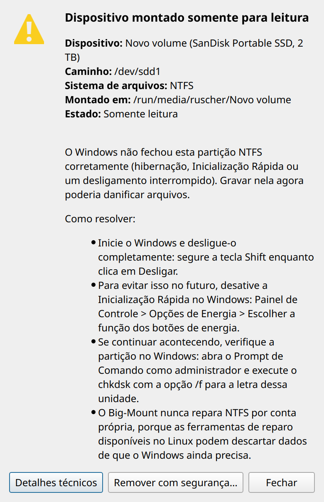
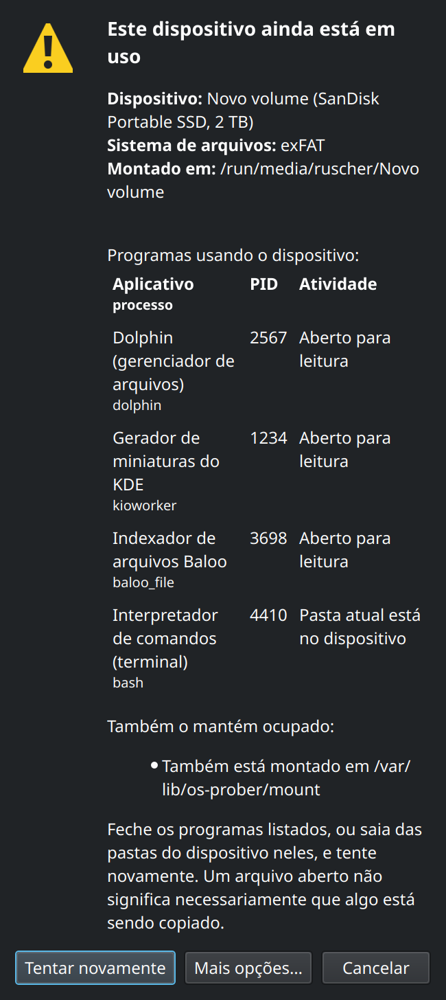

<p align="center">
  
</p>

<h1 align="center">Big-Mount</h1>

<p align="center">
  Montagem automática das partições internas no boot, diagnóstico de dispositivos
  somente leitura, identificação do que mantém um dispositivo ocupado e remoção segura.<br>
  Feito para o <a href="https://www.biglinux.com.br">BigLinux</a> (Manjaro/Arch, KDE Plasma 6), funciona também no GNOME e sem interface gráfica.
</p>

---

## Sumário

1. [O que o Big-Mount faz](#1-o-que-o-big-mount-faz)
2. [Instalação](#2-instalação)
3. [Uso rápido](#3-uso-rápido)
4. [Montagem automática no boot](#4-montagem-automática-no-boot)
5. [Por que não consigo gravar? (somente leitura)](#5-por-que-não-consigo-gravar-somente-leitura)
6. [Dispositivo ocupado e remoção segura](#6-dispositivo-ocupado-e-remoção-segura)
7. [Integração com o desktop](#7-integração-com-o-desktop)
8. [Referência completa de comandos](#8-referência-completa-de-comandos)
9. [Configuração](#9-configuração)
10. [Arquivos instalados](#10-arquivos-instalados)
11. [Segurança e privilégios](#11-segurança-e-privilégios)
12. [Solução de problemas](#12-solução-de-problemas)
13. [Desenvolvimento](#13-desenvolvimento)
14. [Desempenho](#14-desempenho)
15. [Limitações conhecidas](#15-limitações-conhecidas)
16. [Licença](#16-licença)

---

## 1. O que o Big-Mount faz

| Parte | Quando roda | Como quem | O que faz |
|---|---|---|---|
| **Montagem automática** (`bigmount`) | a cada boot, pelo `big-mount.service` | root | monta as partições dos **discos internos** em `/mnt/<rótulo>` para que fiquem sempre disponíveis (dados, Windows, outras instalações Linux) |
| **Diagnóstico** (`bigmount --diagnose`, `--gui`) | quando você pede | você | explica por que um dispositivo não aceita gravação e oferece a correção quando ela é segura |
| **Dispositivo ocupado** (`bigmount --busy`) | quando você pede | você | mostra quais programas, ou outros bloqueios, impedem a desmontagem |
| **Remoção segura** (`--unmount`, `--safe-remove`, `--gui-remove`) | quando você pede | você | desmonta e desliga a unidade pelo UDisks2, sem forçar nada |
| **Notificador** (`bigmount --notifier`) | ao entrar na sessão | você | avisa, uma vez por boot, quando um dispositivo foi montado somente para leitura e diz o motivo |

Princípios do projeto, nesta ordem: **integridade dos dados**, estabilidade e
compatibilidade, funcionamento correto, segurança, desempenho e experiência
do usuário. Por isso o Big-Mount **nunca**:

- repara sistemas de arquivos sozinho (`fsck`, `ntfsfix`, `btrfs check --repair`);
- força desmontagens (`umount -f`, `umount -l`) ou mata processos (`kill -9`, `fuser -k`);
- muda permissões em massa (`chmod -R`, `chown -R`);
- toca em partições listadas no `/etc/fstab`;
- monta dispositivos removíveis, que ficam com o UDisks/Plasma;
- abre janelas como root.

---

## 2. Instalação

### 2.1 Pelo repositório do BigLinux (recomendado)

O Big-Mount já vem instalado no BigLinux. Para instalar ou atualizar:

```bash
sudo pacman -Syu big-mount
```

Na **primeira** instalação, o hook do pacman habilita o serviço
(`systemctl enable big-mount`). Atualizações não reiniciam o serviço; a
versão nova passa a valer no próximo boot.

### 2.2 A partir deste repositório (versão em desenvolvimento)

O `pkgbuild/PKGBUILD` oficial baixa o código de
`https://github.com/biglinux/big-mount`. Para empacotar **o seu checkout**
sem alterar esse arquivo, gere um PKGBUILD temporário fora do repositório:

```bash
git clone https://github.com/ruscher/big-mount.git
cd big-mount
git checkout feature/bigmount-ng            # ou a branch que você quer testar

mkdir -p ~/build/big-mount && cd ~/build/big-mount
sed "s|^source=.*|source=(\"big-mount::git+file://$OLDPWD#branch=$(git -C "$OLDPWD" branch --show-current)\")|" \
    "$OLDPWD/pkgbuild/PKGBUILD" > PKGBUILD
makepkg -f
sudo pacman -U ./big-mount-*.pkg.tar*
```

Conferir o que foi instalado:

```bash
pacman -Qi big-mount
pacman -Ql big-mount
systemctl is-enabled big-mount
```

### 2.3 Dependências

| Pacote | Tipo | Para quê |
|---|---|---|
| `bash` ≥ 5.2 | obrigatório (base) | todos os scripts |
| `util-linux` | obrigatório | `blkid`, `lsblk`, `findmnt`, `mount`, `flock` |
| `udisks2` | obrigatório | desmontar, montar, desligar e trocar dono pelo Polkit |
| `ntfs-3g` | obrigatório | `lowntfs-3g` para NTFS |
| `lsof` | obrigatório | descobrir quem mantém um dispositivo ocupado |
| `kdialog` | opcional | janelas no KDE Plasma |
| `zenity` | opcional | janelas no GNOME e em outros desktops |
| `libnotify` | opcional | notificações (`notify-send`) |
| `polkit` | já vem com o `udisks2` | autorização; `pkexec` para a visão de administrador |

Sem `kdialog` ou `zenity`, tudo funciona no terminal.

### 2.4 Desinstalar ou desativar

```bash
# desativar só a montagem automática, mantendo o resto
sudo touch /etc/bigmountall-no

# desativar o serviço
sudo systemctl disable big-mount

# remover o pacote
sudo pacman -R big-mount
```

Remover o pacote não desmonta nada. As partições montadas continuam assim
até o próximo boot.

---

## 3. Uso rápido

```bash
bigmount --diagnose                    # visão geral de todos os dispositivos
bigmount --diagnose /dev/sdb1          # por que não consigo gravar aqui?
bigmount --diagnose ~/Pendrive/fotos   # funciona com qualquer pasta do dispositivo
bigmount --busy /run/media/$USER/HD    # o que está usando este dispositivo?
bigmount --safe-remove /dev/sdc        # desmontar tudo e desligar a unidade
bigmount --gui                         # o mesmo, em janelas
sudo bigmount --dry-run                # o que o boot montaria, sem montar nada
```

No Dolphin: botão direito numa pasta → **Dispositivo de armazenamento** →
**Por que não consigo gravar aqui?** ou **Remover com segurança**.

No menu de aplicativos: **Diagnóstico de Armazenamento**.

---

## 4. Montagem automática no boot

### 4.1 Sequência

```
big-mount.service (Type=oneshot, After=local-fs.target, KillMode=process)
└─ /usr/bin/bigmount
   1. sai se /etc/bigmountall-no existir
   2. trava /run/lock/big-mount.lock (flock), para não haver duas execuções juntas
   3. cria os links de compatibilidade /media -> /mnt e /mnt/user-mount -> /run/media
   4. descobre o último usuário (SDDM, LightDM ou o primeiro UID >= 1000) e lê /etc/big-mount.conf
   5. tira uma "fotografia" do sistema, uma vez:
        diskseq de cada disco, blkid, lsblk -P, /proc/mounts
   6. passo 1: descarta o que não é sistema de arquivos, o que é virtual e o que já está montado
   7. consulta o udev para todos os candidatos com uma única chamada (udevadm info)
      e espera o udev UMA vez (udevadm settle) se algum ainda não foi processado
   8. passo 2, para cada candidato, na ordem do blkid:
        ignorado pelo UDisks? externo? listado no fstab? -> não monta
        escolhe /mnt/<rótulo>, confere o diskseq, monta, lê o estado real
   9. grava /run/big-mount/status para o notificador e o diagnóstico
```

Na máquina de desenvolvimento a execução leva cerca de **37 ms** e cria **27
processos**. Detalhes na seção [Desempenho](#14-desempenho).

### 4.2 O que nunca é montado

| Caso | Motivo |
|---|---|
| partição no `/etc/fstab` (inclusive `noauto`) | configuração explícita do administrador sempre vence |
| já montada | evita montagem dupla |
| `swap`, `squashfs` | não são dados do usuário |
| `crypto_LUKS`, `BitLocker`, `LVM2_member`, membros de RAID/ZFS/bcache, sem `TYPE` | são contêineres, não sistemas de arquivos |
| `loop*`, `zram*`, `ram*`, `/dev/mapper/*`, `dm-*` | dispositivos virtuais, configurados por quem os usa |
| `UDISKS_IGNORE=1` | ESP, MSR, recuperação do Windows (a mesma informação que o UDisks chama de `HintIgnore`) |
| dispositivo **externo** | fica com o UDisks/Plasma (veja abaixo) |
| udev ainda sem informação depois da espera | sem dados, não há como saber se é externo |
| `diskseq` mudou durante a varredura | o disco foi trocado; a decisão não vale mais |

### 4.3 Como um dispositivo é reconhecido como externo

Muitos HDs e SSDs USB informam `RM=0` ("não removível"). Por isso a decisão
combina **fontes independentes**: basta uma delas para o dispositivo ficar com o
UDisks.

| Fonte | Fato | Exemplos cobertos |
|---|---|---|
| kernel (sysfs) | `/sys/block/X/removable = 1` | pendrives, leitores de cartão |
| kernel (`lsblk TRAN`) | `usb`, `ieee1394`, `sbp` | HD/SSD USB com `RM=0`, docks, FireWire |
| kernel (`lsblk HOTPLUG`) | porta marcada removível | USB, NVMe em gabinete Thunderbolt/USB4 |
| kernel (sysfs) | `device/type = SD` | cartão SD em leitor interno (`MMC` é eMMC soldado: interno) |
| udev | `ID_BUS=usb`/`ieee1394`, `ID_PATH` contendo `-usb-` | a mesma informação, vista pelo udev |
| udev | `ID_DRIVE_FLASH_SD=1`, `ID_DRIVE_MEDIA_FLASH_SD=1` | cartões SD |
| udev | `UDISKS_SYSTEM=0` | regra do administrador, por exemplo para baias eSATA ([9.3](#93-baias-esata-e-outros-casos-especiais)) |

Para ver a decisão para cada dispositivo (trecho da saída na máquina de desenvolvimento):

```console
$ sudo bigmount --dry-run
/dev/nvme0n1p1: skipped, hidden by udev/UDisks (UDISKS_IGNORE)
/dev/nvme0n1p2: skipped, listed in /etc/fstab
/dev/sdd1: left to UDisks, external device (transport=usb hotplug ID_BUS=usb ID_PATH=usb)
dry-run: mkdir -p /mnt/Basic_data_partition
dry-run: mount -t lowntfs-3g -o uid=1000,gid=1007,rw,noatime,exec,umask=000,nodev,nofail,x-gvfs-show /dev/sdb3 /mnt/Basic_data_partition
/dev/sdb3: would be mounted ntfs on /mnt/Basic_data_partition (rw)
/dev/sdb1: skipped, hidden by udev/UDisks (UDISKS_IGNORE)
dry-run: mkdir -p /mnt/Dados
dry-run: mount -o noatime,rw,nodev,nofail,x-gvfs-show /dev/sda1 /mnt/Dados
/dev/sda1: would be mounted btrfs on /mnt/Dados (rw)
```

`--dry-run` não cria diretórios, não monta e não grava o arquivo de estado.
Pode rodar como usuário comum, mas como root o `blkid` vê todas as
partições.

### 4.4 Nome do ponto de montagem

1. `LABEL` do sistema de arquivos; sem ele, `PARTLABEL` (nome da partição
   GPT); sem os dois, o nome do dispositivo (`sdb3`).
2. Espaços e `/` viram `_`; caracteres de controle viram `_`. Acentos e
   Unicode são mantidos (`Fotos Família` → `/mnt/Fotos_Família`).
3. `.` e `..` são rejeitados, porque `..` montaria sobre `/`. Rótulos acima
   de 200 bytes também. Nos dois casos, usa o nome do dispositivo.
4. Se `/mnt/<nome>` está ocupado por **outro** dispositivo, acrescenta um
   número: `Dados1`, `Dados2`... Diretórios vazios e links obsoletos são
   reaproveitados.
5. Cria o link `/mnt/<dispositivo>` → `/mnt/<rótulo>` (`/mnt/sda1` →
   `/mnt/Dados`). Um link antigo que aponta para outro lugar, por exemplo
   depois que os discos trocaram de ordem, é atualizado. Um diretório ou
   arquivo real nesse caminho nunca é tocado.

O rótulo vem do dispositivo e não é confiável: nunca passa por `eval`, por
`echo` nem por um shell.

### 4.5 Opções de montagem

| Sistema de arquivos | Comando |
|---|---|
| NTFS | `mount -t lowntfs-3g -o uid=U,gid=G,rw,noatime,exec,MASK,nodev,nofail,x-gvfs-show` |
| FAT32, exFAT (`TYPE` contendo `fat`) | `mount -o uid=U,gid=G,noatime,rw,MASK,nodev,nofail,x-gvfs-show` |
| ext4, Btrfs, XFS, F2FS e outros | `mount -o noatime,rw,nodev,nofail,x-gvfs-show` |

- `U`/`G`: UID e GID do último usuário que entrou na sessão.
- `MASK`: `umask=000` por padrão; veja [`PERMISSIONS`](#91-etcbig-mountconf).
- `x-gvfs-show`: faz a partição aparecer no Dolphin e no Nautilus.
- Em ext4/Btrfs/XFS valem as permissões do próprio sistema de arquivos.

### 4.6 NTFS do Windows

- **Sem `ntfsfix`.** Versões antigas rodavam o `ntfsfix` em todo boot. Ele
  marca o volume como "precisa de verificação" (dirty bit): o Windows então
  roda o chkdsk a cada inicialização, e drivers como o `ntfs3` recusam
  gravar. O próprio ntfs-3g já recupera o journal quando necessário.
- **Windows hibernado ou com Inicialização Rápida:** o ntfs-3g monta somente
  leitura por conta própria. O Big-Mount lê o estado real em `/proc/mounts`,
  registra o motivo e o notificador avisa você. Versões do ntfs-3g que
  recusam a montagem (códigos 13, 14 e 15 de `ntfs-3g.probe(8)`) são
  tentadas de novo em `ro`. A opção `remove_hiberfile`, que apagaria a sessão
  do Windows, nunca é usada.
- Para voltar a gravar, desligue o Windows completamente: Shift + Desligar,
  ou desative a Inicialização Rápida.

### 4.7 Arquivo de estado

`/run/big-mount/status` (root, 0644, apagado a cada boot). Uma linha por
montagem feita no boot, com campos separados por TAB:

```
# big-mount status v1: DEVICE UUID MOUNTPOINT STATE REASON
/dev/sda1	12a560b3-...	/mnt/Dados	rw	-
/dev/sdb3	BE0256040255C1D7	/mnt/Basic_data_partition	ro	ntfs-readonly
/dev/sdc5	-	/mnt/Velho	failed	mount-exit-32
```

| `STATE` | `REASON` possíveis |
|---|---|
| `rw` | `-` |
| `ro` | `ntfs-readonly`, `ntfs-hibernated`, `ntfs-inconsistent`, `ntfs-unclean`, `readonly-fallback` |
| `failed` | os mesmos de NTFS, ou `mount-exit-N` |

### 4.8 Logs

```bash
journalctl -b -u big-mount            # o que aconteceu neste boot
journalctl -b -u big-mount -p warning # só avisos e erros
systemd-analyze blame | grep big-mount
```

Exemplos de mensagens:

```
/dev/sda1: mounted btrfs on /mnt/Dados (rw)
/dev/sdd1: left to UDisks, external device (transport=usb hotplug ID_BUS=usb ID_PATH=usb)
/dev/sdb3: the driver mounted ntfs read-only on its own (ntfs-readonly)        [aviso]
/dev/sdc5: mount of ext4 on /mnt/Velho failed (exit 32)                         [erro]
waiting for udev to finish processing /dev/sde1
```

### 4.9 Serviço systemd

```ini
[Unit]
Description=BigLinux automount internal partitions
After=local-fs.target
RequiresMountsFor=/mnt

[Service]
Type=oneshot
RemainAfterExit=yes
ExecStart=/usr/bin/bigmount
KillMode=process
```

`KillMode=process` é essencial: o daemon FUSE do NTFS (`mount.lowntfs-3g`)
nasce dentro do serviço. Com o padrão `control-group`, um `systemctl restart
big-mount` o matava, e o volume sumia debaixo dos programas que o usavam. O
serviço não fica residente: o script termina em milissegundos.

---

## 5. Por que não consigo gravar? (somente leitura)

```bash
bigmount --diagnose /dev/sdX1       # ou qualquer pasta dentro do dispositivo
bigmount --gui /dev/sdX1            # em janela
```

<p align="center">
  
</p>

### 5.1 Causas identificadas

| Caso | O que significa | Como é detectado | Correção oferecida |
|---|---|---|---|
| **ok** | leitura e gravação | montado `rw` e o seu usuário tem permissão de gravação (`access(2)`) | — |
| **A** montado somente leitura | alguém montou com `ro`, sem problema aparente | opção `ro`, nenhuma outra causa | **Montar novamente com gravação**, só para montagens do UDisks e nunca para entradas do fstab |
| **B** sem permissão | montado com gravação, mas a pasta principal é de outro usuário (comum em ext4/Btrfs/XFS formatados como root) | rw + sem permissão; dono via `stat` | **Tornar-me proprietário da pasta principal** (UDisks `TakeOwnership`, não recursivo, com Polkit) |
| **B** partição com sistema operacional | outra instalação Linux ou o disco do Windows | `etc/os-release`, subvolumes Btrfs `@`, `Windows/System32`... | nenhuma: as pastas de um sistema precisam manter os donos |
| **B** montado para outro usuário | FAT/NTFS com `uid=` de outra conta | opção `uid=` | **Montar novamente para o meu usuário** (só montagens do UDisks) |
| **C** erro no sistema de arquivos | o kernel parou de gravar para proteger os dados | `/sys/fs/ext4/*/errors_count`, mensagens do kernel ("Remounting filesystem read-only", "forced readonly") | nenhuma: copie os dados e verifique o disco desmontado |
| **D** NTFS inseguro | hibernação, Inicialização Rápida, desligamento incompleto | NTFS montado `ro`; motivo vindo do arquivo de estado ou do journal do ntfs-3g | nenhuma: exige o Windows |
| **E** protegido fisicamente | trava do cartão SD, mídia protegida | `/sys/block/*/ro = 1` | nenhuma: mova a trava |
| **F** hardware | erros de leitura/gravação, cabo, porta | mensagens `I/O error` do kernel | nenhuma: copie os dados, troque o cabo |
| **G** sem suporte de escrita | CD/DVD, ISO, SquashFS, HFS+ com journal, APFS, driver `ntfs` legado | tipo do sistema de arquivos montado | nenhuma |

O botão **Tentar corrigir** só aparece quando existe uma correção segura e
verificável para a causa encontrada. Toda correção pede confirmação, é
conferida depois e, se falhar, o Big-Mount informa que nada foi alterado.

Mesmo quando o dispositivo está gravável, o diagnóstico avisa se o sistema
de arquivos registrou erros (por exemplo `errors_count` > 0 no ext4).

### 5.2 Exemplo no terminal

```console
$ bigmount --diagnose /mnt/root
== Sem permissão para gravar ==
Dispositivo: sdc2 (KINGSTON SA400S37480G, 479 GB)
Caminho: /dev/sdc2
Sistema de arquivos: Btrfs
Montado em: /mnt/root
Estado: Gravável, mas não pelo seu usuário
Esta partição contém um sistema operacional. As pastas dela pertencem a esse sistema e precisam manter os seus proprietários.

Como resolver:

  - Salve seus arquivos em uma pasta que pertença a você, por exemplo a sua pasta pessoal nesse sistema.

Detalhes técnicos:
  device:      /dev/sdc2 (sdc2), disk /dev/sdc
  transport:   sata  removable=0 hotplug=0 ro(part)=0 ro(disk)=0
  filesystem:  btrfs  label='' uuid=e1ee0ad7-...
  mount:       /mnt/root type=btrfs vfs=rw,nodev,noatime fs=rw,ssd,...,subvolid=5,subvol=/
  diagnosis:   permission (root directory root:root 755)
```

### 5.3 Visão geral e autodiagnóstico

Trecho da saída na máquina de desenvolvimento:

```console
$ bigmount --diagnose
Dispositivos de armazenamento

  DISPOSITIVO      RÓTULO             TAMANHO SA      GERENCIADO POR MONTADO EM                     ESTADO
  /dev/sda1        Dados                 1 TB btrfs   big-mount      /mnt/Dados                     leitura e gravação
  /dev/sdb3        -                   479 GB ntfs    big-mount      /mnt/Basic_data_partition      leitura e gravação
  /dev/sdc2        -                   479 GB btrfs   big-mount      /mnt/root                      sem permissão de gravação
  /dev/sdd1        Novo volume           2 TB ntfs    fstab          /run/media/ruscher/Novo volume leitura e gravação
  /dev/nvme0n1p2   -                   999 GB btrfs   sistema        /home                          em uso pelo sistema

Ambiente
  big-mount.service            enabled
  UDisks2                      disponível
  lsof                         instalado
  kdialog                      instalado
  notify-send                  instalado
  log do kernel                acessível
```

"Gerenciado por" diz quem montou: `big-mount`, `fstab`, `UDisks` (Plasma ou
Dolphin), `sistema` (`/`, `/home`, `/boot`...) ou `outro`.

---

## 6. Dispositivo ocupado e remoção segura

### 6.1 Ver o que está usando o dispositivo

```bash
bigmount --busy /run/media/$USER/HD
```

Exemplo ilustrativo (os processos reais são coletados na hora):

```console
== Este dispositivo ainda está em uso ==
Dispositivo: Novo volume (SanDisk Portable SSD, 2 TB)
Sistema de arquivos: exFAT
Montado em: /run/media/ruscher/Novo volume
Programas usando o dispositivo:
  Aplicativo  |  processo  |  PID  |  Atividade
  Dolphin (gerenciador de arquivos)  |  dolphin  |  2567  |  Aberto para leitura
  Gerador de miniaturas do KDE  |  kioworker  |  1234  |  Aberto para leitura
  Interpretador de comandos (terminal)  |  bash  |  4410  |  Pasta atual está no dispositivo
Também o mantém ocupado:
  - Também está montado em /var/lib/os-prober/mount
```

<p align="center">
  
</p>

O que é verificado:

| Tipo | Fonte |
|---|---|
| processos com arquivos abertos, pasta atual, programa ou biblioteca no dispositivo | `lsof -F` (saída estruturada por campos) e `/proc/PID` |
| a mesma partição montada em outro lugar (por exemplo sobras do os-prober) | `findmnt --source` |
| outro dispositivo montado dentro dele | `findmnt -R` |
| arquivo de swap no dispositivo, ou a própria partição como swap | `/proc/swaps` |
| imagem de disco guardada nele e ligada a um loop | `/sys/block/loop*/loop/backing_file` |
| criptografia, LVM ou RAID em cima da partição | `/sys/class/block/*/holders` |

Nomes amigáveis são mostrados para Dolphin, kioworker (miniaturas, lixeira,
arquivos), Baloo, Tracker, terminais e shells, players, visualizadores,
editores, navegadores, cópia/compactação, sincronização (Nextcloud,
Syncthing, Dropbox...) e backup. Um arquivo aberto **não** significa que algo
está sendo copiado. Por isso não há porcentagem, velocidade ou tempo
restante.

**Por que o Plasma às vezes só diz "um ou mais arquivos estão abertos"?** O
applet do Plasma roda `lsof` como você e só enxerga os seus processos. A
mensagem genérica aparece quando o responsável é invisível para ele: um
processo de root ou de outro usuário, ou um bloqueio sem processo (segunda
montagem, swap, loop). O Big-Mount mostra esses casos e oferece **Mostrar
programas de todos os usuários (administrador)**.

### 6.2 Desmontar e remover

```bash
bigmount --unmount /dev/sdc1              # só este sistema de arquivos
bigmount --safe-remove /dev/sdc           # todas as partições da unidade e desliga
bigmount --safe-remove /dev/sdc --no-power-off
bigmount --unmount /dev/sdc1 --close-apps # oferece fechar os programas que o ocupam
bigmount --gui-remove /run/media/$USER/HD # em janela (também no menu do Dolphin)
```

Sequência:

1. **Diagnóstico**: resolve o dispositivo e a unidade. **Recusa** se a
   unidade contém o sistema em execução (`/`, `/home`, `/boot`, `/boot/efi`,
   `/usr`, `/var`... ou swap ativa).
2. **Tentativa normal**: `udisksctl unmount` em cada montagem de cada
   partição (camadas empilhadas primeiro). Senha, quando necessária, é
   pedida pelo Polkit.
3. **Ocupado** (`org.freedesktop.UDisks2.Error.DeviceBusy`): mostra quem
   ocupa e permite **Tentar novamente**, **Atualizar a lista**, **Mostrar
   detalhes técnicos**, **Fechar os programas listados…** e **Mostrar
   programas de todos os usuários**.
4. **Verificação**: o sucesso só é declarado quando o `findmnt` confirma que
   não resta nenhuma montagem.
5. **Desligamento**: `udisksctl power-off`, só para unidades removíveis e só
   quando nada mais (LUKS aberto, LVM, swap) usa a unidade. Discos internos
   são apenas desmontados.

**Fechar programas** só é oferecido para processos que:

- são **seus**;
- **não** fazem parte da sessão gráfica (plasmashell, kwin, dbus,
  pipewire...);
- **não** são shells. Um terminal ignora o pedido; nesse caso a orientação é
  digitar `cd` ou fechar a aba;
- **não** têm nenhum arquivo aberto para escrita. Encerrar no meio de uma
  cópia deixaria um arquivo incompleto.

Sempre com confirmação explícita, avisando que alterações não salvas podem
ser perdidas. O sinal é só `SIGTERM` (o mesmo de fechar a janela), nunca
`SIGKILL`. Antes de enviar, o horário de início do processo é conferido,
para não atingir outro processo que tenha herdado o mesmo PID. A espera é de
até 5 segundos, e quem não fechar é informado.

Mensagens finais, mostradas só depois de verificadas:

| Resultado | Mensagem |
|---|---|
| desmontado e desligado | **Dispositivo removido com segurança** — todas as operações necessárias foram concluídas. O dispositivo está pronto para ser desconectado. |
| desmontado, a unidade não desliga pelo computador | desmontado; já pode ser desconectado |
| disco interno | dispositivo desmontado (não sugere desconectar) |
| ocupado, sem autorização ou sistema em uso | o motivo; o dispositivo continua montado e nada é forçado |

---

## 7. Integração com o desktop

| Integração | Onde | Detalhes |
|---|---|---|
| Menu de contexto do Dolphin | botão direito numa pasta → **Dispositivo de armazenamento** | **Por que não consigo gravar aqui?** (`bigmount --gui %f`) e **Remover com segurança (mostra o que o mantém ocupado)** (`bigmount --gui-remove %f`) |
| Lançador | menu de aplicativos → **Diagnóstico de Armazenamento** | escolha o dispositivo numa lista |
| Notificações | ao montar um dispositivo que não aceita gravação | ações **Ver detalhes**, **Como resolver** e, só quando há correção segura, **Tentar corrigir** |
| Janelas | KDialog (Plasma) ou Zenity (GNOME) | tema claro/escuro, HiDPI e leitor de tela vêm do próprio toolkit |

O **notificador** é iniciado pelo autostart
(`/etc/xdg/autostart/big-mount-notifier.desktop`). Ele:

- espera eventos de montagem com `findmnt --poll`: o kernel o acorda, e não
  há varredura periódica (cerca de 10 MB de memória e 0 de CPU parado);
- ao entrar na sessão, confere o que já está montado, inclusive as montagens
  do boot;
- avisa no máximo **uma vez por dispositivo e por causa a cada boot**
  (`~/.local/state/big-mount/notified`);
- ignora CDs, DVDs e imagens, que são somente leitura por natureza, e não
  repete avisos de montagem bem-sucedida, que o Plasma já mostra;
- existe uma instância por sessão (`$XDG_RUNTIME_DIR/big-mount-notifier.lock`).

Para desativar: **Configurações do Sistema → Inicialização automática**, ou

```bash
mkdir -p ~/.config/autostart
printf '[Desktop Entry]\nHidden=true\n' > ~/.config/autostart/big-mount-notifier.desktop
```

Por que não há integração direta com a mensagem de erro do Plasma: o Plasma
não oferece ponto de extensão para isso, e o `udisksd` não publica nenhum
evento quando uma desmontagem é recusada. Interceptar as notificações do
Plasma pelo texto seria frágil, por isso o Big-Mount não faz isso.

---

## 8. Referência completa de comandos

```
bigmount [OPÇÃO] [ALVO]
```

`ALVO` é um dispositivo (`/dev/sdb1`, `/dev/sdb`, `/dev/disk/by-uuid/...`) ou
**qualquer pasta** dentro de um dispositivo montado. Caminhos relativos são
aceitos; um alvo vazio é recusado.

| Comando | Precisa de root | Descrição |
|---|---|---|
| `bigmount` | sim | montagem automática (é o que o serviço executa) |
| `bigmount --dry-run` | não (recomendado como root) | mostra as decisões e os comandos, sem alterar nada |
| `bigmount --diagnose` | não | visão geral dos dispositivos e do ambiente |
| `bigmount --diagnose ALVO` | não | motivo de não gravar, correção possível, detalhes técnicos, quem está usando |
| `bigmount --busy ALVO` | não | o que mantém o dispositivo ocupado |
| `bigmount --unmount ALVO` | não (Polkit pode pedir senha) | desmonta todas as montagens desse sistema de arquivos |
| `bigmount --safe-remove ALVO` | não (Polkit) | desmonta todas as partições da unidade e a desliga, se for removível |
| `  --no-power-off` | — | com `--safe-remove`: desmonta tudo, mas não desliga |
| `  --close-apps` | — | com `--unmount`/`--safe-remove`: oferece fechar os programas elegíveis |
| `  --assume-yes` | — | com `--close-apps`: não pergunta (para scripts) |
| `bigmount --gui [ALVO]` | não | diagnóstico em janela; sem alvo, mostra uma lista |
| `bigmount --gui-remove ALVO` | não | remoção segura em janela |
| `bigmount --notifier` | não | notificador da sessão (iniciado pelo autostart) |
| `bigmount -h`, `--help` | não | ajuda |

Códigos de saída:

| Código | Significado |
|---|---|
| 0 | concluído (ou dispositivo ok, no `--diagnose`) |
| 1 | erro; no `--diagnose ALVO`, o dispositivo não aceita gravação |
| 2 | uso incorreto (opção desconhecida, alvo vazio) |
| 3 | dispositivo ocupado |
| 4 | recusado: a unidade contém o sistema em execução |
| 5 | autorização negada ou cancelada |
| 6 | desmontado, mas a unidade ainda está em uso (LUKS/LVM/RAID); não foi desligada |
| 7 | desmontado, mas a unidade não pôde ser desligada pelo computador |

Exemplo em script:

```bash
if bigmount --safe-remove /dev/sdc; then
    echo "pode desconectar"
else
    case $? in
        3) bigmount --busy /dev/sdc ;;
        4) echo "esse é o disco do sistema" ;;
    esac
fi
```

Idioma: as mensagens seguem o idioma da sessão (português do Brasil ou
inglês). Para forçar inglês: `LANGUAGE=en bigmount --diagnose`.

---

## 9. Configuração

### 9.1 `/etc/big-mount.conf`

```ini
# Quem pode gravar nas partições INTERNAS FAT, exFAT e NTFS montadas em /mnt
PERMISSIONS=shared
```

| Valor | Opções de montagem | Efeito |
|---|---|---|
| `shared` (padrão) | `umask=000` | todas as contas locais leem, gravam e executam; é o comportamento de todas as versões anteriores |
| `owner` | `dmask=022,fmask=022` | só o último usuário que entrou grava; todos leem (a execução continua permitida, para Wine/Steam) |
| `private` | `umask=077` | só o último usuário acessa |

- Vale para FAT/exFAT/NTFS internos. ext4, Btrfs, XFS etc. mantêm as próprias
  permissões.
- O arquivo é lido como dados, nunca executado. Um valor desconhecido gera
  um aviso no journal e usa `shared`.
- É preservado nas atualizações do pacote (`backup=` no PKGBUILD).
- Aplicar sem reiniciar o computador: `sudo systemctl restart big-mount`.
  Partições já montadas mantêm as opções até serem montadas de novo.

### 9.2 Desativar a montagem automática

```bash
sudo touch /etc/bigmountall-no      # desativa
sudo rm /etc/bigmountall-no         # reativa
```

### 9.3 Baias eSATA e outros casos especiais

O kernel não marca portas eSATA como removíveis. Para o Big-Mount (e o
UDisks) tratarem um disco eSATA como externo, crie uma regra udev:

```bash
# descubra o caminho do disco
udevadm info --query=property --name=/dev/sdX | grep ID_PATH=

sudo tee /etc/udev/rules.d/99-esata.rules <<'EOF'
ENV{ID_PATH}=="pci-0000:00:17.0-ata-5*", ENV{UDISKS_SYSTEM}="0"
EOF
sudo udevadm control --reload && sudo udevadm trigger
```

Para **impedir** que uma partição interna seja montada, há duas opções:
coloque-a no `/etc/fstab` com `noauto`, ou esconda-a de vez com
`ENV{UDISKS_IGNORE}="1"`.

Para montar uma partição em outro lugar ou com outras opções, coloque-a no
`/etc/fstab`. O Big-Mount nunca toca em partições listadas lá.

---

## 10. Arquivos instalados

| Caminho | Função |
|---|---|
| `/usr/bin/bigmount` | montagem automática e ponto de entrada de todos os comandos |
| `/usr/lib/big-mount/lib.sh` | fatos dos dispositivos, diagnóstico, bloqueios, fechamento de programas, UDisks |
| `/usr/lib/big-mount/ui.sh` | janelas (KDialog/Zenity/terminal) e notificações |
| `/usr/lib/big-mount/cli.sh` | comandos, textos, fluxos gráficos e notificador |
| `/usr/lib/big-mount/bigmount-holders` | auxiliar privilegiado, somente leitura (via `pkexec`) |
| `/usr/lib/systemd/system/big-mount.service` | serviço do boot |
| `/usr/share/libalpm/hooks/big-mount.hook` | habilita o serviço na primeira instalação |
| `/etc/big-mount.conf` | configuração ([9.1](#91-etcbig-mountconf)) |
| `/etc/xdg/autostart/big-mount-notifier.desktop` | inicia o notificador na sessão |
| `/usr/share/applications/big-mount.desktop` | lançador "Diagnóstico de Armazenamento" |
| `/usr/share/kio/servicemenus/big-mount.desktop` | menu de contexto do Dolphin |
| `/usr/share/polkit-1/actions/org.biglinux.big-mount.policy` | ação Polkit do auxiliar privilegiado |
| `/usr/share/icons/hicolor/scalable/apps/big-mount.svg` | ícone |
| `/usr/share/locale/pt_BR/LC_MESSAGES/big-mount.mo` | tradução |

Arquivos criados durante o uso:

| Caminho | Quem cria | Conteúdo |
|---|---|---|
| `/mnt/<rótulo>`, `/mnt/<dispositivo>` | serviço | pontos de montagem e links |
| `/media` → `/mnt`, `/mnt/user-mount` → `/run/media` | serviço | links de compatibilidade |
| `/run/big-mount/status` | serviço | estado das montagens do boot |
| `/run/lock/big-mount.lock` | serviço | trava contra execução simultânea |
| `~/.local/state/big-mount/notified` | notificador | avisos já mostrados neste boot |

---

## 11. Segurança e privilégios

```
boot (root)                            sessão do usuário (nunca root)
big-mount.service ── escreve ──▶  /run/big-mount/status ── lê ──▶  bigmount --notifier
                                                                     ├─ notify-send (D-Bus da sessão)
                                                                     └─ KDialog / Zenity

ações do usuário ── udisksctl/D-Bus ──▶ UDisks2 ── Polkit decide (senha, se preciso)
"programas de todos os usuários" ── pkexec ──▶ /usr/lib/big-mount/bigmount-holders (somente leitura)
```

- **Root** só executa o boot e o auxiliar `bigmount-holders`. O auxiliar
  aceita um único argumento, que precisa ser o ponto de montagem exato de um
  dispositivo de bloco local, e só imprime a lista de processos. Ele tem uma
  ação Polkit própria (`org.biglinux.big-mount.inspect-processes`,
  `auth_admin_keep`), então autorizá-lo não dá acesso a nenhum outro modo
  como root.
- **Montar, desmontar, desligar e trocar dono** passam pelo UDisks2, e quem
  decide é a política Polkit do próprio UDisks. O Big-Mount não amplia
  nenhuma permissão.
- **Dados de outros usuários**: como usuário, o `lsof` só vê os seus
  processos. Os de outras contas só aparecem com senha de administrador.
- **Dados não confiáveis** (rótulos, nomes de arquivos e de processos) nunca
  passam por `eval` nem por um shell. Eles são escapados para HTML/Pango nas
  janelas e livres de sequências de escape no terminal. Os catálogos de
  tradução são carregados com `noexpand_translation`.
- **Corridas**: `flock` no boot; `diskseq` entre a varredura e a montagem;
  horário de início do processo antes de enviar `SIGTERM`.
- O código distribuído é verificado por um teste que procura comandos
  proibidos (`ntfsfix`, `mkfs`, `fsck`, `umount -f/-l`, `kill -9`, `fuser -k`,
  `chmod -R`, `chown -R`, `remove_hiberfile`, `--force`).

---

## 12. Solução de problemas

**Meu HD USB aparece em `/mnt` em vez de aparecer no Dolphin como removível.**
Veja a decisão com `sudo bigmount --dry-run`. Se o disco não aparecer como
"external device", mande a saída de
`lsblk -dn -o NAME,TRAN,RM,HOTPLUG /dev/sdX` e
`udevadm info --query=property --name=/dev/sdX`.

**Uma partição interna não foi montada no boot.**
`journalctl -b -u big-mount` e `cat /run/big-mount/status`. Motivos comuns:
ela está no `/etc/fstab`, está escondida (`UDISKS_IGNORE`), é um contêiner
(LUKS/LVM) ou a montagem falhou (`failed` no estado).

**A partição do Windows está somente leitura.**
`bigmount --diagnose /mnt/<nome>`. Quase sempre é hibernação ou
Inicialização Rápida: desligue o Windows com Shift + Desligar ou desative a
Inicialização Rápida.

**"O dispositivo não pode ser removido porque arquivos estão abertos".**
`bigmount --busy <pasta do dispositivo>`, ou o menu do Dolphin **Remover com
segurança**. Se nenhum programa seu aparecer, use **Mostrar programas de
todos os usuários** ou procure uma segunda montagem (por exemplo em
`/var/lib/os-prober/mount`).

**Formatei um HD em ext4 e não consigo gravar.**
A pasta principal pertence a root. Use `bigmount --gui <pasta>` → **Tornar-me
proprietário da pasta principal**.

**Não aparecem janelas, só texto.**
Instale `kdialog` (Plasma) ou `zenity` (GNOME), e confira se a variável
`WAYLAND_DISPLAY` ou `DISPLAY` existe na sessão.

**O diagnóstico diz "log do kernel inacessível".**
O seu usuário não pode ler o journal (no Arch, isso exige os grupos `wheel`,
`adm` ou `systemd-journal`). O diagnóstico funciona, com menos detalhes
sobre erros, e a opção de remontar fica desativada por falta de evidência.

---

## 13. Desenvolvimento

### 13.1 Estrutura do repositório

```
big-mount/                  árvore que o PKGBUILD copia para /
  usr/bin/bigmount          boot + entrada dos comandos
  usr/lib/big-mount/        lib.sh, ui.sh, cli.sh, bigmount-holders
  usr/lib/systemd/system/   big-mount.service
  usr/share/...             hook, desktop, service menu, polkit, ícone, locale
  etc/                      big-mount.conf, autostart
pkgbuild/PKGBUILD           empacotamento oficial (origem: biglinux/big-mount)
locale/                     big-mount.pot, pt_BR.po, update-pot.sh, compile.sh
tests/                      suítes, stubs, benchmark, fixtures
docs/                       auditoria e decisões de cada fase (01 a 11)
.github/workflows/          build do BigLinux e testes
```

O caminho de boot fica inteiro em `/usr/bin/bigmount`, sem `source`: as
bibliotecas só são carregadas pelos outros comandos.

### 13.2 Testes

```bash
bash tests/run-tests.sh new        # boot com stubs (89 cenários)
bash tests/run-tests.sh old        # o script original, como referência
bash tests/lib-tests.sh            # biblioteca: decisões, política de processos, escapes (66)
bash tests/integration.sh          # montagens REAIS com imagens descartáveis via UDisks2 (80)
BM=/usr/bin/bigmount bash tests/integration.sh   # o mesmo contra o pacote instalado
bash tests/bench.sh big-mount/usr/bin/bigmount 20  # desempenho do boot
```

- `run-tests.sh` e `bench.sh` nunca tocam em disco: todos os comandos de
  disco são stubs, e os scripts **abortam** se `mount`, `ntfsfix`, `blkid`
  etc. não resolverem para os stubs (por exemplo num checkout em partição
  `noexec`).
- `integration.sh` precisa de uma sessão local ativa (o Polkit permite criar
  loop devices sem senha), roda como usuário comum, só usa imagens em
  `/tmp` e desfaz tudo ao sair. Ele cobre os casos A–G, dispositivo
  ocupado, fechamento de programas, remoção segura, recusa do sistema,
  fluxos gráficos com cliques simulados e o notificador.

Qualidade:

```bash
shellcheck -x -P big-mount/usr/lib/big-mount:tests \
    big-mount/usr/bin/bigmount big-mount/usr/lib/big-mount/*.sh \
    big-mount/usr/lib/big-mount/bigmount-holders tests/*.sh tests/stubs/*
for f in big-mount/usr/bin/bigmount big-mount/usr/lib/big-mount/*.sh; do bash -n "$f"; done
```

O workflow `.github/workflows/tests.yml` roda sintaxe, shellcheck, a
compilação da tradução e as suítes com stubs em cada pull request.

### 13.3 Traduções

Os textos ficam em inglês no código, no formato `$"..."`, como nos outros
scripts do BigLinux.

```bash
bash locale/update-pot.sh     # extrai os textos para locale/big-mount.pot e atualiza os .po
# edite locale/pt_BR.po (ou crie locale/<idioma>.po a partir do .pot)
bash locale/compile.sh        # gera big-mount/usr/share/locale/<idioma>/LC_MESSAGES/big-mount.mo
```

Use `printf` com `%s` para dados variáveis. Não coloque `$` nem aspas
escapadas dentro de `$"..."`.

### 13.4 Empacotamento e o fork

`ruscher/big-mount` é o fork de desenvolvimento de `biglinux/big-mount`. O
`PKGBUILD` sempre baixa o repositório **oficial**, então os pacotes do
BigLinux só mudam quando as alterações chegam lá. Para testar uma branch,
use a [seção 2.2](#22-a-partir-deste-repositório-versão-em-desenvolvimento).

Atenção: o workflow `build-package.yml` pede ao serviço de build do BigLinux
que construa o pacote a **cada push, em qualquer branch**. Para enviar uma
branch sem disparar esse build, inclua `[skip ci]` na mensagem do último
commit.

### 13.5 Documentação técnica

| Documento | Conteúdo |
|---|---|
| [`docs/01-auditoria.md`](docs/01-auditoria.md) | auditoria da versão anterior: problemas, evidências, severidade |
| [`docs/02-deteccao-dispositivos.md`](docs/02-deteccao-dispositivos.md) | interno × externo |
| [`docs/03-sistemas-arquivos.md`](docs/03-sistemas-arquivos.md) | opções, NTFS, decisões de driver e permissões |
| [`docs/04-modo-somente-leitura.md`](docs/04-modo-somente-leitura.md) | árvore de decisão A–G |
| [`docs/05-diagnostico-processos.md`](docs/05-diagnostico-processos.md) | dispositivo ocupado, Plasma e Dolphin |
| [`docs/06-desmontagem-segura.md`](docs/06-desmontagem-segura.md) | sequência e política de fechamento |
| [`docs/07-integracao-kde.md`](docs/07-integracao-kde.md) | fronteira de privilégio, notificações, janelas |
| [`docs/08-performance.md`](docs/08-performance.md) | medições |
| [`docs/09-testes.md`](docs/09-testes.md) | suítes, cobertura, validação manual pendente |
| [`docs/10-seguranca.md`](docs/10-seguranca.md) | modelo de segurança |
| [`docs/11-relatorio-final.md`](docs/11-relatorio-final.md) | resumo das mudanças |

---

## 14. Desempenho

Medido com `tests/bench.sh`: dispositivos reais, `mount` simulado,
`/proc/mounts` vazio como no boot, 20 a 30 execuções, 9 partições, as mesmas
3 montagens nas duas versões.

| Métrica (mediana) | Versão anterior | Atual |
|---|---|---|
| Tempo | 127 ms | 37–40 ms |
| CPU | 129 ms | 38–42 ms |
| Processos criados | 194 | 27 |
| Chamadas a `ntfsfix` | 1 | 0 |
| Clientes D-Bus (`udisksctl`) | 10 | 0 |

No boot real a diferença tende a ser maior, porque a versão anterior
ativava o `udisksd` pelo D-Bus (o `systemd-analyze blame` registrou 1,019 s
para o serviço antigo). O diagnóstico (`lsof`, `journalctl`) nunca roda
durante o boot.

---

## 15. Limitações conhecidas

- O Plasma não permite acrescentar ações à própria mensagem de falha de
  desmontagem. O diagnóstico fica no menu do Dolphin, no lançador e na linha
  de comando.
- Fechar programas usa `SIGTERM`: programas que não tratam esse sinal podem
  perder alterações não salvas. Por isso a confirmação avisa, e por isso
  programas que estão gravando nunca entram na lista.
- Como usuário, só os seus processos aparecem. Os demais exigem senha de
  administrador.
- Dispositivos `/dev/mapper` (LUKS/LVM abertos) não são montados no boot.
  Use o `/etc/fstab` com `/etc/crypttab`.
- Btrfs com subvolumes aninhados: processos dentro de outro subvolume podem
  não aparecer no `lsof` do ponto de montagem.
- Ainda dependem de validação em hardware real: eSATA, NVMe Thunderbolt,
  leitor SD interno, power-off de HD USB, aparência no Breeze com HiDPI e
  leitor de tela, edição GNOME (lista em [`docs/09-testes.md`](docs/09-testes.md)).

---

## 16. Licença

[GNU General Public License v3.0](LICENSE).
