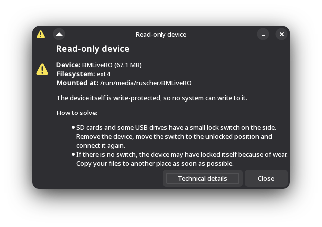
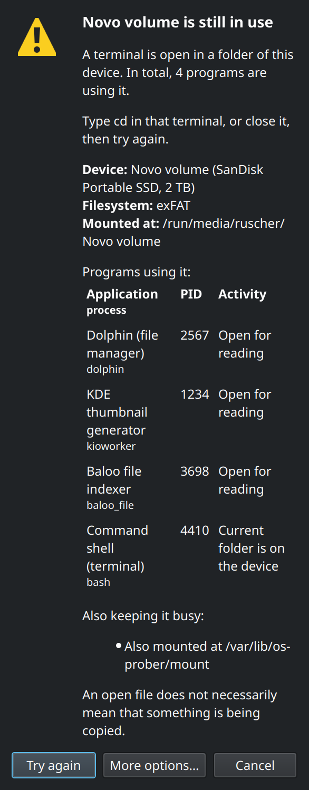

<p align="center">
  
</p>

<h1 align="center">Big-Mount</h1>

<p align="center">
  Automatic mounting of internal partitions at boot, diagnosis of read-only
  devices, what keeps a device busy, and safe removal.<br>
  Made for <a href="https://www.biglinux.com.br">BigLinux</a> (Manjaro/Arch, KDE Plasma 6, Wayland).
  It also works on GNOME and without any graphical session.
</p>

---

## Contents

1. [What Big-Mount does](#1-what-big-mount-does)
2. [Installation](#2-installation)
3. [Quick start](#3-quick-start)
4. [Automatic mounting at boot](#4-automatic-mounting-at-boot)
5. [Why can't I write here? (read-only devices)](#5-why-cant-i-write-here-read-only-devices)
6. [Busy devices and safe removal](#6-busy-devices-and-safe-removal)
7. [Desktop integration and notifications](#7-desktop-integration-and-notifications)
8. [Command reference](#8-command-reference)
9. [Configuration](#9-configuration)
10. [Installed files](#10-installed-files)
11. [Security and privileges](#11-security-and-privileges)
12. [Troubleshooting](#12-troubleshooting)
13. [Translations](#13-translations)
14. [Development](#14-development)
15. [Performance](#15-performance)
16. [Known limitations](#16-known-limitations)
17. [License](#17-license)

---

## 1. What Big-Mount does

| Part | When it runs | As | What it does |
| --- | --- | --- | --- |
| **Automatic mounting** (`bigmount`) | at every boot, from `big-mount.service` | root | mounts the partitions of **internal disks** under `/mnt/<label>`, so they are always available (data, Windows, other Linux installs) |
| **Diagnosis** (`bigmount --diagnose`, `--gui`) | on request | you | explains why a device cannot be written to, and offers the fix when it is safe |
| **Busy device** (`bigmount --busy`) | on request | you | shows which programs, or other holders, prevent the unmount |
| **Safe removal** (`--unmount`, `--safe-remove`, `--gui-remove`) | on request | you | unmounts and powers off the drive through UDisks2, without forcing anything |
| **Notifier** (`bigmount --notifier`) | when you log in | you | tells you, once per boot, when a device was mounted read-only, and why |

The priorities of the project, in order: **data integrity**, stability and
compatibility, correctness, security, performance and user experience.
That is why Big-Mount **never**:

- repairs filesystems by itself (`fsck`, `ntfsfix`, `btrfs check --repair`);
- forces unmounts (`umount -f`, `umount -l`) or kills processes (`kill -9`, `fuser -k`);
- changes permissions recursively (`chmod -R`, `chown -R`);
- touches partitions listed in `/etc/fstab`;
- mounts removable devices, which belong to UDisks/Plasma;
- opens windows as root.

---

## 2. Installation

### 2.1 From a release (recommended for this version)

Every [release](https://github.com/ruscher/big-mount/releases) has a ready
package attached:

```bash
# download big-mount-<version>-any.pkg.tar.zst from the release page, then
sudo pacman -U ./big-mount-*-any.pkg.tar.zst
```

### 2.2 From the BigLinux repository

Big-Mount is part of BigLinux. To install or update it:

```bash
sudo pacman -Syu big-mount
```

The BigLinux repository is built from
[biglinux/big-mount](https://github.com/biglinux/big-mount), so it gets this
version once the work has been merged there.

### 2.3 Build the package yourself

`pkgbuild/PKGBUILD` builds the `master` branch of this repository:

```bash
git clone https://github.com/ruscher/big-mount.git
cd big-mount/pkgbuild
makepkg -f
sudo pacman -U ./big-mount-*.pkg.tar*
```

To package a **local checkout or another branch** without touching the
PKGBUILD, generate a temporary one outside the repository:

```bash
cd big-mount                               # your checkout
git checkout my-branch
mkdir -p ~/build/big-mount && cp pkgbuild/big-mount.install ~/build/big-mount/
cd ~/build/big-mount
sed "s|^source=.*|source=(\"big-mount::git+file://$OLDPWD#branch=$(git -C "$OLDPWD" branch --show-current)\")|" \
    "$OLDPWD/pkgbuild/PKGBUILD" > PKGBUILD
makepkg -f
sudo pacman -U ./big-mount-*.pkg.tar*
```

### 2.4 What happens on installation and updates

- On the **first** installation a pacman hook enables the service
  (`systemctl enable big-mount`).
- Nothing is restarted automatically. The new boot code runs at the next
  boot, and the notifier starts at your next login. The package prints how
  to apply it right away: `sudo systemctl restart big-mount` is safe, and
  mounted NTFS volumes stay mounted (verified on a running system).
- Your `/etc/big-mount.conf` is kept on updates (`backup=`).

Check what was installed:

```bash
pacman -Qi big-mount
pacman -Ql big-mount
systemctl is-enabled big-mount
```

### 2.5 Requirements

| Package | Kind | What for |
| --- | --- | --- |
| `bash` ≥ 5.2 | required (base) | every script |
| `util-linux` | required | `blkid`, `lsblk`, `findmnt`, `mount`, `flock` |
| `udisks2` | required | unmount, mount, lock, power off and take ownership through polkit |
| `ntfs-3g` | required | `lowntfs-3g` for NTFS |
| `lsof` | required | find what keeps a device busy |
| `kdialog` | optional | dialogs on KDE Plasma |
| `zenity` | optional | dialogs on GNOME and other desktops |
| `libnotify` | optional | notifications (`notify-send`); without it `kdialog --passivepopup` is used |
| `polkit` | comes with `udisks2` | authorization; `pkexec` for the administrator view |

Without `kdialog` or `zenity`, everything works in the terminal.

### 2.6 Disable or uninstall

```bash
# disable only the automatic mounting, keep everything else
sudo touch /etc/bigmountall-no

# disable the service
sudo systemctl disable big-mount

# remove the package
sudo pacman -R big-mount
```

Removing the package does not unmount anything. Mounted partitions stay
mounted until the next boot.

---

## 3. Quick start

```bash
bigmount --diagnose                    # overview of every device
bigmount --diagnose /dev/sdb1          # why can't I write here?
bigmount --diagnose ~/Stick/photos     # any folder on the device works too
bigmount --busy /run/media/$USER/HDD   # what is using this device?
bigmount --safe-remove /dev/sdc        # unmount everything and power the drive off
bigmount --gui                         # the same, in dialogs
sudo bigmount --dry-run                # what the boot would mount, without mounting
```

In Dolphin: right-click a folder → **Storage device** → **Why can't I
write here?** or **Safely remove**.

In the application menu: **Storage Diagnostics**.

---

## 4. Automatic mounting at boot

### 4.1 Sequence

```text
big-mount.service (Type=oneshot, After=local-fs.target, KillMode=process)
└─ /usr/bin/bigmount
   1. exits if /etc/bigmountall-no exists
   2. locks /run/lock/big-mount.lock (flock), so two runs never overlap
   3. creates the compatibility links /media -> /mnt and /mnt/user-mount -> /run/media
   4. finds the last user (SDDM, LightDM, or the first UID >= 1000), reads /etc/big-mount.conf
   5. takes one snapshot of the system:
        the diskseq of every disk, blkid, lsblk -P, /proc/mounts
   6. pass 1: drops what is not a filesystem, what is virtual and what is already mounted
   7. asks udev about every candidate in a single call (udevadm info),
      and waits for udev ONCE (udevadm settle) if a device is not processed yet
   8. pass 2, for each candidate, in blkid order:
        hidden by UDisks? external? listed in fstab? -> not mounted
        choose /mnt/<label>, check the diskseq again, mount, read the real state back
   9. writes /run/big-mount/status for the notifier and the diagnosis
```

On the development machine a run takes about **40 ms** and creates **27
processes** (see [Performance](#15-performance)).

### 4.2 What is never mounted

| Case | Why |
| --- | --- |
| partition in `/etc/fstab` (even `noauto`) | the administrator's explicit configuration always wins |
| already mounted | no double mounts |
| `swap`, `squashfs` | not user data |
| `crypto_LUKS`, `BitLocker`, `LVM2_member`, RAID/ZFS/bcache members, no `TYPE` | containers, not filesystems |
| `loop*`, `zram*`, `ram*`, `/dev/mapper/*`, `dm-*` | virtual devices, set up by whoever uses them |
| `UDISKS_IGNORE=1` | ESP, MSR, Windows recovery (what UDisks calls `HintIgnore`) |
| an **external** device | belongs to UDisks/Plasma (see below) |
| udev still has no information after the wait | without facts, there is no telling whether it is external |
| `diskseq` changed during the scan | the disk was replaced; the decision no longer holds |

### 4.3 How an external device is recognized

Many USB hard disks and SSDs report `RM=0` ("not removable"), so the decision
combines **independent sources**. Any one of them is enough to leave the
device to UDisks:

| Source | Fact | Examples |
| --- | --- | --- |
| kernel (sysfs) | `/sys/block/X/removable = 1` | USB sticks, card readers |
| kernel (`lsblk TRAN`) | `usb`, `ieee1394`, `sbp` | USB HDD/SSD with `RM=0`, docks, FireWire |
| kernel (`lsblk HOTPLUG`) | port marked removable | USB, NVMe in Thunderbolt/USB4 enclosures |
| kernel (sysfs) | `device/type = SD` | SD card in an internal reader (`MMC` is soldered eMMC: internal) |
| udev | `ID_BUS=usb`/`ieee1394`, `ID_PATH` containing `-usb-` | the same information, seen by udev |
| udev | `ID_DRIVE_FLASH_SD=1`, `ID_DRIVE_MEDIA_FLASH_SD=1` | SD cards |
| udev | `UDISKS_SYSTEM=0` | an administrator's rule, e.g. for eSATA bays ([9.3](#93-esata-bays-and-other-special-cases)) |

To see the decision for every device (excerpt from the development machine):

```console
$ sudo bigmount --dry-run
/dev/nvme0n1p1: skipped, hidden by udev/UDisks (UDISKS_IGNORE)
/dev/nvme0n1p2: skipped, listed in /etc/fstab
/dev/sdd1: left to UDisks, external device (transport=usb hotplug ID_BUS=usb ID_PATH=usb)
dry-run: mkdir -p /mnt/Basic_data_partition
dry-run: mount -t lowntfs-3g -o uid=1000,gid=1007,rw,noatime,exec,umask=000,nodev,nofail,x-gvfs-show /dev/sdb3 /mnt/Basic_data_partition
/dev/sdb3: would be mounted ntfs on /mnt/Basic_data_partition (rw)
/dev/sdb1: skipped, hidden by udev/UDisks (UDISKS_IGNORE)
dry-run: mkdir -p /mnt/Dados
dry-run: mount -o noatime,rw,nodev,nofail,x-gvfs-show /dev/sda1 /mnt/Dados
/dev/sda1: would be mounted btrfs on /mnt/Dados (rw)
```

`--dry-run` creates no directory, mounts nothing and writes no status file.
It works as a normal user, but as root `blkid` sees every partition. On a
terminal the messages follow your language; in the journal they stay in
English.

### 4.4 Mount point name

1. The filesystem `LABEL`; without one, the `PARTLABEL` (GPT partition
   name); without both, the device name (`sdb3`).
2. Spaces, `/` and control characters become `_`. Accents and Unicode are
   kept (`Family Photos` → `/mnt/Family_Photos`).
3. `.` and `..` are rejected (`..` would mount over `/`), and so are labels
   longer than 200 bytes. In both cases the device name is used.
4. If `/mnt/<name>` is used by **another** device, a number is added:
   `Data1`, `Data2`... Empty directories and stale links are reused.
5. The link `/mnt/<device>` → `/mnt/<label>` is created (`/mnt/sda1` →
   `/mnt/Data`). An old link pointing elsewhere, for example after the disks
   changed order, is updated. A real directory or file at that path is never
   touched.

The label comes from the device and is untrusted: it never goes through
`eval`, `echo` or a shell.

### 4.5 Mount options

| Filesystem | Command |
| --- | --- |
| NTFS | `mount -t lowntfs-3g -o uid=U,gid=G,rw,noatime,exec,MASK,nodev,nofail,x-gvfs-show` |
| FAT32, exFAT (`TYPE` containing `fat`) | `mount -o uid=U,gid=G,noatime,rw,MASK,nodev,nofail,x-gvfs-show` |
| ext4, Btrfs, XFS, F2FS and others | `mount -o noatime,rw,nodev,nofail,x-gvfs-show` |

- `U`/`G`: UID and GID of the last user who logged in.
- `MASK`: `umask=000` by default; see [`PERMISSIONS`](#91-etcbig-mountconf).
- `x-gvfs-show`: shows the partition in Dolphin and Nautilus.
- ext4/Btrfs/XFS keep the filesystem's own permissions.

### 4.6 Windows NTFS partitions

- **No `ntfsfix`.** Older versions ran `ntfsfix` on every boot. It marks the
  volume as "needs to be checked" (the dirty bit): Windows then runs chkdsk
  at every start, and drivers such as `ntfs3` refuse to write. ntfs-3g
  recovers the journal by itself when needed.
- **Windows hibernated or with Fast Startup:** ntfs-3g mounts the volume
  read-only on its own. Big-Mount reads the real state back from
  `/proc/mounts`, records the reason and the notifier tells you. ntfs-3g
  versions that refuse (exit codes 13, 14 and 15 of `ntfs-3g.probe(8)`) are
  retried with `ro`. `remove_hiberfile`, which would delete the Windows
  session, is never used.
- To write again, shut Windows down completely (Shift + Shut down) or
  disable Fast Startup.

### 4.7 Status file

`/run/big-mount/status` (root, 0644, cleared at every boot) has one line per
mount made at boot, with fields separated by tabs:

```text
# big-mount status v1: DEVICE UUID MOUNTPOINT STATE REASON
/dev/sda1	12a560b3-...	/mnt/Data	rw	-
/dev/sdb3	BE0256040255C1D7	/mnt/Basic_data_partition	ro	ntfs-readonly
/dev/sdc5	-	/mnt/Old	failed	mount-exit-32
```

| `STATE` | Possible `REASON` |
| --- | --- |
| `rw` | `-` |
| `ro` | `ntfs-readonly`, `ntfs-hibernated`, `ntfs-inconsistent`, `ntfs-unclean`, `readonly-fallback` |
| `failed` | the NTFS reasons, or `mount-exit-N` |

### 4.8 Logs

```bash
journalctl -b -u big-mount            # what happened during this boot
journalctl -b -u big-mount -p warning # warnings and errors only
systemd-analyze blame | grep big-mount
```

Example messages:

```text
/dev/sda1: mounted btrfs on /mnt/Data (rw)
/dev/sdd1: left to UDisks, external device (transport=usb hotplug ID_BUS=usb ID_PATH=usb)
/dev/sdb3: the driver mounted ntfs read-only on its own (ntfs-readonly)        [warning]
/dev/sdc5: mount of ext4 on /mnt/Old failed (exit 32)                          [error]
waiting for udev to finish processing /dev/sde1
```

### 4.9 The systemd service

```ini
[Unit]
Description=BigLinux automount internal partitions
After=local-fs.target
RequiresMountsFor=/mnt

[Service]
Type=oneshot
RemainAfterExit=yes
ExecStart=/usr/bin/bigmount
KillMode=process
```

`KillMode=process` matters: the NTFS FUSE daemon (`mount.lowntfs-3g`) is
started inside the service. With the default `control-group`, a `systemctl
restart big-mount` killed it and the volume vanished under the programs
using it. Nothing stays resident: the script ends within milliseconds.

---

## 5. Why can't I write here? (read-only devices)

```bash
bigmount --diagnose /dev/sdX1       # or any folder on the device
bigmount --gui /dev/sdX1            # in a dialog
```

<p align="center">
  
</p>

### 5.1 Causes

| Case | Meaning | How it is detected | Fix offered |
| --- | --- | --- | --- |
| **ok** | read and write | mounted `rw` and your user may write (`access(2)`) | — |
| **A** mounted read-only | someone mounted it `ro`, no visible problem | `ro` option, no other cause | **Mount again with writing**, only for UDisks mounts, never for fstab entries |
| **B** no permission | mounted rw, but the main folder belongs to another user (common for ext4/Btrfs/XFS formatted as root) | rw + no permission; owner from `stat` | **Become owner of the main folder** (UDisks `TakeOwnership`, not recursive, polkit) |
| **B** partition holding an operating system | another Linux install or the Windows disk | `etc/os-release`, Btrfs `@` subvolumes, `Windows/System32`... | none: system folders must keep their owners |
| **B** mounted for another user | FAT/NTFS with another `uid=` | `uid=` option | **Mount again for my user** (UDisks mounts only) |
| **C** filesystem errors | the kernel stopped writes to protect the data | `/sys/fs/ext4/*/errors_count`, kernel messages ("Remounting filesystem read-only", "forced readonly") | none: copy the data and check the disk unmounted |
| **D** unsafe NTFS | hibernation, Fast Startup, interrupted shutdown | NTFS mounted `ro`; reason from the status file or from the ntfs-3g journal | none: needs Windows |
| **E** write-protected | SD card lock switch, protected media | `/sys/block/*/ro = 1` | none: move the switch |
| **F** hardware | read/write errors, cable, port | kernel `I/O error` messages | none: copy the data, try another cable |
| **G** no write support | CD/DVD, ISO, SquashFS, journaled HFS+, APFS, legacy `ntfs` driver | type of the mounted filesystem | none |
| folder of another user | you asked about a folder that belongs to someone else, inside a writable device | the folder itself, under the mount that contains it | none: the owner is named |
| system partition | `/`, `/boot/efi`... of the running system | system mount points | none |
| swap | swap space, not for files | filesystem type | none |

The fix button only appears when the cause has a safe, verifiable
correction. Every correction asks for confirmation and is checked
afterwards. If it fails, Big-Mount says that nothing was changed. Even when
the device is writable, the diagnosis warns when the filesystem has
recorded errors (e.g. ext4 `errors_count` > 0).

### 5.2 Terminal example

```console
$ bigmount --diagnose /mnt/root
== No permission to write ==
Device: sdc2 (KINGSTON SA400S37480G, 479 GB)
Path: /dev/sdc2
Filesystem: Btrfs
Mounted at: /mnt/root
Status: Writable, but not by your user
This partition contains an operating system. Its folders belong to that system and must keep their owners.

How to solve:

  - Save your files in a folder that belongs to you, for example your home folder on that system.

Technical details:
  device:      /dev/sdc2 (sdc2), disk /dev/sdc
  transport:   sata  removable=0 hotplug=0 ro(part)=0 ro(disk)=0
  filesystem:  btrfs  label='' uuid=e1ee0ad7-...
  mount:       /mnt/root type=btrfs vfs=rw,nodev,noatime fs=rw,ssd,...,subvolid=5,subvol=/
  diagnosis:   permission (root directory root:root 755)
```

### 5.3 Overview and self-check

Excerpt from the development machine:

```console
$ bigmount --diagnose
Storage devices

  DEVICE           LABEL                  SIZE FS      MANAGED BY     MOUNTED AT                     STATE
  /dev/sda1        Dados                  1 TB btrfs   big-mount      /mnt/Dados                     read and write
  /dev/sdb3        -                    479 GB ntfs    big-mount      /mnt/Basic_data_partition      read and write
  /dev/sdc2        -                    479 GB btrfs   big-mount      /mnt/root                      no write permission
  /dev/sdd1        Novo volume            2 TB ntfs    fstab          /run/media/ruscher/Novo volume read and write
  /dev/nvme0n1p2   -                    999 GB btrfs   system         /home                          in use by the system

Environment
  big-mount.service            enabled
  UDisks2                      available
  lsof                         installed
  kdialog                      installed
  notify-send                  installed
  kernel log                   readable
```

"Managed by" tells who mounted it: `big-mount`, `fstab`, `UDisks` (Plasma or
Dolphin), `system` (`/`, `/home`, `/boot`...) or `other`.

---

## 6. Busy devices and safe removal

### 6.1 What is using the device

```bash
bigmount --busy /run/media/$USER/HDD
```

Illustrative example (the real processes are collected at that moment):

```console
== Novo volume is still in use ==
A terminal is open in a folder of this device. In total, 3 programs are using it.

Type cd in that terminal, or close it, then try again.

Device: Novo volume (SanDisk Portable SSD, 2 TB)
Filesystem: exFAT
Mounted at: /run/media/ruscher/Novo volume
Programs using it:
  Application  |  process  |  PID  |  Activity
  Dolphin (file manager)  |  dolphin  |  2567  |  Open for reading
  KDE thumbnail generator  |  kioworker  |  1234  |  Open for reading
  Command shell (terminal)  |  bash  |  4410  |  Current folder is on the device
Also keeping it busy:
  - Also mounted at /var/lib/os-prober/mount
An open file does not necessarily mean that something is being copied.
```

<p align="center">
  
</p>

The dialog starts with a plain-language summary and advice, chosen from the
holder that matters most. A program writing outranks a terminal, which
outranks a file manager, then an indexer, then anything else. The
technical table follows, and full paths, users and states are behind
**Technical details**.

What is checked:

| Holder | Source |
| --- | --- |
| processes with open files, a current folder, a program or library on the device | `lsof -F` (structured field output) and `/proc/PID` |
| the same partition mounted elsewhere (e.g. os-prober leftovers) | `findmnt --source` |
| another device mounted inside it | `findmnt -R` |
| a swap file on it, or the partition itself as swap | `/proc/swaps` |
| a disk image stored on it and attached to a loop device | `/sys/block/loop*/loop/backing_file` |
| encryption, LVM or RAID on top of the partition | `/sys/class/block/*/holders` |

Friendly names are shown for:

- Dolphin, and kioworker by protocol (thumbnails, trash, files);
- Baloo, Tracker;
- terminals and shells;
- players, viewers, editors, browsers;
- copy/archive tools, sync clients (Nextcloud, Syncthing, Dropbox...) and
  backup tools.

An open file does **not** mean that something is being copied, so there are
no percentages, speeds or remaining times.

**Why does Plasma sometimes only say "one or more files are open"?**
Plasma's applet runs `lsof` as you and only sees your processes. The
generic message appears when the holder is invisible to it: a process of
root or another user, or a holder without a process (a second mount, swap,
a loop device). Big-Mount shows those, and offers **Show programs of all
users (administrator)**.

### 6.2 Unmount and remove

```bash
bigmount --unmount /dev/sdc1              # this filesystem only
bigmount --safe-remove /dev/sdc           # every partition of the drive, then power off
bigmount --safe-remove /dev/sdc --no-power-off
bigmount --unmount /dev/sdc1 --close-apps # offer to close the programs that hold it
bigmount --gui-remove /run/media/$USER/HDD # in dialogs (also in the Dolphin menu)
```

Sequence:

1. **Diagnosis.** Resolves the device and its drive, and **refuses** if the
   drive holds the running system (`/`, `/home`, `/boot`, `/boot/efi`,
   `/usr`, `/var`... or active swap).
2. **Services.** systemd services that stop when the device goes away
   (`BindsTo=`, `Requires=`, `PartOf=`, `Requisite=` or
   `RequiresMountsFor=` on its mount, such as a photo or media server) are
   listed first. Nothing happens until you agree to stop them. The message
   says whether they start again by themselves when the device comes back.
3. **Normal attempt.** `udisksctl unmount` for every mount of every
   partition (stacked layers first). Polkit asks for a password when needed.
4. **Busy** (`org.freedesktop.UDisks2.Error.DeviceBusy`). Shows what holds
   it and offers **Try again**, **Refresh the list**, **Show technical
   details**, **Close the listed programs…** and **Show programs of all
   users**.
5. **Verification.** The mount table decides, not the answer of
   udisksctl, and every partition is checked again at the end.
6. **Release.** An NTFS or exFAT volume mounted through FUSE is still being
   written by its driver (`ntfs-3g`) after the unmount returns, and a
   container may have its own mount of the device. Big-Mount waits until
   both are gone (up to 60 s) before saying anything is safe.
7. **Encryption.** Open LUKS volumes on the drive are locked.
8. **Power off.** `udisksctl power-off`, only for removable drives, only
   when nothing else uses the drive, with 3 attempts. Internal disks are
   only unmounted.

Before every step that cannot be undone, the disk sequence number is read
again: if another device took the name, the operation stops. If an unmount
or power-off takes more than 2 seconds, a popup says "Writing pending data
to the device. Do not disconnect it yet."

**Closing programs** is only offered for processes that:

- are **yours**;
- are **not** part of the desktop session (plasmashell, kwin, dbus,
  pipewire...);
- are **not** shells. A terminal ignores the request, so the advice is to
  type `cd` or close it;
- have **no** file open for writing. Closing in the middle of a copy would
  leave an incomplete file.

The confirmation always warns that unsaved changes may be lost, and
**Cancel is the default button**. The signal is `SIGTERM` (what closing a
window does), never `SIGKILL`. Before sending it, the start time of the
process is compared with the one recorded at diagnosis, so a process that
inherited the PID is never hit.

Final messages, shown only after verification:

| Outcome | Popup |
| --- | --- |
| unmounted and powered off | **Safe to disconnect** — Successfully unmounted and powered off. You can disconnect it now. |
| removable, cannot be powered off by the computer | **Safe to disconnect** — Successfully unmounted... |
| internal disk | **Device unmounted** (does not suggest unplugging it) |
| holds the running system | **Unable to remove device** |
| authorization refused | **Unable to unmount device** — the device remains mounted |
| still in use (LVM, RAID) | **Unable to power off device** — do not disconnect it yet |
| power-off failed | **Unable to power off device** — it was unmounted; wait a moment before disconnecting it |
| services depend on it | dialog **Services use this device**: **Stop them and remove** or **Cancel** (default) |

---

## 7. Desktop integration and notifications

| Integration | Where | Details |
| --- | --- | --- |
| Dolphin service menu | right-click a folder → **Storage device** | **Why can't I write here?** (`bigmount --gui %f`) and **Safely remove (shows what keeps it busy)** (`bigmount --gui-remove %f`) |
| Launcher | application menu → **Storage Diagnostics** | choose a device from a list |
| Notifications | when a device you cannot write to is mounted, and when a removal ends | see below |
| Dialogs | KDialog (Plasma) or Zenity (GNOME) | light/dark theme, HiDPI and screen readers come from the toolkit |

### 7.1 Notifications

There is one notification path: `notify-send`, falling back to
`kdialog --passivepopup` (which on Plasma 6 reaches the same notification
server, without buttons), falling back to the terminal. A message is never
shown twice.

| Kind | Duration |
| --- | --- |
| information: Safe to disconnect, Device unmounted, Device ready, Writing pending data | 5 s, not kept in the history |
| problems, possibly with buttons: Read-only device, Unable to unmount device, ... | 15 s, kept in Plasma's history |
| decisions: busy device, close programs, apply a fix | dialogs that never expire |

The durations are `BM_POPUP_SECONDS` and `BM_WARNING_SECONDS` in
`usr/lib/big-mount/ui.sh`. A read-only warning offers **View details**,
**How to solve** and, only when a safe fix exists, the fix itself. Plasma
lists the notifications under "Big-Mount" (System Settings →
Notifications). Successful mounts are never announced, because Plasma
already does that.

The **notifier** is started by autostart
(`/etc/xdg/autostart/big-mount-notifier.desktop`). It:

- waits for mount events with `findmnt --poll`. The kernel wakes it up and
  there is no periodic scan: 2 processes, 9 MB, 0 CPU while idle, 45 ms
  from a mount to the notification;
- checks what is already mounted when you log in, including the mounts
  made at boot;
- warns at most **once per device and cause per boot**
  (`~/.local/state/big-mount/notified`);
- ignores CDs, DVDs and images, which are read-only by nature;
- runs as one instance per session (`$XDG_RUNTIME_DIR/big-mount-notifier.lock`).

To disable it: **System Settings → Autostart**, or

```bash
mkdir -p ~/.config/autostart
printf '[Desktop Entry]\nHidden=true\n' > ~/.config/autostart/big-mount-notifier.desktop
```

Why there is no hook into Plasma's own unmount error: Plasma offers no
extension point for it, and `udisksd` publishes no event when an unmount is
refused. Intercepting Plasma's notifications by their text would be
fragile, so Big-Mount does not do it.

---

## 8. Command reference

```text
bigmount [OPTION] [TARGET]
```

`TARGET` is a device (`/dev/sdb1`, `/dev/sdb`, `/dev/disk/by-uuid/...`) or
**any folder** inside a mounted device. Relative paths are accepted; an
empty target is refused.

| Command | Needs root | Description |
| --- | --- | --- |
| `bigmount` | yes | automatic mounting (what the service runs) |
| `bigmount --dry-run` | no (recommended as root) | shows the decisions and commands, changes nothing |
| `bigmount --diagnose` | no | overview of the devices and the environment |
| `bigmount --diagnose TARGET` | no | why it cannot be written, possible fix, technical details, who is using it |
| `bigmount --busy TARGET` | no | what keeps the device busy |
| `bigmount --unmount TARGET` | no (polkit may ask) | unmounts every mount of this filesystem |
| `bigmount --safe-remove TARGET` | no (polkit) | unmounts every partition of the drive, locks LUKS, powers it off if removable |
| `  --no-power-off` | — | with `--safe-remove`: unmount everything, do not power off |
| `  --close-apps` | — | with `--unmount`/`--safe-remove`: offer to close the eligible programs |
| `  --assume-yes` | — | do not ask before closing programs (with `--close-apps`) or stopping services that depend on the device (scripts) |
| `bigmount --gui [TARGET]` | no | diagnosis in a dialog; without a target, a list |
| `bigmount --gui-remove TARGET` | no | safe removal in dialogs |
| `bigmount --notifier` | no | session notifier (started by autostart) |
| `bigmount -h`, `--help` | no | help |

Exit codes:

| Code | Meaning |
| --- | --- |
| 0 | done (or, for `--diagnose TARGET`, the device is fine) |
| 1 | error; for `--diagnose TARGET`, the device cannot be written to |
| 2 | wrong usage (unknown option, empty target) |
| 3 | device busy |
| 4 | refused: the drive holds the running system |
| 5 | authorization refused or cancelled |
| 6 | unmounted, but the drive is still in use (LVM/RAID); not powered off |
| 7 | unmounted, but the drive cannot be powered off by the computer |
| 8 | unmounted, but powering it off failed (wait a moment before unplugging) |
| 9 | nothing done: systemd services depend on the device (`--assume-yes` stops them) |

In a script:

```bash
if bigmount --safe-remove /dev/sdc; then
    echo "you can unplug it"
else
    case $? in
        3) bigmount --busy /dev/sdc ;;
        4) echo "that is the system disk" ;;
    esac
fi
```

---

## 9. Configuration

### 9.1 `/etc/big-mount.conf`

```ini
# Who may write to INTERNAL FAT, exFAT and NTFS partitions mounted under /mnt
PERMISSIONS=shared
```

| Value | Mount options | Effect |
| --- | --- | --- |
| `shared` (default) | `umask=000` | every local account reads, writes and runs files: the behavior of every previous version |
| `owner` | `dmask=022,fmask=022` | only the last user who logged in writes; everyone reads (running programs stays allowed, for Wine/Steam) |
| `private` | `umask=077` | only the last user who logged in has access |

- Applies to internal FAT/exFAT/NTFS. ext4, Btrfs, XFS, etc. keep their own
  permissions.
- The file is parsed as data, never executed. An unknown value is reported
  in the journal and `shared` is used.
- It is kept on package updates (`backup=` in the PKGBUILD).
- Apply without rebooting: `sudo systemctl restart big-mount`. Partitions
  that are already mounted keep their options until they are mounted again.

### 9.2 Disable the automatic mounting

```bash
sudo touch /etc/bigmountall-no      # disable
sudo rm /etc/bigmountall-no         # enable again
```

### 9.3 eSATA bays and other special cases

The kernel does not mark eSATA ports as removable. For Big-Mount (and
UDisks) to treat an eSATA disk as external, add a udev rule:

```bash
# find the path of the disk
udevadm info --query=property --name=/dev/sdX | grep ID_PATH=

sudo tee /etc/udev/rules.d/99-esata.rules <<'EOF'
ENV{ID_PATH}=="pci-0000:00:17.0-ata-5*", ENV{UDISKS_SYSTEM}="0"
EOF
sudo udevadm control --reload && sudo udevadm trigger
```

To **prevent** an internal partition from being mounted, either put it in
`/etc/fstab` with `noauto`, or hide it entirely with
`ENV{UDISKS_IGNORE}="1"`.

To mount a partition somewhere else or with other options, put it in
`/etc/fstab`. Big-Mount never touches partitions listed there.

---

## 10. Installed files

| Path | Role |
| --- | --- |
| `/usr/bin/bigmount` | automatic mounting and entry point of every command |
| `/usr/lib/big-mount/lib.sh` | device facts, diagnosis, holders, closing programs, UDisks |
| `/usr/lib/big-mount/ui.sh` | dialogs (KDialog/Zenity/terminal) and notifications |
| `/usr/lib/big-mount/cli.sh` | commands, texts, graphical flows and the notifier |
| `/usr/lib/big-mount/bigmount-holders` | privileged, read-only helper (through `pkexec`) |
| `/usr/lib/systemd/system/big-mount.service` | boot service |
| `/usr/share/libalpm/hooks/big-mount.hook` | enables the service on the first installation |
| `/etc/big-mount.conf` | configuration ([9.1](#91-etcbig-mountconf)) |
| `/etc/xdg/autostart/big-mount-notifier.desktop` | starts the notifier in the session |
| `/usr/share/applications/big-mount.desktop` | "Storage Diagnostics" launcher |
| `/usr/share/kio/servicemenus/big-mount.desktop` | Dolphin service menu |
| `/usr/share/polkit-1/actions/org.biglinux.big-mount.policy` | polkit action of the privileged helper |
| `/usr/share/icons/hicolor/scalable/apps/big-mount.svg` | icon |
| `/usr/share/locale/pt_BR/LC_MESSAGES/big-mount.mo` | Brazilian Portuguese translation |

Files created while running:

| Path | Created by | Content |
| --- | --- | --- |
| `/mnt/<label>`, `/mnt/<device>` | service | mount points and links |
| `/media` → `/mnt`, `/mnt/user-mount` → `/run/media` | service | compatibility links |
| `/run/big-mount/status` | service | state of the boot mounts |
| `/run/lock/big-mount.lock` | service | lock against simultaneous runs |
| `~/.local/state/big-mount/notified` | notifier | warnings already shown during this boot |

---

## 11. Security and privileges

```text
boot (root)                            user session (never root)
big-mount.service ── writes ──▶  /run/big-mount/status ── reads ──▶  bigmount --notifier
                                                                     ├─ notify-send (session D-Bus)
                                                                     └─ KDialog / Zenity

user actions ── udisksctl/D-Bus ──▶ UDisks2 ── polkit decides (password if needed)
"programs of all users" ── pkexec ──▶ /usr/lib/big-mount/bigmount-holders (read-only)
```

- **Root** only runs the boot path and the `bigmount-holders` helper. The
  helper accepts a single argument, which must be the exact mount point of a
  local block device, and only prints the process list. It has its own
  polkit action (`org.biglinux.big-mount.inspect-processes`,
  `auth_admin_keep`), so authorizing it gives access to no other mode as
  root. Its output is deleted as soon as the dialog closes.
- **Mounting, unmounting, locking, powering off and taking ownership** go
  through UDisks2, whose own polkit policy decides. Big-Mount widens no
  permission.
- **Other users' data:** as a user, `lsof` sees only your processes. Other
  accounts appear only with the administrator password.
- **Untrusted data** (labels, file and process names) never goes through
  `eval` or a shell. It is escaped for HTML/Pango in dialogs and stripped of
  escape sequences in the terminal. Translation catalogs are loaded with
  `noexpand_translation`, and configuration values are never used as printf
  formats.
- **Races:** `flock` at boot, and the disk sequence number between the scan
  and the mount and before every irreversible removal step. The process
  start time is checked before any `SIGTERM`.
- A test scans the shipped code for forbidden commands (`ntfsfix`, `mkfs`,
  `fsck`, `umount -f/-l`, `kill -9`, `fuser -k`, `chmod -R`, `chown -R`,
  `remove_hiberfile`, `--force`).

---

## 12. Troubleshooting

**My USB disk appears under `/mnt` instead of as a removable device in
Dolphin.** Look at the decision with `sudo bigmount --dry-run`. If the disk
is not reported as an "external device", report the output of
`lsblk -dn -o NAME,TRAN,RM,HOTPLUG /dev/sdX` and
`udevadm info --query=property --name=/dev/sdX`.

**An internal partition was not mounted at boot.** Check
`journalctl -b -u big-mount` and `cat /run/big-mount/status`. Common reasons:
it is in `/etc/fstab`, it is hidden (`UDISKS_IGNORE`), it is a container
(LUKS/LVM), or the mount failed (`failed` in the status).

**The Windows partition is read-only.** Run
`bigmount --diagnose /mnt/<name>`. It is almost always hibernation or Fast
Startup: shut Windows down with Shift + Shut down, or disable Fast Startup.

**"The device cannot be removed because files are open."** Run
`bigmount --busy <folder on the device>`, or use the Dolphin menu **Safely
remove**. If none of your programs is listed, use **Show programs of all
users**, or look for a second mount (e.g. `/var/lib/os-prober/mount`).

**I formatted a disk as ext4 and cannot write to it.** Its main folder
belongs to root. Use `bigmount --gui <folder>` → **Become owner of the main
folder**.

**No dialogs, only text.** Install `kdialog` (Plasma) or `zenity` (GNOME),
and check that `WAYLAND_DISPLAY` or `DISPLAY` exists in the session.

**The diagnosis says "kernel log not readable".** Your user cannot read the
journal (on Arch that needs the `wheel`, `adm` or `systemd-journal` groups).
The diagnosis still works with fewer details about errors, and the remount
fix is withheld for lack of evidence.

---

## 13. Translations

Big-Mount is written in English. Every user-visible text goes through GNU
gettext:

- `$"..."` strings in the shell scripts (the BigLinux convention);
- the `.desktop` files and the polkit policy, generated from English
  templates in `locale/templates/`.

Messages follow the system language (`LANGUAGE`, `LC_ALL`, `LC_MESSAGES`,
`LANG`). An untranslated language or message falls back to English. Boot
messages are translated on a terminal (`--dry-run`) and stay in English in
the journal.

```text
locale/
  big-mount.pot          template with every message
  pt_BR.po               Brazilian Portuguese
  LINGUAS                languages to build
  templates/             English .desktop and polkit templates
  its/                   polkit ITS rules (so the catalog builds without polkit installed)
  update-pot.sh          extract the messages and merge them into every .po
  compile.sh             build the .mo files, .desktop files and the policy
```

To add a language, for example Spanish:

```bash
msginit --no-translator -l es -i locale/big-mount.pot -o locale/es.po
echo es >> locale/LINGUAS
# translate locale/es.po
bash locale/compile.sh
bash tests/i18n-tests.sh
```

After changing a message in the code:

```bash
bash locale/update-pot.sh   # new entries appear untranslated, changed ones as fuzzy
# review every fuzzy entry: msgmerge's guesses are usually wrong
bash locale/compile.sh
bash tests/i18n-tests.sh    # fails on untranslated, fuzzy or mismatched %s/%d
```

Keep data out of the format: use `printf $"Device %s is busy" "$name"`,
never put a variable inside `$"..."`.

---

## 14. Development

### 14.1 Repository layout

```text
big-mount/                  tree the PKGBUILD copies to /
  usr/bin/bigmount          boot path + entry point of the commands
  usr/lib/big-mount/        lib.sh, ui.sh, cli.sh, bigmount-holders
  usr/lib/systemd/system/   big-mount.service
  usr/share/...             hook, desktop files, service menu, polkit, icon, locale
  etc/                      big-mount.conf, autostart
pkgbuild/PKGBUILD           official packaging (source: biglinux/big-mount)
locale/                     translations (see 13)
tests/                      suites, stubs, benchmarks, fixtures
docs/                       audits, decisions and results (01-11)
.github/workflows/          BigLinux build and tests
```

The boot path lives entirely in `/usr/bin/bigmount` and sources nothing.
The libraries are loaded only by the other commands.

### 14.2 Tests

```bash
bash tests/run-tests.sh new        # boot path with stubs
bash tests/run-tests.sh old        # the original script, as a reference
bash tests/lib-tests.sh            # library: decisions, process policy, removal protections, notifications
bash tests/i18n-tests.sh           # catalog, generated resources, runtime languages
bash tests/package-check.sh        # package() on the checkout, installed files, metadata
bash tests/integration.sh          # REAL mounts of disposable images through UDisks2
BM=/usr/bin/bigmount bash tests/integration.sh   # the same against the installed package
bash tests/bench.sh big-mount/usr/bin/bigmount 20  # boot path performance
bash tests/measure-session.sh      # diagnosis time, notification latency, notifier idle cost
```

- `run-tests.sh` and `bench.sh` never touch a disk. Every disk command is a
  stub, and both scripts **abort** if `mount`, `ntfsfix`, `blkid`, etc. do
  not resolve to the stubs (for example on a `noexec` checkout).
- `integration.sh` needs an active local session (polkit lets it set up
  loop devices without a password). It runs as a normal user, only uses
  images in `/tmp` and undoes everything on exit. It covers the causes A–G,
  busy devices, closing programs, safe removal of single- and
  multi-partition drives, the running system, GUI flows with scripted clicks
  and the notifier.

Quality checks:

```bash
shellcheck -x -P big-mount/usr/lib/big-mount:tests \
    big-mount/usr/bin/bigmount big-mount/usr/lib/big-mount/*.sh \
    big-mount/usr/lib/big-mount/bigmount-holders locale/*.sh tests/stubs/* \
    $(ls tests/*.sh | grep -v bigmount.old.sh)
```

`.github/workflows/tests.yml` runs syntax, shellcheck and every suite except
the integration one on each pull request, in an Arch Linux container and as
a normal user (the generated translation files depend on the gettext
version, so CI uses the same tools as BigLinux).

What needs a person (the real dialogs, notifications and Dolphin menu, the
theme and scale, a real boot) is guided by a script that uses only
disposable devices:

```bash
bash tests/manual-check.sh              # inside the desktop session
bash tests/manual-check.sh --after-boot # after rebooting with the package installed
```

### 14.3 Packaging, releases, the fork and the build workflow

`ruscher/big-mount` is the development fork of `biglinux/big-mount`.
`pkgbuild/PKGBUILD` builds this fork (`url`/`source` point to it, with a
comment explaining why). When the work is merged into `biglinux/big-mount`,
point them back there. `pkgbuild/big-mount.install` only prints messages; it
restarts nothing.

Releases are tagged on `master` (`vMAJOR.MINOR.PATCH`), and each one carries
the package built from that tag by `pkgbuild/PKGBUILD`. The screenshots in
this README are real captures of the dialogs on Plasma 6 (Breeze, dark). To test a branch,
use [section 2.3](#23-build-the-package-yourself).

`build-package.yml` asks the BigLinux build service to build the package on
pushes. Its filter `branches: ["*"]` does not match names that contain `/`,
so **work branches such as `feature/x` never trigger an official build**:
experiment there and merge to `master` when ready. Pushes that only change
docs or tests do not trigger it either.

### 14.4 Technical documentation

| Document | Content |
| --- | --- |
| [`docs/01-audit.md`](docs/01-audit.md) | the two audits: findings, evidence, severity |
| [`docs/02-device-detection.md`](docs/02-device-detection.md) | internal vs. external |
| [`docs/03-filesystem-support.md`](docs/03-filesystem-support.md) | options, NTFS, driver and permission decisions |
| [`docs/04-read-only-diagnostics.md`](docs/04-read-only-diagnostics.md) | the A–G decision tree |
| [`docs/05-busy-processes.md`](docs/05-busy-processes.md) | busy devices, Plasma and Dolphin |
| [`docs/06-safe-removal.md`](docs/06-safe-removal.md) | sequence, protections and closing policy |
| [`docs/07-kde-integration.md`](docs/07-kde-integration.md) | privilege boundary, notifications, dialogs |
| [`docs/08-performance.md`](docs/08-performance.md) | measurements |
| [`docs/09-testing.md`](docs/09-testing.md) | suites, coverage, pending manual validation |
| [`docs/10-security.md`](docs/10-security.md) | security model |
| [`docs/11-final-report.md`](docs/11-final-report.md) | summary of the changes, per round and release |

---

## 15. Performance

Measured on the development machine with `tests/bench.sh` (real devices,
simulated `mount`, empty `/proc/mounts` as at boot, 9 partitions) and
`tests/measure-session.sh`:

| Metric (median) | Original script | Current |
| --- | --- | --- |
| Boot path, time | 127 ms | 40 ms |
| Boot path, processes | 194 | 27 |
| `ntfsfix` calls | 1 | 0 |
| `udisksctl` D-Bus clients at boot | 10 | 0 |
| Mount → notification | — | 45 ms |
| Notifier while idle | — | 2 processes, 9 MB, 0 CPU |
| `--diagnose` | — | 245 ms (mostly `lsof`) |

At boot, the difference is larger than measured here, because the original
version activated `udisksd` over D-Bus (`systemd-analyze blame` recorded
1.019 s for the old service). Diagnosis tools (`lsof`, `journalctl`) never
run during boot. Details in [`docs/08-performance.md`](docs/08-performance.md).

---

## 16. Known limitations

- Plasma does not let other programs add actions to its own unmount error.
  The diagnosis lives in the Dolphin menu, the launcher and the command
  line.
- Closing programs uses `SIGTERM`. A program that does not handle it may
  lose unsaved changes, which is why the confirmation warns, why Cancel is
  the default, and why programs that are writing are never offered.
- As a user, only your own processes are listed. Others need the
  administrator password.
- `/dev/mapper` devices (open LUKS/LVM) are not mounted at boot; use
  `/etc/fstab` with `/etc/crypttab`.
- Btrfs with nested subvolumes: processes inside another subvolume may not
  show up in the `lsof` of the mount point.
- A container that mounts the device by itself keeps it in use after the
  unmount. Big-Mount shows it and waits up to 60 s for it to stop, but it
  never stops containers itself. Services bound to the mount are stopped
  by systemd, and only after you agree.
- Verified on the installed package and a running Plasma 6 session:
  - the full integration suite against `/usr/bin/bigmount`;
  - `systemctl restart big-mount` with a mounted NTFS volume, whose FUSE
    daemon stays alive;
  - real notifications, 77 ms after the mount, 15 s, with buttons, and no
    process left behind;
  - the polkit action, and the language selection;
  - a real boot (716 ms, three internal partitions, read-write);
  - safe removal and power-off of a real USB SSD (NTFS, used by a Docker
    service), reconnected afterwards, clean.
  - a USB SSD connected during boot (left to UDisks), an encrypted drive,
    the Dolphin menu through Dolphin's own code, the accessibility tree
    read by Orca, Breeze dark and light at 100–200 %, X11, and the Zenity
    dialogs of the GNOME edition.
- Still to validate on real hardware or by a person:
  - Windows Fast Startup (needs a Windows boot);
  - hearing Orca, the physical right-click in Dolphin, the administrator
    password prompts;
  - eSATA, Thunderbolt NVMe, an internal SD reader, the power-off of a
    USB HDD;
  - a real GNOME session, several users logged in.

  See [`docs/09-testing.md`](docs/09-testing.md).

---

## 17. License

[GNU General Public License v3.0](LICENSE).
