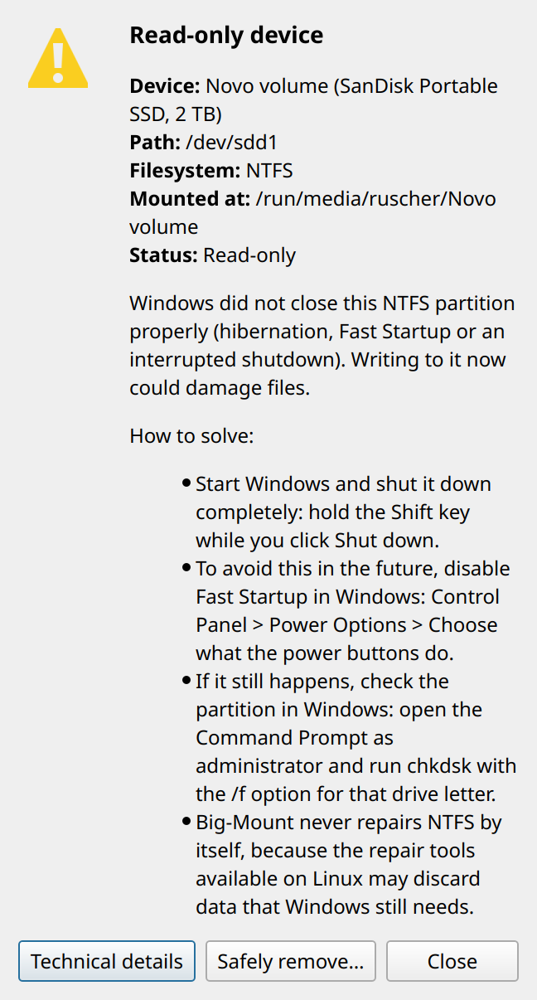

# 07 — KDE Plasma integration

## Privilege boundary

```text
boot (root)                        user session (never root)
big-mount.service ── writes ──▶  /run/big-mount/status ── reads ──▶ bigmount --notifier
                                                                     ├─ notify-send (session D-Bus)
                                                                     └─ KDialog / Zenity
```

The boot service never opens a window or talks to a session. The session
notifier reads the status file and reacts to mount events through
`findmnt --poll`: the kernel wakes it up, and there is no periodic scan.

## Notifications: what was measured

Measured on Plasma 6.7.4 / Wayland with `dbus-monitor`:

- `kdialog --passivepopup TEXT 5` sends **the same**
  `org.freedesktop.Notifications.Notify` call as `notify-send`, with
  `expire_timeout = 5000`. It identifies itself as app `kdialog` and cannot
  carry action buttons. Using both would show the same message twice.
- Plasma honors the requested duration: a notification with an action and
  `--expire-time 5000` closed after exactly 5.0 s.
- **Without** a duration, Plasma kept a notification with buttons open for
  more than 30 s. The previous version therefore left a `notify-send`
  process waiting behind every read-only warning.

## Notifications: the policy

One path only, in `bm_notify` (`usr/lib/big-mount/ui.sh`):

| Kind | Mechanism | Duration |
| --- | --- | --- |
| information (safe to disconnect, unmounted, fixed) | `notify-send --transient` | `BM_POPUP_SECONDS` = 5 s, not kept in the history |
| problem, possibly with buttons (read-only device, unable to unmount) | `notify-send` with `--action` | `BM_WARNING_SECONDS` = 15 s, kept in the history |
| decision (busy device, close programs, apply a fix) | persistent KDialog/Zenity dialog | never expires |
| no session bus, but KDialog present | `kdialog --passivepopup`, same durations, no buttons | — |
| no desktop at all | one line on stderr | — |

The two durations are defined once. Every notification carries
`desktop-entry=big-mount`, so Plasma shows the Big-Mount icon and lists the
app in its notification settings. **A decision is never confirmed by a
timer.**

When notifications appear:

| Event | Title |
| --- | --- |
| a device the user cannot write to (once per device and cause per boot) | Read-only device / No permission to write / The filesystem needs attention / ... |
| an unmount or power-off still running after 2 s | *Device name* — Writing pending data to the device. Do not disconnect it yet. |
| removal finished | Safe to disconnect / Device unmounted |
| removal failed | Unable to unmount device / Unable to remove device / Unable to power off device |
| a correction applied | Device ready / Unable to fix the device |

Successful mounts are never announced, because Plasma already does that.
CDs, DVDs and disk images never cause a read-only warning. The notifier
keeps a per-boot list (`~/.local/state/big-mount/notified`), so the same
device and cause are not announced twice.

Latency from a mount to the notification: 45 ms (it was 1044 ms with an
artificial 1 s wait; see 08).

## Dialogs

| Dialog | Default button | Why |
| --- | --- | --- |
| Device is busy: Try again / More options… / Cancel | Try again | harmless |
| Close these programs? | **Cancel** | an accidental Enter must not close anything |
| Apply a correction (remount, become owner) | the correction | nothing on the device is changed |
| Diagnosis | Technical details / Close | — |

KDialog renders a small rich-text document built by `bm_doc_*`. Untrusted
text (labels, file and process names) is escaped in one place. Each dialog
opens with a plain-language summary, the technical details come after it,
and the full paths are behind "Technical details".

The real `kdialog` 26.08 accepts every call form the code uses (checked on
the Qt offscreen platform: valid forms wait for the user, an invalid one
exits with 1). The real `zenity` 4.2.2 has every option used. The layout was
checked by rendering the generated HTML with Qt (`QMessageBox`, Fusion,
scale 2, light and dark palettes, English and Portuguese). That review made
the technical name a second line under the friendly name, kept only the PID
on one line (long text used to be cut off), and removed an empty gap.



**Not verified on a real Plasma screen:** Breeze theme, 125/150/200 %
scaling, the Orca screen reader and the Dolphin service menu itself. These
are listed as manual validation in 09.

## Desktop files

| File | Role |
| --- | --- |
| `usr/share/applications/big-mount.desktop` | "Storage Diagnostics" launcher, and the `desktop-entry` of the notifications |
| `etc/xdg/autostart/big-mount-notifier.desktop` | starts the notifier in the session |
| `usr/share/kio/servicemenus/big-mount.desktop` | Dolphin submenu "Storage device" |
| `usr/share/polkit-1/actions/org.biglinux.big-mount.policy` | the administrator view |

All of them are generated from the English templates in `locale/templates`
by `locale/compile.sh` (see 09 and the README for translations).

## Idle cost of the notifier

Measured: 2 processes (`bash` and `findmnt --poll`), 9.2 MB RSS in total,
0 CPU ticks in 10 s of idle time. It can be disabled in System Settings →
Autostart.
